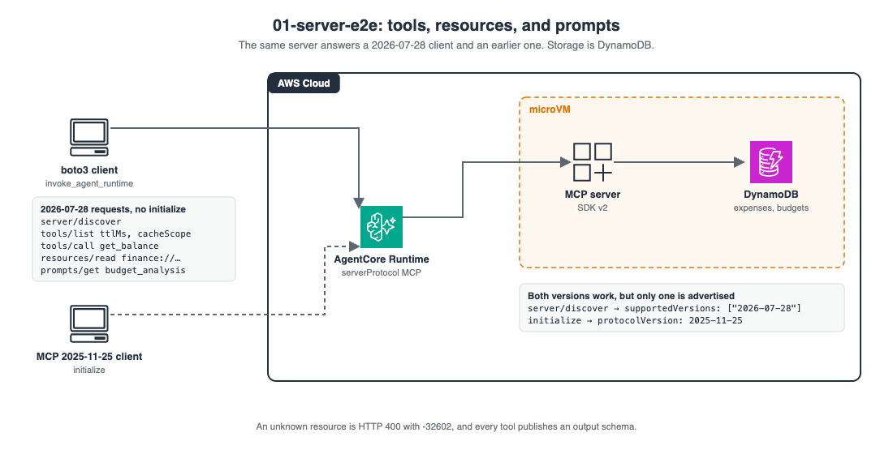

# MCP server features: tools, resources, and prompts

## Overview

A finance tracker MCP server with tools, resources, and prompts, backed by Amazon DynamoDB and hosted on Amazon Bedrock AgentCore Runtime. It's built with MCP Python SDK v2, so the same server answers MCP 2026-07-28 clients and earlier ones.

### Architecture



### What changes for server features in MCP 2026-07-28

| | MCP 2025-11-25 | MCP 2026-07-28 |
|---|---|---|
| Starting a session | `initialize`, then `notifications/initialized` | No handshake. Each request carries its protocol version and client capabilities in `_meta` and in the `MCP-Protocol-Version`, `Mcp-Method`, and `Mcp-Name` headers |
| Learning what the server supports | The `initialize` result | `server/discover` |
| List results | — | `ttlMs` and `cacheScope`, so clients can cache `tools/list`, `prompts/list`, and `resources/templates/list` |
| Unknown resource | `-32002` | `-32602`, with HTTP 400 |
| Resource change notifications | `resources/subscribe` | `subscriptions/listen` (not covered here) |
| Health checks on AgentCore Runtime | The MCP `ping` method | Your server's `GET /ping` (2026-07-28 removed `ping`) |

### Tutorial details

| Detail | Value |
|:--|:--|
| Tutorial type | Hosting tools, resources, and prompts on AgentCore Runtime |
| Components | AgentCore Runtime (code zip, `platformVersion="V2"`, IAM auth), MCP Python SDK v2, DynamoDB |
| Client | boto3 `invoke_agent_runtime`, sending raw MCP JSON-RPC |
| Complexity | Medium |

## Prerequisites

Python 3.12 or later, AWS credentials, and a Region where AgentCore Runtime V2 is available (for example `us-west-2`). From the folder above this one:

```bash
pip install -r requirements.txt
export AWS_REGION=us-west-2
```

## Usage

```bash
python deploy.py    # DynamoDB table, IAM role, code zip, agent runtime, then a tools/list smoke test
python invoke.py    # tools, resources, and prompts over MCP 2026-07-28, then the same calls as a 2025-11-25 client
```

`invoke.py` prints each exchange. Abridged:

```
── server/discover  HTTP 200
   {"supportedVersions": ["2026-07-28"], ...}
── tools/list  HTTP 200  ttlMs=300000 cacheScope=public
── tools/call get_balance  HTTP 200
   {"balance": 2957.5, "income": 3000.0, "expenses": 42.5}
── resources/read finance://unknown (expected error)  HTTP 400  error -32602: Unknown resource: finance://unknown/x
── 2025-11-25 initialize  protocolVersion=2025-11-25
```

## Clean up

```bash
python cleanup.py   # deletes everything deploy.py created
```

## Key points

* **No handshake.** `helpers/mcp_client.py` adds `_meta` to every request and passes the standard headers as boto3's `mcpProtocolVersion`, `mcpMethod`, and `mcpName`.
* **Errors keep their HTTP status.** An unknown resource comes back as HTTP 400, and boto3 raises a `ClientError` with an empty message. `helpers/mcp_client.py` recovers the JSON-RPC error from the response body.
* **`server/discover` lists only `2026-07-28`**, even though the server also answers earlier clients through `initialize`.
* **Serve `GET /ping`.** AgentCore Runtime uses it for health checks; a server that implements only 2026-07-28 rejects the MCP `ping` method.
* **Typed tool results.** Tools return Pydantic models, so each tool publishes an `outputSchema` and its results carry `structuredContent`.

## Files

| File | Description |
|:--|:--|
| `agents/mcp_server.py` | The MCP server: four tools, two resource templates, two prompts |
| `requirements.txt` | The server's dependencies, installed for arm64 into the code zip |
| `deploy.py` / `invoke.py` / `cleanup.py` | Deploy, call, and delete |
| `../helpers/` | Shared code: `runtime_utils.py` (`GET /ping`, serving), `dynamo_utils.py` (storage), `mcp_client.py` (boto3 MCP client), `deploy_utils.py` |

To run the server locally on `127.0.0.1:8000`: `PYTHONPATH=../helpers python agents/mcp_server.py`. Its tools need a DynamoDB table named by `FINANCE_TABLE`.
