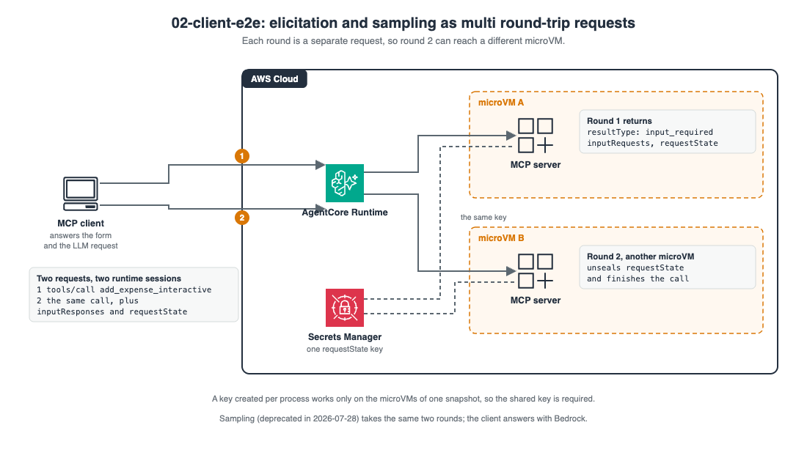

# MCP client features: elicitation and sampling

## Overview

A finance assistant MCP server that asks the user for input (elicitation) and asks the client's model for text (sampling), hosted on Amazon Bedrock AgentCore Runtime. In MCP 2026-07-28 both work as multi round-trip requests (MRTR): the tool call returns the questions, and the client calls the tool again with the answers. No session or open stream is kept between rounds, so each round can reach a different microVM.

### Architecture



### What changes for client features in MCP 2026-07-28

| | MCP 2025-11-25 | MCP 2026-07-28 |
|---|---|---|
| Server asks the user | An `elicitation/create` request sent to the client during the tool call, over an open stream | The tool call returns `resultType: input_required` with `inputRequests`; the client calls the tool again with `inputResponses` and the `requestState` it received |
| Server asks the client's model | `sampling/createMessage` during the tool call | The same round trip. Sampling is deprecated (SEP-2577): new tools should call a model API directly |
| Client capabilities | Sent once, in `initialize` | Sent on every request, in `_meta` |
| Where the server keeps state between rounds | In the open session | In `requestState`, sealed by the server and returned by the client |
| On AgentCore Runtime | Needs stateful mode (see `05-compatibility-e2e`) | Works in the default stateless mode |

### Tutorial details

| Detail | Value |
|:--|:--|
| Tutorial type | Elicitation and sampling on AgentCore Runtime |
| Components | AgentCore Runtime (code zip, `platformVersion="V2"`, IAM auth), MCP Python SDK v2, DynamoDB, AWS Secrets Manager, Amazon Bedrock |
| Client | boto3 `invoke_agent_runtime` (raw rounds), then the MCP Python SDK v2 `Client` |
| Complexity | Medium |

## Prerequisites

Python 3.12 or later, AWS credentials, a Region where AgentCore Runtime V2 is available (for example `us-west-2`), and access to Claude Haiku 5.5 on Amazon Bedrock for the sampling answers. From the folder above this one:

```bash
pip install -r requirements.txt
export AWS_REGION=us-west-2
```

## Usage

```bash
python deploy.py    # DynamoDB table, requestState secret, IAM role, code zip, agent runtime, then a smoke test
python invoke.py    # elicitation and sampling, round by round with boto3, then with the SDK v2 client
```

`python invoke.py --interactive` lets you type the form answers yourself. Abridged output:

```
── round 1: input_required  ['elicitation/create']
   server asks: 'New expense for alice'  fields: ['amount', 'description', 'category']
── round 2: input_required  ['elicitation/create']
   server asks: 'Record $18.75 for Taxi to the airport (transport)?'  fields: ['confirm']
── round 3: result  HTTP 200
   {"recorded": true, "amount": 18.75, ..., "instance_id": "142dc3130540"}
── round 1: input_required  ['sampling/createMessage']
── round 2: result  HTTP 200
   {"analysis": "- **Food is over budget:** ...", "model": "us.anthropic.claude-haiku-5-5", ...}
```

## Clean up

```bash
python cleanup.py   # deletes everything deploy.py created, including the secret
```

## Key points

* **Rounds can depend on earlier answers.** `add_expense_interactive` asks for the details first; the confirmation it asks next is built from them. The SDK asks the next question only after the answers it depends on arrive.
* **Every microVM needs the same `requestState` key.** The server seals `requestState` so the client can't change it. A runtime runs several microVMs, and a retry can reach any of them, so the key lives in Secrets Manager and is read on first use. With a key per process, retries fail when they reach another microVM. The server keeps the current and the previous version of the secret, so you can rotate it without breaking rounds in flight.
* **The sealed state isn't bound to the caller here.** The SDK binds `requestState` to the authenticated principal only when it authenticates the request itself; behind AgentCore Runtime it doesn't, so anyone allowed to invoke the runtime could replay a `requestState` for the same tool call until it expires. In your server, pass `bind_principal=` to `RequestStateSecurity` with the caller's identity (see the top-level README).
* **`instance_id` shows which microVM ran the last round.** `invoke.py` starts a new runtime session for each round, so a round can land on a different microVM from the one before.
* **Treat sampled text as untrusted.** The client's model writes it, not your server.
* **Thinking is off for the sampling answers.** The server asks for at most 300 tokens; with Claude Haiku 5.5's default thinking, the reasoning uses most of them and the answer is cut off.

## Files

| File | Description |
|:--|:--|
| `agents/mcp_server.py` | The MCP server: `add_expense_interactive` (elicitation), `analyze_spending` (sampling), `add_expense`, `set_budget` |
| `requirements.txt` | The server's dependencies, installed for arm64 into the code zip |
| `deploy.py` / `invoke.py` / `cleanup.py` | Deploy, call, and delete |
| `../helpers/` | Shared code: `runtime_utils.py` (`GET /ping`, serving, the `requestState` key), `dynamo_utils.py`, `mcp_client.py` (boto3 and SDK v2 clients), `deploy_utils.py` |

To run the server locally on `127.0.0.1:8000`: `PYTHONPATH=../helpers python agents/mcp_server.py`. Without `REQUEST_STATE_SECRET_ARN` it uses a key that lives only in that process, which is fine for a single local server. Its tools need a DynamoDB table named by `FINANCE_TABLE`.
