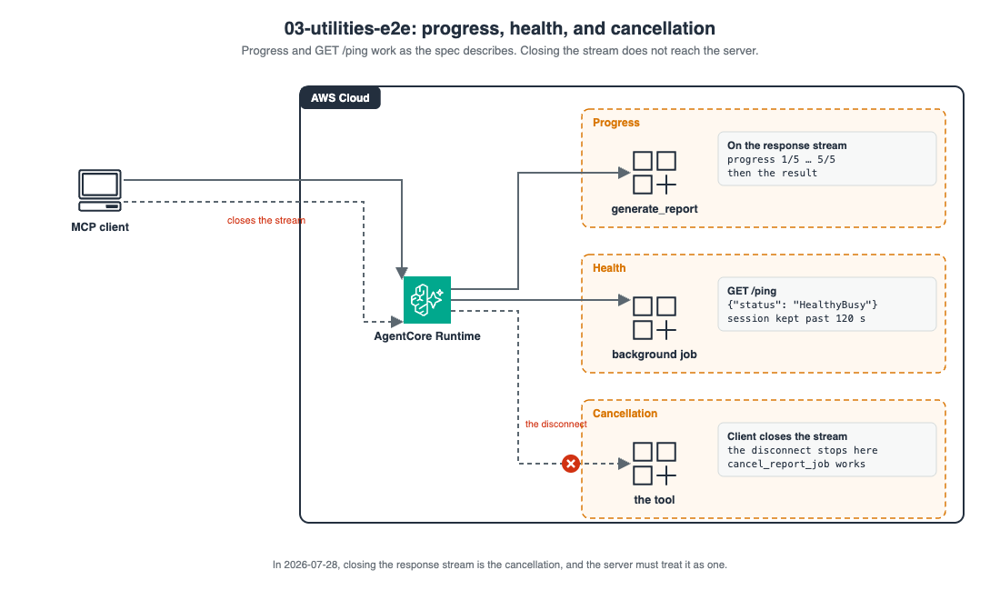

# MCP utilities: progress, cancellation, and health

## Overview

A finance reports MCP server, hosted on Amazon Bedrock AgentCore Runtime, that streams progress while it builds a report, can be cancelled, and runs long reports in the background. While a background report runs, the server's `GET /ping` reports `HealthyBusy`, so AgentCore Runtime keeps its microVM.

### Architecture



### What changes for utilities in MCP 2026-07-28

| | MCP 2025-11-25 | MCP 2026-07-28 |
|---|---|---|
| Progress | `notifications/progress` for requests that carry a `progressToken` | Unchanged. The notifications arrive on the response stream of the request they belong to |
| Cancelling a request over HTTP | The client sends `notifications/cancelled` with the request ID. A disconnect isn't a cancellation | **Closing the response stream is the cancellation.** No `notifications/cancelled` is sent. See [Cancellation](#cancellation-what-changed) |
| Health checks on AgentCore Runtime | The MCP `ping` method | Your server's `GET /ping`. MCP 2026-07-28 removed `ping` |
| Logging | `logging/setLevel`, then `notifications/message` | Deprecated (SEP-2577). `logging/setLevel` is removed; a request sets its log level in `_meta`. Not covered here |

### Tutorial details

| Detail | Value |
|:--|:--|
| Tutorial type | Progress, cancellation, and background work on AgentCore Runtime |
| Components | AgentCore Runtime (code zip, `platformVersion="V2"`, IAM auth, 120-second idle timeout), MCP Python SDK v2, DynamoDB |
| Client | boto3 `invoke_agent_runtime` with a streamed response, then the MCP Python SDK v2 `Client` |
| Complexity | Medium |

## Cancellation: what changed

**MCP 2025-11-25 and earlier.** To cancel a request, the client sent a `notifications/cancelled` message with the request's ID. Over HTTP, a dropped connection did *not* mean cancel: the spec said that disconnection "SHOULD NOT be interpreted as the client cancelling its request", so a server kept working until the result was ready.

**MCP 2026-07-28.** Each request has its own response stream, so the stream itself is the signal. Over Streamable HTTP, closing the response stream "MUST be treated by the server as cancellation of that request", and the server should stop the work as soon as it can. Clients no longer send `notifications/cancelled` over HTTP; it's kept only for stdio, where there is no stream to close. A client that times out a request cancels it the same way, by closing the stream.

**On AgentCore Runtime today**, closing the client's stream doesn't stop the tool. The disconnect doesn't reach the server in the microVM, so the tool runs to the end. Part 2 of `invoke.py` shows it: the report the client stopped waiting for finishes about 13 seconds later. Run on your machine, the same server stops the tool as soon as the stream closes, because MCP Python SDK v2 cancels the tool when the client disconnects.

Until that changes, run work that may need stopping as a background job with its own cancel tool, as this sample does with `start_report_job` and `cancel_report_job`. To stop everything in a session, AgentCore Runtime has `StopRuntimeSession`, which ends the session, and with it anything the microVM holds in memory.

## Prerequisites

Python 3.12 or later, AWS credentials, and a Region where AgentCore Runtime V2 is available (for example `us-west-2`). From the folder above this one:

```bash
pip install -r requirements.txt
export AWS_REGION=us-west-2
```

## Usage

```bash
python deploy.py                 # DynamoDB table, IAM role, code zip, agent runtime, then a smoke test
python invoke.py                 # progress, cancellation, and the SDK v2 client
python invoke.py --idle-check    # also shows HealthyBusy keeping a session alive (waits about 4 minutes)
```

Abridged output:

```
═══ Part 1: progress notifications, streamed with boto3 ═══
     2.1s  progress 1/5  Reading transactions
     5.3s  progress 2/5  Totalling by category
     ...
     9.4s  result
═══ Part 2: cancellation ═══
Closing the response stream:
     6.8s  closing the response stream
   the report on the server: completed (13s after the stream closed)
Cancelling a background job with a tool:
   started job-906655e0  ping HealthyBusy
── cancel_report_job  HTTP 200
   {"job_id": "job-906655e0", "status": "cancelled", "ping_status": "Healthy", ...}
═══ Part 4: HealthyBusy keeps a session alive ═══
   session A:  instance 61eea74eecfc  → new microVM: True
   session B:  instance d7fd8e7de088  job running  → same microVM: True
```

## Clean up

```bash
python cleanup.py   # deletes everything deploy.py created
```

## Key points

* **Read the stream as it arrives.** `helpers/mcp_client.py` reads the boto3 response with `iter_lines(chunk_size=1)`. With the default 1 KB chunks, small events such as progress wait until the buffer fills, often until the result.
* **`HealthyBusy` keeps a session alive.** With `--idle-check`, two sessions stay idle for longer than the 120-second idle timeout. The session with no job gets a new microVM; the session whose job keeps `GET /ping` at `HealthyBusy` keeps its microVM and its job.
* **Background jobs live in one microVM.** Call `get_report_job` and `cancel_report_job` on the same runtime session that started the job.

## Files

| File | Description |
|:--|:--|
| `agents/mcp_server.py` | The MCP server: `generate_report` (progress, cancellation), `start_report_job`, `get_report_job`, `cancel_report_job`, `server_status` |
| `requirements.txt` | The server's dependencies, installed for arm64 into the code zip |
| `deploy.py` / `invoke.py` / `cleanup.py` | Deploy, call, and delete |
| `../helpers/` | Shared code: `runtime_utils.py` (`GET /ping` and `HealthyBusy`, serving), `dynamo_utils.py`, `mcp_client.py` (boto3 and SDK v2 clients), `deploy_utils.py` |

To run the server locally on `127.0.0.1:8000`: `PYTHONPATH=../helpers python agents/mcp_server.py`. Its tools need a DynamoDB table named by `FINANCE_TABLE`.
