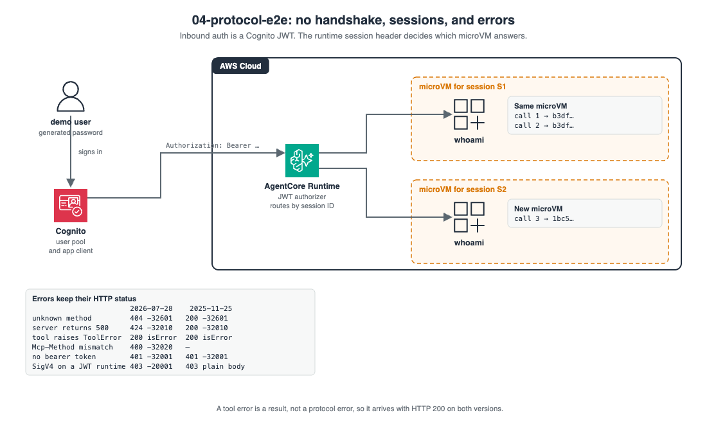

# MCP protocol basics: no handshake, sessions, and errors

## Overview

A small MCP server on Amazon Bedrock AgentCore Runtime, protected by an Amazon Cognito JWT authorizer, that shows the protocol-level changes in MCP 2026-07-28: requests need no `initialize` handshake, the runtime session header decides which microVM answers, and errors keep their HTTP status. Its tools are probes: `whoami` reports which microVM answered, `get_budget` raises a tool error, and `simulate_server_fault` is answered with HTTP 500.

### Architecture



### What changes in the protocol in MCP 2026-07-28

| | MCP 2025-11-25 | MCP 2026-07-28 |
|---|---|---|
| Starting | `initialize`, then `notifications/initialized` | No handshake. Every request carries its protocol version and client capabilities in `_meta` |
| Standard headers | `MCP-Protocol-Version` after `initialize` | `MCP-Protocol-Version`, `Mcp-Method`, and `Mcp-Name` on every request. A header that disagrees with the body is HTTP 400, `-32020` |
| Sessions | The server issues `Mcp-Session-Id` at `initialize` | No MCP session. On AgentCore Runtime, `X-Amzn-Bedrock-AgentCore-Runtime-Session-Id` picks the microVM |
| Errors | Usually HTTP 200 with a JSON-RPC error | The HTTP status matches the error, for example 404 for an unknown method |
| `Mcp-Param-{name}` headers | — | New. Not covered here |

### Tutorial details

| Detail | Value |
|:--|:--|
| Tutorial type | Protocol behavior on AgentCore Runtime |
| Components | AgentCore Runtime (code zip, `platformVersion="V2"`, JWT inbound auth), Amazon Cognito, MCP Python SDK v2 |
| Client | HTTPS with a Cognito access token (boto3 signs every request with SigV4, which a JWT runtime rejects) |
| Complexity | Medium |

## Prerequisites

Python 3.12 or later, AWS credentials, and a Region where AgentCore Runtime V2 is available (for example `us-west-2`). From the folder above this one:

```bash
pip install -r requirements.txt
export AWS_REGION=us-west-2
```

## Usage

```bash
python deploy.py    # Cognito user pool and demo user, IAM role, code zip, agent runtime with a JWT authorizer
python invoke.py    # no handshake, sessions, and the error table
```

`deploy.py` gives the demo user a generated password and saves it in `runtime_config.json`, which only you can read and which git ignores. `invoke.py` signs in with it to get an access token.

### No handshake

```
── 2026-07-28 tools/list, first request  200, ok  ['whoami', 'get_budget', 'simulate_server_fault']
── 2025-11-25 initialize  200, ok  protocolVersion=2025-11-25
```

The first request of a 2026-07-28 client is a normal call. The same server still answers an earlier client that starts with `initialize`.

### The runtime session header picks the microVM

```
── S1         instance b3dfd7c039fe
── S1 again   instance b3dfd7c039fe
── S2         instance 1bc552b5beac
── no header  instance cd00c457bb34
── no header  instance 48778c433613
```

Requests with the same `X-Amzn-Bedrock-AgentCore-Runtime-Session-Id` reach the same microVM. A request without one gets a generated ID and a new microVM every time, which adds latency and counts against your active-session quota. Send one session ID, at least 33 characters long, on related requests. Responses also carry `Mcp-Session-Id` with the same value.

### Errors keep their HTTP status

| Case | 2026-07-28 | 2025-11-25 (earlier client) |
|---|---|---|
| Unknown method (answered by your server) | 404, `-32601` | 200, `-32601` |
| Your server answers HTTP 500 | 424, `-32010` | 200, `-32010` |
| Tool raises `ToolError` | 200, `isError: true` | 200, `isError: true` |
| `Mcp-Method` header doesn't match the body | 400, `-32020` | — |
| No bearer token | 401, `-32001`, with `WWW-Authenticate` | 401, `-32001`, with `WWW-Authenticate` |
| SigV4 request to a JWT runtime | 403, `-20001` | 403, not JSON-RPC ¹ |
| Runtime ARN that doesn't exist | 404, not JSON-RPC ¹ | 404, not JSON-RPC ¹ |

¹ A body like `{"message": "..."}`. Check the HTTP status rather than expecting a JSON-RPC error in these cases.

A tool error is a result, not a protocol error, so it arrives with HTTP 200 on both versions. For 2026-07-28 requests, AgentCore Runtime passes your server's 200, 202, 400, 401, 403, and 404 through, and turns any other status, such as this 500, into 424; for earlier clients, anything other than 200 and 202 becomes 200.

## Clean up

```bash
python cleanup.py   # deletes everything deploy.py created, including the user pool
```

## Key points

* **Check the HTTP status as well as the JSON-RPC code.** On 2026-07-28 the status tells a bad request from a server fault without parsing the body.
* **Middleware can route on the standard headers.** `ServerFault` in `agents/mcp_server.py` answers one tool with HTTP 500 by reading `Mcp-Method` and `Mcp-Name`, without parsing the body, as a gateway could.
* **Retry session conflicts.** While a runtime session is being set up or torn down, AgentCore Runtime can answer HTTP 409 with `-32005` and a "please retry" message (RetryableConflictException). `helpers/mcp_client.py` retries it with a short backoff.
* **The demo user exists only for this sample.** The user pool allows admin-created users only, and the runtime accepts only tokens issued to its app client.

## Files

| File | Description |
|:--|:--|
| `agents/mcp_server.py` | The MCP server: `whoami`, `get_budget`, `simulate_server_fault`, and the `ServerFault` middleware |
| `requirements.txt` | The server's dependencies, installed for arm64 into the code zip |
| `deploy.py` / `invoke.py` / `cleanup.py` | Deploy, call, and delete |
| `../helpers/` | Shared code: `runtime_utils.py` (`GET /ping`, serving), `mcp_client.py` (`HttpMcpClient`, `cognito_token`), `deploy_utils.py` (Cognito, JWT authorizer) |

To run the server locally on `127.0.0.1:8000`: `PYTHONPATH=../helpers python agents/mcp_server.py`.
