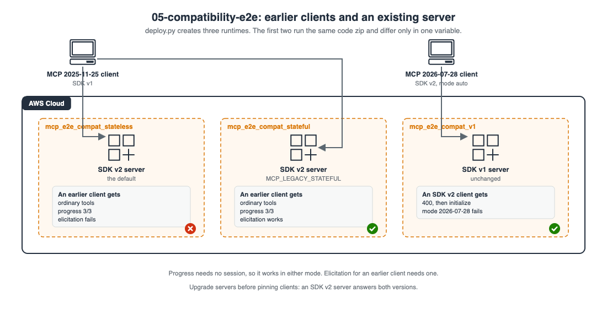

# Compatibility: earlier clients and existing servers

## Overview

What MCP 2026-07-28 means for the clients and servers you already run. Three runtimes on Amazon Bedrock AgentCore Runtime: the same MCP Python SDK v2 server deployed twice, serving earlier clients in stateless and in stateful mode, and an unchanged MCP Python SDK v1 server.

### Architecture



### What earlier clients and servers see

| | MCP 2025-11-25 client | MCP 2026-07-28 client |
|---|---|---|
| Ordinary tools | Work on either runtime | Work |
| Progress notifications | Work on either runtime: they travel on the request's own response stream | Work |
| Elicitation and sampling | The server sends them back during the call, over the session, so the runtime must serve earlier clients in **stateful** mode | Work in stateless mode: they are multi round-trip requests, sealed with a key every microVM shares (`02-client-e2e`) |
| Session | `initialize` returns `Mcp-Session-Id`, which the client sends on every later request | No MCP session. `X-Amzn-Bedrock-AgentCore-Runtime-Session-Id` picks the microVM |
| Against an SDK v1 server | Unchanged | `mode="auto"` falls back to `initialize`; a client pinned to 2026-07-28 fails |

### Tutorial details

| Detail | Value |
|:--|:--|
| Tutorial type | Backward compatibility on AgentCore Runtime |
| Components | Three AgentCore Runtimes (code zip, `platformVersion="V2"`, IAM auth), MCP Python SDK v2 and v1, AWS Secrets Manager |
| Client | boto3 `invoke_agent_runtime` and the MCP Python SDK v2 client, plus an SDK v1 client in its own virtual environment |
| Complexity | Medium |

## Prerequisites

Python 3.12 or later, AWS credentials, and a Region where AgentCore Runtime V2 is available (for example `us-west-2`). From the folder above this one:

```bash
pip install -r requirements.txt
export AWS_REGION=us-west-2
```

## Usage

```bash
python deploy.py    # three runtimes: _stateless, _stateful, and _v1 (about 4 minutes each)
python invoke.py    # what an SDK v2 client sees, including against the SDK v1 server
```

An MCP 2025-11-25 client needs MCP Python SDK v1, which can't be installed next to v2, so it runs in its own virtual environment:

```bash
python -m venv .venv-earlier
.venv-earlier/bin/pip install -r requirements-earlier-client.txt
.venv-earlier/bin/python invoke_earlier.py
```

### One server, both protocol versions

```
── 2026-07-28 tools/call whoami  HTTP 200
   {"protocol_version": "2026-07-28", "legacy_mode": "stateless"}
── 2026-07-28 add_expense round 1  input_required  ['Record $12.50 for food?']
── 2026-07-28 add_expense round 2, another session  HTTP 200
   {"recorded": true, "expenses": 3, "instance_id": "bb6104ec5aa8"}
── 2025-11-25 initialize  protocolVersion=2025-11-25
── 2025-11-25 tools/call whoami  HTTP 200
   {"protocol_version": "2025-11-25", "legacy_mode": "stateless"}
── server/discover  supportedVersions=['2026-07-28']
```

The 2026-07-28 client's elicitation works on the stateless runtime: round 2 goes out on a new runtime session, so it can reach another microVM, and the shared key still opens its `requestState`.

`server/discover` lists only `2026-07-28`, although the same server answers earlier clients through `initialize`. A client that probes with `server/discover` alone won't learn that.

### An earlier client, stateless and then stateful

```
── Stateless runtime (the default)
   initialize: protocolVersion=2025-11-25, Mcp-Session-Id=741b6c8d-d343-492b-b615-0643a3024e9d
   get_total: {"expenses": 2, "total": 275.0}
   add_expense failed: Cannot send 'elicitation/create': this transport context has no back-channel …
   progress 1/3: exported batch 1 of 3   (and 2/3, 3/3)

── Stateful runtime (MCP_LEGACY_STATEFUL=true)
   server asks (elicitation/create): Record $12.50 for food?
   add_expense: {"recorded": true, "expenses": 3, …}
```

The two runtimes run the same code zip and differ only in the `MCP_LEGACY_STATEFUL` environment variable, which decides whether the server keeps a session for earlier clients.

### An unchanged SDK v1 server

```
── SDK v2 client, mode='auto'
   {"protocol_version": "2025-11-25", "get_total": {…}, "http": ["400", "200", "202", "405", "200", "200"]}
── SDK v2 client, mode='2026-07-28'
   {"error": "MCPError: Bad Request: Unsupported protocol version: 2026-07-28. Supported versions: …"}
```

The default `mode="auto"` tries 2026-07-28, gets HTTP 400, and falls back to the `initialize` handshake, so existing servers keep working. The 202 answers `notifications/initialized`, and the 405 refuses the GET stream that the client opens at the same moment, so those two can arrive in either order. Upgrade your servers before you pin clients to 2026-07-28.

## Clean up

```bash
python cleanup.py   # deletes everything deploy.py created, including the requestState secret
```

## Key points

* **Upgrade order:** servers first, then clients. An SDK v2 server answers both versions, so clients can move at their own pace.
* **Stateful mode is only for earlier clients.** 2026-07-28 never needs it, so turn it on only while earlier clients still use elicitation or sampling, and leave the default off for new work.
* **Progress needs no session.** It works for earlier clients on the stateless runtime, because the notifications travel on the request's own response stream.
* **AgentCore Runtime issues `Mcp-Session-Id` itself.** The client receives a dashed UUID of the runtime's own, not the ID the server's SDK generated; the runtime translates between them.
* **Runtime session IDs must be at least 33 characters.** A shorter one is rejected with HTTP 400 before it reaches your server.
* **Both paths run on one server.** An earlier client's elicitation lives in its session. A 2026-07-28 client's is a multi round-trip request whose rounds can reach different microVMs, so the SDK v2 runtimes seal `requestState` with a key from Secrets Manager. Without it, the SDK's default key is created at import and frozen into the Runtime V2 snapshot, so rounds that reach microVMs from different snapshots fail with `-32602`.

## Files

| File | Description |
|:--|:--|
| `agents/mcp_server.py` | The SDK v2 server: `whoami`, `get_total`, `add_expense` (elicitation), `export_expenses` (progress) |
| `agents_v1/mcp_server_v1.py` | The existing SDK v1 server, unchanged: `get_total`, `greet`, `whoami` |
| `requirements.txt` / `requirements-v1.txt` | Each server's dependencies, installed for arm64 into its own code zip |
| `requirements-earlier-client.txt` | The MCP 2025-11-25 client's dependencies, for a separate virtual environment |
| `deploy.py` / `invoke.py` / `invoke_earlier.py` / `cleanup.py` | Deploy, call as each client, and delete |
| `../helpers/` | Shared code: `runtime_utils.py` (`GET /ping`, serving), `mcp_client.py`, `deploy_utils.py` |

To run both servers locally: `PYTHONPATH=../helpers python agents/mcp_server.py` on `127.0.0.1:8000`, a second one with `MCP_LEGACY_STATEFUL=true MCP_PORT=8001`, and `python agents_v1/mcp_server_v1.py` with `MCP_PORT=8002` from the SDK v1 environment.
