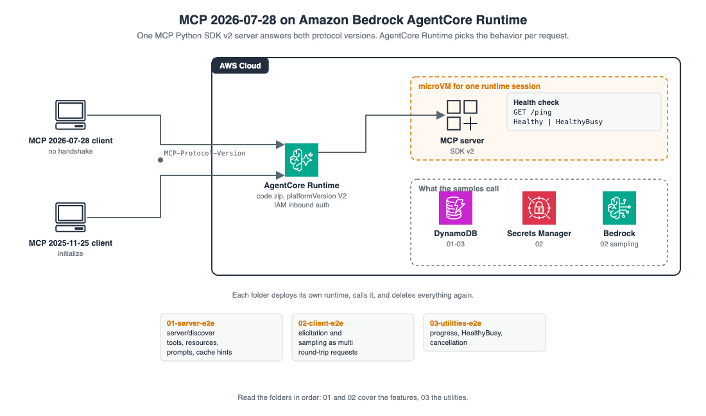

# MCP 2026-07-28 end-to-end examples

## Overview

The [Model Context Protocol](https://modelcontextprotocol.io/) defines how AI agents discover and use tools, read resources, and ask a user or a model for something. The [2026-07-28 specification](https://modelcontextprotocol.io/specification/2026-07-28) makes the protocol stateless: no handshake, no protocol session, and every request self-describing.

Amazon Bedrock AgentCore Runtime hosts MCP servers on both the new and earlier protocol versions, choosing the behavior per request from the `MCP-Protocol-Version` header, with no configuration change. These three tutorials cover the server features, the client features, and the utilities on one MCP Python SDK v2 server.



## What changed in MCP 2026-07-28

The [changelog](https://modelcontextprotocol.io/specification/2026-07-28/changelog) lists every change. These are the ones that matter when you host an MCP server:

* **No sessions.** Protocol sessions and the `Mcp-Session-Id` header are gone ([SEP-2567](https://modelcontextprotocol.io/seps/2567-sessionless-mcp)).
* **No handshake, and no `ping`.** `initialize` and `ping` are removed, and `server/discover` replaces the `initialize` result. Each request carries its protocol version and the client's capabilities in `_meta` ([SEP-2575](https://modelcontextprotocol.io/seps/2575-stateless-mcp)).
* **Routing fields in headers.** Every request carries `MCP-Protocol-Version`, `Mcp-Method`, and `Mcp-Name`, so a gateway can route without parsing the body ([SEP-2243](https://modelcontextprotocol.io/seps/2243-http-standardization)).
* **Errors carry an HTTP status.** A protocol error pairs an HTTP status with its JSON-RPC code.
* **Elicitation and sampling without a session.** The server returns `input_required` with its questions, and the client calls the tool again with the answers: a multi round-trip request ([SEP-2322](https://modelcontextprotocol.io/seps/2322-MRTR)).
* **Cancellation is closing the stream.** Over HTTP, closing a request's response stream *is* the cancellation; `notifications/cancelled` is now for stdio only.
* **Sampling, Roots, and Logging are deprecated.** They keep working for at least twelve months, but new servers shouldn't adopt them ([SEP-2577](https://modelcontextprotocol.io/seps/2577-deprecate-roots-sampling-and-logging)).

## What AgentCore Runtime does

* **It reads `MCP-Protocol-Version` on every request** and applies that version's behavior. One runtime serves both, so your clients can move at their own pace.
* **It keeps a session's requests on one microVM.** For 2026-07-28 it routes on `X-Amzn-Bedrock-AgentCore-Runtime-Session-Id`, which your client sends; earlier clients keep routing on `Mcp-Session-Id`.
* **It health-checks your server's `GET /ping`.** The route is recommended rather than required, and since 2026-07-28 removed the MCP `ping` method it's the only reliable health signal. While it answers `HealthyBusy`, the session's microVM stays alive.
* **It passes some of your server's status codes through.** For 2026-07-28 requests, 200, 202, 400, 401, 403, and 404 reach the client with your body, and any other status becomes HTTP 424 with `-32010`. For earlier clients, only 200 and 202 pass, and any other status becomes HTTP 200.

## MCP feature support

| Feature | Spec methods | MCP 2025-11-25 | MCP 2026-07-28 | Covered in |
|:--|:--|:--|:--|:--|
| Tools | `tools/list`, `tools/call` | yes | yes, plus cache hints and typed results | 01 |
| Resources | `resources/list`, `resources/read` | yes | yes | 01 |
| Prompts | `prompts/list`, `prompts/get` | yes | yes | 01 |
| Discovery | `initialize` → `server/discover` | yes | yes, but it lists only 2026-07-28 | 01 |
| Elicitation | `elicitation/create` | stateful mode only | multi round-trip requests | 02 |
| Sampling | `sampling/createMessage` | stateful mode only | the same, deprecated | 02 |
| Progress | `notifications/progress` | yes, in either mode (with SSE responses, the SDK default) | yes | 03 |
| Health checks | `ping` → `GET /ping` | either | `GET /ping`; without it AgentCore Runtime only sees a server that stops answering | 03 |
| Cancellation | `notifications/cancelled` → closing the stream | yes | **the disconnect does not reach the server yet** | 03 |
| Errors | — | mostly HTTP 200 | the HTTP status matches | 01 |
| Sessions | `Mcp-Session-Id` → runtime session header | yes | yes | 03 |
| Resource subscriptions | `resources/subscribe` → `subscriptions/listen` | yes | not covered here | — |
| Logging | `logging/setLevel` → `_meta` log level | yes | deprecated; `logging/setLevel` is removed and the level is set per request | — |
| Roots | `roots/list` | not covered here | deprecated | — |
| Tasks | `tasks/*` | experimental, not covered | moved to an extension, not covered | — |
| `Mcp-Param-{name}` headers | — | — | not covered here | — |

## Project structure

```
09-mcp-e2e/
├── 01-server-e2e/           # Tools, resources, and prompts on MCP Python SDK v2
├── 02-client-e2e/           # Elicitation and sampling as multi round-trip requests
├── 03-utilities-e2e/        # Progress, health checks, and cancellation
└── helpers/                 # Shared code: deploy, serve, storage, and the MCP clients
```

Every folder has the same shape: `agents/` with the server, then `deploy.py`, `invoke.py`, and `cleanup.py`, plus its own README and architecture diagram.

| Helper | What it does |
|:--|:--|
| `deploy_utils.py` | The code zip, IAM role, DynamoDB table, and the agent runtime |
| `runtime_utils.py` | Serving the MCP app, `GET /ping` with `HealthyBusy`, and the shared `requestState` key |
| `mcp_client.py` | An MCP client over boto3, and the MCP Python SDK v2 transport signed with SigV4 |
| `dynamo_utils.py` | The finance storage the samples share |

## What each folder shows

### 01 — Server features

Tools, resources, and prompts on one SDK v2 server, with DynamoDB behind them. It shows `server/discover`, the `ttlMs` and `cacheScope` hints that let clients cache list results, typed tool results, and an unknown resource arriving as HTTP 400 with `-32602`. The same server then answers a 2025-11-25 client.

### 02 — Client features

A tool that asks the user for an expense and then for a confirmation built from those answers, as multi round-trip requests, and one that asks the client's model for an analysis (sampling, deprecated). Each round is a separate request, so a round can land on a different microVM; a key in AWS Secrets Manager is what lets any microVM unseal the `requestState`.

### 03 — Utilities

A five-step report that streams progress as it runs, a background job that keeps its microVM alive by reporting `HealthyBusy` on `GET /ping`, and cancellation. Closing the response stream is the 2026-07-28 cancellation signal, but the disconnect doesn't reach the server through AgentCore Runtime today, so the folder also shows a cancel tool that works.

## Prerequisites

* Python 3.12 or later, and `pip install -r requirements.txt`
* AWS credentials, and a Region where AgentCore Runtime V2 is available, for example `export AWS_REGION=us-west-2`
* Access to Amazon Bedrock AgentCore Runtime. Folder 02 also calls Claude Haiku 5.5 on Amazon Bedrock
* AWS services used: AgentCore Runtime, IAM, S3, DynamoDB, Secrets Manager (02)

### Region and cost

The samples run in any Region with AgentCore Runtime V2. Folder 02 answers sampling requests with the `us.anthropic.claude-haiku-5-5` cross-Region inference profile, which works from US Regions; elsewhere, set `MODEL` in `02-client-e2e/invoke.py` to your geography's profile. Runtimes are billed for the time their sessions run, and the other resources cost little at this scale. Each `cleanup.py` deletes everything its `deploy.py` created, including after a failed deploy.

### Before you build on these samples

* **The tools trust the `user_alias` argument.** AgentCore Runtime authenticates the caller, but any caller can pass any alias. In your server, take the user from the authenticated identity instead, for example the JWT that a runtime with a JWT authorizer forwards when you add `Authorization` to its request header allowlist.
* **Bind `requestState` to the caller.** The SDK binds sealed `requestState` to the authenticated principal, but only when the SDK itself authenticates the request. Behind AgentCore Runtime it sees no token, so the state isn't bound to a caller and anyone allowed to invoke the runtime can replay it until it expires (10 minutes by default). Pass `bind_principal=` to `RequestStateSecurity` with the caller's identity, such as the `sub` claim of the forwarded JWT.

## Quick start

```bash
cd 01-server-e2e
python deploy.py    # builds the code zip and deploys the runtime; a few minutes
python invoke.py    # calls it and prints every exchange
python cleanup.py   # deletes everything it created
```

Read the folders in order. Each one deploys its own resources and deletes them again, so run `cleanup.py` before moving on.

## Resources

* [MCP 2026-07-28 specification](https://modelcontextprotocol.io/specification/2026-07-28) and its [changelog](https://modelcontextprotocol.io/specification/2026-07-28/changelog)
* [MCP servers on AgentCore Runtime](https://docs.aws.amazon.com/bedrock-agentcore/latest/devguide/runtime-mcp.html) and the [protocol contract](https://docs.aws.amazon.com/bedrock-agentcore/latest/devguide/runtime-mcp-protocol-contract.html)
* [Stateful MCP server features](https://docs.aws.amazon.com/bedrock-agentcore/latest/devguide/mcp-stateful-features.html), for earlier clients
* [MCP Python SDK](https://github.com/modelcontextprotocol/python-sdk)
