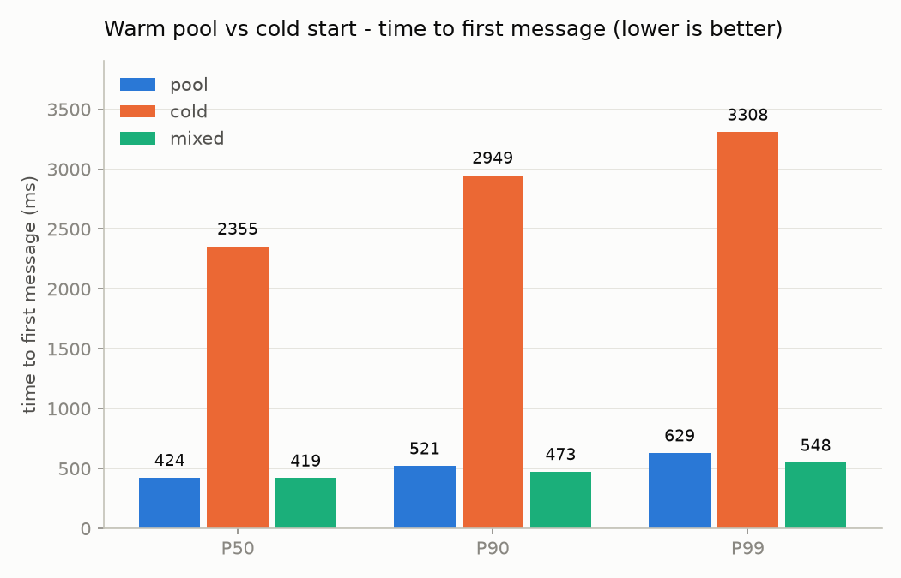
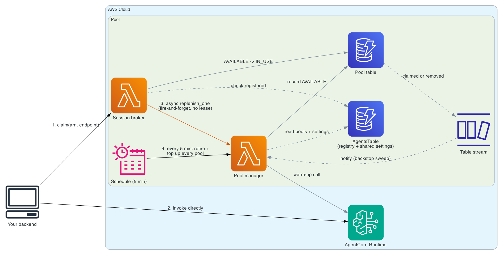
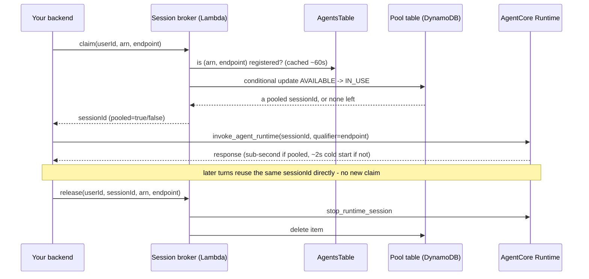
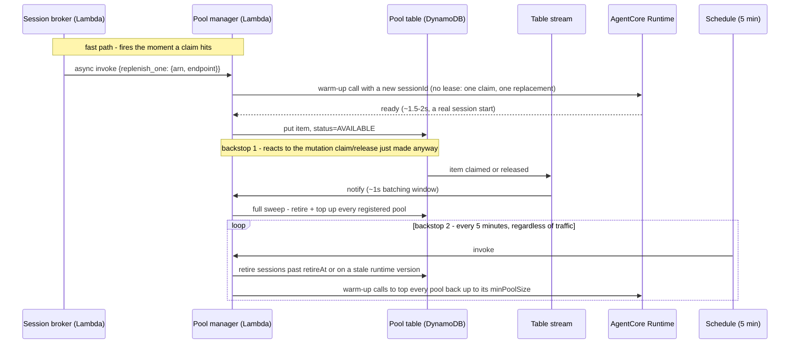

# Warm pool for Amazon Bedrock AgentCore Runtime

Amazon Bedrock AgentCore Runtime's microVM-per-session
model gives strong isolation, but a session nobody has used yet pays a startup time ~2 seconds
that for some use cases isn't enough. That's fine for a batch job. It's not fine for the first message of a
conversation someone just opened, or for a workload that is latency sensitive.

This sample is a self-managed warm pool: a small set of AWS resources that keep sessions started and
ready *before* anyone asks for one, so your users get served from the pool instead of paying that cold
start. Sample for *Architecture patterns for agents on the new Amazon Bedrock AgentCore Runtime*.

**What this buys you** — measured by the load test this sample ships with, not a vendor benchmark:



| | P50 | P90 | P99 |
|---|---|---|---|
| **pool vs cold** | 82% faster | 82% faster | 81% faster |
| **mixed vs cold** (pool oversubscribed) | 82% faster | 84% faster | 83% faster |

Run `./deploy.sh test --rate 5` on your own account and you'll get your own chart — `--rate` spaces
arrivals out instead of firing a full-concurrency burst (see
[Spacing requests out, or sizing the pool up just for the test](#spacing-requests-out-or-sizing-the-pool-up-just-for-the-test)).
Getting *this* result also took actually sizing the pool for the load, not just turning it on — see
[Load test](#load-test).

> Sample code for testing. Review IAM, authentication, and quotas before any production use.

## Architecture



Five pieces, two of your own calls (bold below), everything else automatic:

1. **Your backend claims a session** from the broker, naming which agent (`arn`) and `endpoint` it
   wants. The broker checks that pair against the agent registry, moves one item from `AVAILABLE` to
   `IN_USE` in the pool table (a plain DynamoDB conditional update), and hands back its session ID.
2. **Your backend invokes AgentCore Runtime directly** with that session ID — the broker is out of the
   picture from here on, it only brokered the handoff.
3. The claim also fires a fire-and-forget trigger straight to the pool manager - "warm exactly one more
   for this `(arn, endpoint)`" - so a replacement starts before you've even gotten your response. The
   same table mutation also flows through a DynamoDB Stream to the pool manager as a backstop sweep.
4. Every 5 minutes, a schedule invokes the same pool manager as a second backstop: it retires sessions
   that have aged out or belong to an old runtime version, and tops every registered pool back up to its
   minimum, even if nothing has been claimed or released recently.

One pool manager, one broker, and one pool table manage **any number of agents** - which `(arn,
endpoint)` pools exist, how big each should be, and every tunable setting (`refillConcurrency`,
`retireAfterS`, ...) all live as data in a small registry table (`AgentsTable`), not in the stack's
parameters or a Lambda env var. Adding an agent is `./deploy.sh register`, and changing a setting is
`./deploy.sh configure` - both take effect on the pool manager's next sweep, not a redeploy. See
[Settings](#settings) for the full `AgentsTable` layout.

The diagram's "claimed or removed" label covers both halves of that trigger: a **claim** removes the
`pool` attribute (step 3 above), and a **release** (when your backend is done with the conversation)
removes the whole item the same way — both are table mutations, both wake up the pool manager the same
way. See [How it works](#how-it-works) for the full request and replenish lifecycles.

## Layout

The pool itself doesn't know or care what your agent does — it only needs a V2 AgentCore runtime ARN
that answers a `warmup` action. `agent/` and `agent-infra/` are a disposable stub agent that exists so
this sample has something to pool against; bring your own runtime instead and skip them entirely (see
[Bring your own runtime](#bring-your-own-runtime-or-several)).

```
# the pool - agent-agnostic, this is what the pattern actually is
cloudformation/warm-pool.yaml    AgentsTable (registry) + PoolTable, IAM roles, two Lambda functions,
                                 stream mapping, Amazon EventBridge Scheduler schedule
src/broker.py                    claim (conditional update AVAILABLE to IN_USE, then kicks a fast
                                 replenish) and release (stop, then delete)
src/pool_manager.py              the fast one-session replenish, the full sweep (table stream, schedule,
                                 or ./deploy.sh fill), retire by age or stale version
src/common.py                    shared clients, the agent registry lookup
scripts/manage_agents.py         register, list, or remove (arn, endpoint, minPoolSize) pools
scripts/load_test.py             parallel load test: pool vs cold, hit rate, pool depth over time
scripts/drain_pool.py            drain AVAILABLE sessions (optionally one arn/endpoint), or --all on destroy
ui/server.py, ui/index.html      local page: cold vs pooled side by side, live (./deploy.sh demo)
deploy.sh                        up | agent | endpoint | deploy | register | fill | status | test | demo | drain | destroy

# sample agent - optional, only here so the pool has something to pool against
agent/app.py, agent/Dockerfile   stub agent (arm64 container) with a warm-up action
agent-infra/deploy.py            boto3: ECR repository, execution role, image push, V2 runtime create/update
agent-infra/destroy.py           boto3: delete the runtime, role, and repository this sample created
agent-infra/arn.py               boto3: print the runtime ARN (deploy.sh feeds it to the pool stack)
agent-infra/endpoint.py          boto3: list, create, update, and delete runtime endpoints
```

## Prerequisites

- AWS CLI v2 with credentials for the target account (used for the CloudFormation, S3, and Lambda steps)
- bash, `zip`, and Python 3.10+ with `venv`. `deploy.sh` creates `.venv/` and installs the latest boto3 there,
  so the `bedrock-agentcore-control` client is always current. `UPGRADE=1` forces a reinstall.
- Docker with `buildx` (only for `./deploy.sh agent`, i.e. building the sample stub agent; skip it if
  you're bringing your own runtime. Apple silicon builds arm64 natively)

## Quick start

```bash
export AWS_REGION=us-west-2
./deploy.sh up          # sample agent, then pool, then fill
./deploy.sh status
./deploy.sh test        # --mode suite: pool, cold, mixed, side by side
./deploy.sh demo        # local web page: cold vs pooled, side by side
./deploy.sh destroy
```

## Step by step

### 1. Agent runtime (optional — skip if you have your own)

```bash
./deploy.sh agent
```

`deploy.sh` runs `agent-infra/deploy.py` with boto3. It creates the ECR repository and the execution role
`warm_pool_stub_agent-execution-role` if they don't exist, builds `agent/` for linux/arm64, and pushes it
under a content-hashed tag. Then it creates the runtime `warm_pool_stub_agent` on platform version V2
(HTTP protocol, public network mode, `idleRuntimeSessionTimeout` equal to `RETIRE_AFTER_S`, `maxLifetime`
of 8 hours) and waits for `READY`. The ARN is printed at the end.

Running `agent` again after a change to `agent/` pushes a new image and updates the runtime in place.
`DEFAULT` moves to the new version, and the pool manager retires the `DEFAULT` sessions from the old one
on its next run (the script triggers one right away).

### 2. Pool

```bash
./deploy.sh deploy        # the stack itself - no agent reference, it doesn't need one
./deploy.sh register --arn <runtime arn> --endpoint DEFAULT --min-pool-size 10
./deploy.sh fill           # sweep now instead of waiting up to 5 minutes for the schedule
```

`deploy` just builds and deploys the CloudFormation stack - `AgentsTable`, `PoolTable`, the broker, the
pool manager. It no longer takes a runtime ARN at all: which agents it manages is data in `AgentsTable`,
not a stack parameter, so adding or removing an agent never requires a redeploy. It creates a private,
encrypted S3 bucket for the Lambda package, bundles a recent boto3 (the copy in the Lambda runtime may not
include the `bedrock-agentcore` client), uploads it under a content-hashed key, and runs
`aws cloudformation deploy`.

`register` is what actually puts an agent to work: it writes one `(arn, endpoint, minPoolSize)` row,
and the pool manager picks it up on its very next sweep. Run it again with a different `--min-pool-size`
to resize a pool in place, or `./deploy.sh unregister --arn ... --endpoint ...` to stop managing it
(sessions already in it are left alone - `./deploy.sh drain` first if you want them stopped). `./deploy.sh
agents` lists every registered pool.

### Bring your own runtime (or several)

Skip `agent` entirely and register any existing V2 runtime(s) instead:

```bash
./deploy.sh register --arn arn:aws:bedrock-agentcore:us-west-2:123456789012:runtime/my-agent-XXXX \
  --endpoint DEFAULT --min-pool-size 10
```

Register as many `(arn, endpoint)` pairs as you want, across as many different agents as you want - one
stack manages all of them. Each agent must answer `{"action": "warmup"}` before any model call, and its
`idleRuntimeSessionTimeout` must be at least `RETIRE_AFTER_S`. `destroy` never deletes a runtime it didn't
create: `agent-infra/destroy.py` only acts when the sample's own execution role exists, and never touches
runtimes you registered that it didn't build.

## Endpoints

The pool is per `(arn, endpoint)`, not just per endpoint. A session belongs to the endpoint, and the
runtime version, it was started on, so a session warmed on `DEFAULT` can't serve a caller that wants
`canary` - even for the same agent. Each pair gets its own entry in `AgentsTable` and its own partition
in the pool table:

```bash
AGENT_NAME=my-agent ./deploy.sh endpoint versions                  # runtime versions, newest first
AGENT_NAME=my-agent ./deploy.sh endpoint create canary --version 2 # pin canary to version 2
./deploy.sh register --arn <my-agent's arn> --endpoint canary --min-pool-size 2
./deploy.sh status                                                 # depth per (arn, endpoint)
AGENT_NAME=my-agent ./deploy.sh endpoint update canary --version 3 # promote: canary's pool refills on version 3 by itself
```

`DEFAULT` is managed by the service and always tracks the latest version, so `endpoint` won't create,
update, or delete it. Your backend passes `arn` and `endpoint` on `claim` and must invoke with
`qualifier=<endpoint>`. The broker rejects any `(arn, endpoint)` pair that isn't in `AgentsTable`.

On every sweep the pool manager reads each registered pool's live version with `GetAgentRuntimeEndpoint`.
Pooled sessions carry the version they started on, and any that no longer match are retired, so a runtime
update or an endpoint promotion drains the right pool without a manual step. While an endpoint is
`UPDATING`, its refill waits for the next sweep.

## Load test

`./deploy.sh test` runs `scripts/load_test.py` against the deployed stack. Conversations run in parallel,
so you measure the pool under contention, which is the case it exists for. It tests one registered
`(arn, endpoint)` pool at a time: with exactly one registered, it's picked automatically; with more than
one, set `AGENT_RUNTIME_ARN` to say which (see `./deploy.sh agents` for the list).

Run `./deploy.sh fill` right before testing so pool depth starts at or above `--concurrency` — a cold
pool makes most of the first wave miss, and a miss in pool mode pays the claim round trip *and* a full
cold start, so it looks worse than plain cold mode for reasons that have nothing to do with pooling.

```bash
./deploy.sh test                                        # the default: --mode suite, concurrency 10
./deploy.sh test --mode suite --concurrency 20           # same three scenarios, bigger pool/load
./deploy.sh test --mode suite --chart before_after.png   # same run, plus a before/after PNG bar chart
./deploy.sh test --rate 3 --conversations 300 --hold-ms 20000 --mode pool   # open loop: 3 new conversations/s
./deploy.sh test --mode suite --out results.json         # raw per-conversation records, for your own analysis
```

The default, `--mode suite`, runs three fixed scenarios so the pool's value shows up without any flags
to tune: **pool** (claim from the pool, concurrency == capacity), **cold** (same volume, no pool, the
baseline pool has to beat), **mixed** (pool oversubscribed, `--concurrency + 2`, to see how it degrades
under more demand than capacity). Each scenario runs 10 conversations per concurrent slot (`--concurrency
10` → 10/100, 10/100, 12/120) — never run `--conversations == --concurrency`: with only one wave ever in
flight, the pool phase's own Lambda warm-up burst and any one-off jitter dominate a sample too small to
average them out.

It reports, as P50/P90/P99:

- **TTFM** (time to first message): what the user waits for. In pool mode it is the claim plus the first
  invoke, in cold mode just the first invoke on a new session. In open-loop mode it also includes any
  queue wait, so saturation shows up instead of being hidden.
- **Hit rate** and **pool depth trend** (sparkline + min/average/end), sampled every second. A depth that
  hits 0 with a falling hit rate means refills can't keep up: raise `minPoolSize`
  (`./deploy.sh register`) or `refillConcurrency` (`./deploy.sh configure`), or lower the arrival rate.
- Throughput and errors. Pass `--out results.json` for the full per-conversation records (claim latency,
  hit/miss split, retries), if you want more than the table, or `--chart path.png` for a grouped bar
  chart of TTFM P50/P90/P99 per scenario — the same chart at the top of this README.

**Sizing is a feedback loop, not a one-time calculation.** A higher hit rate makes TTFM faster, which in
closed-loop mode (`--concurrency`, no `--rate`) means each of the N users starts their next conversation
sooner — so a better-performing pool drives *more* throughput through itself, which drains it faster,
which demands even more refill headroom. `minPoolSize = concurrency` (no headroom) is the worst case on
purpose: it shows the pool still winning on P50 while misses visibly drag P90/P99. At `--concurrency 10`
with `refillConcurrency=20`, `maxAddsPerRun=20`, `claimCandidates=20` (`./deploy.sh configure`), going
from `minPoolSize` 10 → 20 → 40 → 60 took hit rate from ~50% to 66% to 82% to **100%** (also 100% for the oversubscribed
`mixed` phase at concurrency 12, once claims started kicking a fast one-session replenish instead of
waiting on the stream) — and only then does `pool` win on P50, P90, *and* P99, instead of P50 alone.
Each warm-up is a real ~1.5-2s session start, which is the actual floor on how fast the pool can react;
headroom is what buys you the time that latency costs. Raise `minPoolSize` (`./deploy.sh register` again
with a new `--min-pool-size`) and re-run `--mode suite` until the hit rate stops improving, rather than
computing a single target and trusting it.

Arrival models:

| Mode | Flags | Use it to |
|---|---|---|
| Closed loop | `--concurrency N` | Load a fixed number of parallel users |
| Open loop | `--rate R --concurrency N` | Model real arrivals (Poisson at R/s). Concurrency is the cap in flight |

`--turns`, `--think-ms`, and `--hold-ms` make conversations longer, so sessions stay `IN_USE` the way
real ones do. Without a hold, a session is released right after its first message, which flatters the
pool. Cold mode creates one new session per conversation, so keep its rate under the 25 new sessions/s
account quota, which your other traffic shares.

### Spacing requests out, or sizing the pool up just for the test

A low hit rate on a small pool at full concurrency isn't a bug to fix in the test - see the
feedback-loop note above - but if what you actually want is "does *my* traffic shape overwhelm this
pool", there are two different knobs for two different questions, and they're not the same question:

- **"Is my pool big enough for a burst at full concurrency?"** → leave `--rate` unset (closed loop) and
  size the pool up for the test: `./deploy.sh register --arn ... --endpoint ... --min-pool-size 60`,
  `./deploy.sh fill`, run the test, then `./deploy.sh register ... --min-pool-size 10` to put it back
  (or `./deploy.sh drain` first if you want the extra sessions stopped immediately instead of aging out
  on their own). This is exactly the recipe we used to go from 50% to 100% hit rate at
  `--concurrency 10` in the numbers above - a bigger pool *for the test*, not a permanent setting.
- **"Does my pool keep up if requests arrive spread out instead of all at once?"** → leave `minPoolSize`
  alone and add `--rate R` instead. That switches the test to open loop: new conversations arrive one
  at a time with a random (Poisson) gap averaging `1/R` seconds, instead of all `--concurrency` of them
  starting at once the moment a slot frees up. `--rate 2` means a new conversation roughly every 500ms on
  average - the pool manager gets real breathing room between claims instead of racing ten simultaneous
  ones. `--concurrency` still caps how many can be in flight at once; `queue_ms` in the per-conversation
  records (`--out results.json`) shows when even that cap gets hit.

Closed loop (no `--rate`) is the harder, more honest test - it's what a real traffic spike looks like,
and it's why `--mode suite` defaults to it. Reach for `--rate` when you specifically want to model a
*lighter* arrival pattern instead of raising the pool to survive a heavier one.

## Demo UI

```bash
./deploy.sh demo                       # http://localhost:8000
./deploy.sh demo --port 8080 --endpoint canary
```

A local page (`ui/server.py`, stdlib `http.server` + boto3 - nothing to install beyond the venv
`deploy.sh` already manages) for showing the difference live instead of reading numbers off a table.
Type a prompt, hit **Run both**: it sends the same prompt to a brand-new cold session and to a session
claimed from the pool, in parallel, and shows each one's time-to-ready (end-to-end minus the agent's own
`handler_ms`, so a slow model call doesn't hide the pool's actual effect) as a claim/start/agent
breakdown on a shared scale, with running P50/P90/max and a per-run histogram. **Run both ×5** repeats
it for a less noisy comparison. A chip in the header polls live pool depth every 2s.

It binds to `127.0.0.1` only - open the URL it prints locally, or tunnel/forward the port if you're
running `deploy.sh` on a remote box. Needs exactly one registered pool to pick automatically, same rule
as `test`/`drain`: set `AGENT_RUNTIME_ARN` first if you've registered more than one (`./deploy.sh
agents` lists them), and `--endpoint` to point it at a non-`DEFAULT` one.

## How it works

The pool isn't a one-time pre-warmed batch that depletes and stays empty — it's a self-healing pool.
Every single claim immediately kicks off a replacement in the background, so at steady state consumption
and replenishment happen in parallel. Two independent lifecycles make that true: the **request**
lifecycle, driven by your backend's own calls, and the **replenish** lifecycle, which has a fast path
*and* two backstops, none of them driven by your backend.

### Request lifecycle: what your backend does



Claim once per conversation, not once per message: the session ID is good for every turn until you
release it. `pooled=false` means the pool was empty and the broker handed back a brand-new ID instead —
your backend doesn't need to do anything different, it just pays the normal ~2s cold start on `invoke`.

### Replenish lifecycle: a fast path, plus two backstops



The fast path is what actually keeps hit rate high under load: it fires fire-and-forget from the broker
the instant a claim succeeds, with no lease and no "missing" recomputation - one claim always justifies
exactly one replacement, so there's nothing for a lease to protect against, and skipping it is what gets
the replacement started before the stream's ~1s batching window would even have noticed. The stream and
the schedule are both backstops, not where you should expect your steady-state replenishment to come
from: the stream still runs a full sweep on every claim/release as a correctness net (it also catches
*releases*, which the fast path doesn't trigger on), and the schedule is the only thing that reacts to
*nothing happening* - a session aging out while the pool sits idle with no claims to trigger anything,
or catching up if a pool manager run ever failed partway through.

The `available` GSI behind both diagrams is `KEYS_ONLY` (sessionId, pool, createdAt — nothing else) to
keep it cheap, where `pool = "<arn>#<endpoint>"` - one partition per registered pool, however many
agents are registered. The pool manager's retire step needs `retireAt` and `version`, which it does
**not** get from that index: `retireAt` is derived from `createdAt` plus that pool's `retireAfterS`
(always true by construction, so no extra read), and `version` costs one `GetItem`, skipped once age already decided an
item's fate. If you add a new field the retire logic depends on, it will silently default to
`None`/`0` from the index — fetch it explicitly, don't read it off the queried item.

Broker payloads:

```json
{"action": "claim",   "userId": "u-123", "arn": "arn:aws:bedrock-agentcore:...", "endpoint": "DEFAULT"}
{"action": "release", "userId": "u-123", "sessionId": "pool-...", "arn": "arn:aws:bedrock-agentcore:...", "endpoint": "DEFAULT"}
```

## Using it day to day

This sample's test script claims, invokes, and releases for you. Your actual backend needs to do the
same three things, plus one thing the pool doesn't do for you:

- **Keep your own conversation → sessionId mapping.** AgentCore Runtime doesn't know about your users or
  conversations, only session IDs — and a user can have several conversations at once. Claim once when a
  conversation starts, store the returned session ID next to your conversation/thread record, and reuse
  that same ID for every turn. Don't claim per message: a session is good for the whole conversation.
- **Release when the conversation actually ends** — not just when the user goes idle. A pool's
  `retireAfterS`/`maxLifetimeS` are backstops for sessions an abandoning user never explicitly ended,
  not your primary cleanup path; relying on them means paying for idle sessions far longer than you need to.
- **Pass the same `arn` and `endpoint`** on every claim and invoke for a given conversation
  (`qualifier=<endpoint>` on the AgentCore call). A session started on `DEFAULT` cannot serve a `canary`
  request, and vice versa, and a pair that was never `./deploy.sh register`-ed is rejected outright.
- **If your backend already has IAM access to the pool table and `AgentsTable`**, you can skip the
  broker Lambda's network hop entirely: `claim` and `release` are just the conditional
  `UpdateItem`/`DeleteItem` calls in `src/broker.py` plus the registry check in `common.get_agent()`,
  all callable straight from DynamoDB. Keep the ownership check before `release` either way — it's what
  stops one user's session (and its memory/files) from ever reaching another user.

Before trusting any of this at your real traffic shape, run the load test (above) at your expected
concurrency and conversation volume, confirm the hit rate and pool-depth trend, and size `minPoolSize`
(`./deploy.sh register --min-pool-size N`) and `refillConcurrency`/`maxAddsPerRun`
(`./deploy.sh configure`) from the result — not from a one-time calculation (see the feedback-loop note
under [Load test](#load-test)).

## Settings

**Everything here is data in `AgentsTable`, not a Lambda env var.** `AgentsTable` is a small
single-table-design store: `PK="AGENT#<arn>" SK="ENDPOINT#<endpoint>"` rows hold one pool's settings,
and one `PK="GLOBAL" SK="CONFIG"` row holds the settings every pool shares, plus the defaults a pool
inherits when it doesn't set its own. Change either kind of row and the pool manager picks it up on
its *very next sweep* (seconds) — no `aws cloudformation deploy` (~1 min) required. The only things
still wired as env vars are `TABLE_NAME`/`AGENTS_TABLE_NAME` (a Lambda has to be told where to even
look) and `POOL_MANAGER_FUNCTION` (the broker's reference to its sibling function) — see
`cloudformation/warm-pool.yaml`'s two `Environment` blocks if you want to confirm that's really all
that's left.

**Per-pool** (`./deploy.sh register --arn ... --endpoint ... --min-pool-size N [--retire-after-s N]
[--max-lifetime-s N] [--claim-candidates N]`):

| Setting | Default | Guidance |
|---|---|---|
| `minPoolSize` | *(required)* | Needs real headroom, not just peak rate x refill time: at concurrency 10 we needed `60` (6x) to reach 100% hit rate and have `pool` beat `cold` on every percentile, not just P50 — see the feedback-loop note under [Load test](#load-test) |
| `claimCandidates` | 20 (from `GLOBAL`) | How many of the oldest `AVAILABLE` sessions `claim()` considers before reporting a miss. Must exceed the number of claims arriving within the same ~100ms — otherwise concurrent callers collide on the same handful of candidates and report false misses even though the pool has plenty of inventory just past that window. Scale it with `minPoolSize`, not just concurrency |
| `retireAfterS` | 14400 (from `GLOBAL`) | Max lifetime minus your longest conversation for *this* agent. Different registered agents can have genuinely different runtime lifetimes - don't assume one value fits all of them |
| `maxLifetimeS` | 28800 (from `GLOBAL`) | Must mirror this agent's actual `maxLifetime` (set when its runtime was created) - the TTL backstop on its pool items is only correct if these match |

**Shared, every pool falls back to these** (`./deploy.sh configure --refill-concurrency N
--max-adds-per-run N [--retire-after-s N] [--max-lifetime-s N] [--claim-candidates N]`; run with no
flags to just print the current values):

| Setting | Default | Guidance |
|---|---|---|
| `refillConcurrency` | 8 | Parallel warm-ups per full sweep (not the per-claim fast path, which always does exactly one, unlocked). **This is the real ceiling on how fast a bulk refill can happen** — initial fill, catching up after a version retirement, recovering from a burst of misses — not Lambda or DynamoDB, which have no reserved concurrency or provisioned capacity here. Each warm-up is a real session create (~1.5-2 s), so sustained bulk-refill throughput ≈ `refillConcurrency / 1.8s`. Keep it (plus any cold-mode traffic) under the account's 25 new-sessions/s quota, shared across *every* registered agent |
| `maxAddsPerRun` | 20 | New sessions per full sweep, across all registered pools. **Match it to `refillConcurrency`** (or a multiple of it) — if it's lower, a big refill gets artificially split into extra waves of ~1.5-2s each, and demand can drain a pool in the gap between waves |
| `retireAfterS`, `maxLifetimeS`, `claimCandidates` | see above | The fallback a pool inherits if its own `register` call didn't set one |

`IDLE_TIMEOUT_S` is a `deploy.sh` shell variable, not a pool setting at all - it only configures the
*sample agent's own runtime* (`idleRuntimeSessionTimeout`) when `./deploy.sh agent`/`up` build it, and
must be `>= RETIRE_AFTER_S` (the same-named shell variable `cmd_agent` uses, which `up` also passes to
`register` as that agent's `--retire-after-s`).

Pooled sessions count toward the active-session quota, and each idle one keeps memory held.
Alarm on `ActiveSessionCount`, and track pool depth and hit rate. Only one full sweep works at a time: a
lease item in the table is the lock, and a run that finds it held returns at once and leaves one more
pass to the holder, so triggers aren't lost and the pool doesn't overshoot.

## Security notes

- Never hand a released session to another user. `release` checks ownership, then stops the session
  before deleting its item.
- The broker trusts `userId`. Invoke it only from an authenticated backend (IAM), or front it
  with Amazon API Gateway and an authorizer that derives `userId` from the token.
- **IAM is scoped to this account and Region, not to one runtime ARN** - a deliberate tradeoff for
  supporting any number of agents from one stack. `AgentRuntimeArn` used to be a CloudFormation
  parameter, so `bedrock-agentcore:InvokeAgentRuntime`/`StopRuntimeSession`/`GetAgentRuntimeEndpoint`
  could be pinned to it in IAM at deploy time; now that agents are rows in `AgentsTable` added without
  a redeploy, that scoping isn't expressible in IAM anymore, and the broker/pool-manager roles can act
  on **any** AgentCore runtime in this account and Region. The actual access boundary moved to the
  application layer: `claim`/`release` reject any `(arn, endpoint)` that isn't a row in `AgentsTable`,
  and only `./deploy.sh register` (or direct write access to that table) can add one. If that tradeoff
  doesn't fit your threat model, the narrower per-ARN scoping is a straightforward IAM policy edit for
  a single-agent deployment - see the `Resource` lines in `cloudformation/warm-pool.yaml`.
- The runtime execution role (the sample agent's own role, separate from the broker/manager roles
  above) can only pull from its own ECR repository and write its own logs, traces, and metrics.
- Both tables use encryption at rest and point-in-time recovery. The code bucket blocks public access.
  The ECR repository uses immutable tags and scan on push. The runtime trust policy is limited to this account and Region.

## After a runtime update

Nothing to do. The pool manager retires sessions whose version no longer matches their endpoint's live
version, and refills. `./deploy.sh drain` (optionally `--arn ARN` and/or `--endpoint NAME`) is still
there to empty pools on demand.

## Destroy

```bash
./deploy.sh destroy          # YES=1 skips the prompt, KEEP_AGENT=1 keeps the runtime
```

The script pauses the pool manager (reserved concurrency 0) so nothing refills, stops every session in
the table, deletes the pool stack, and empties and deletes the code bucket. Then `agent-infra/destroy.py`
deletes the custom endpoints, the runtime, its execution role, and the ECR repository with its images, and `.venv/` is removed.
You can also run `python agent-infra/destroy.py` on its own.
