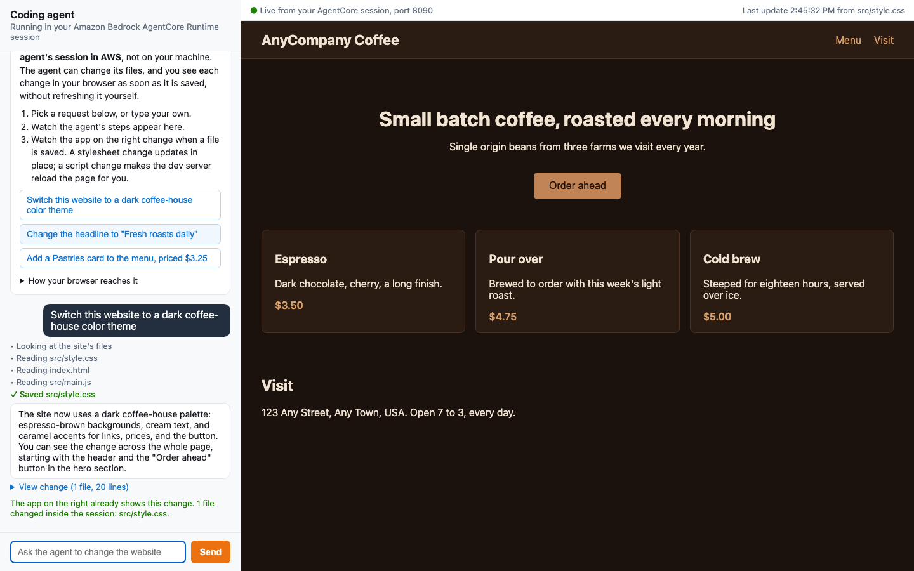
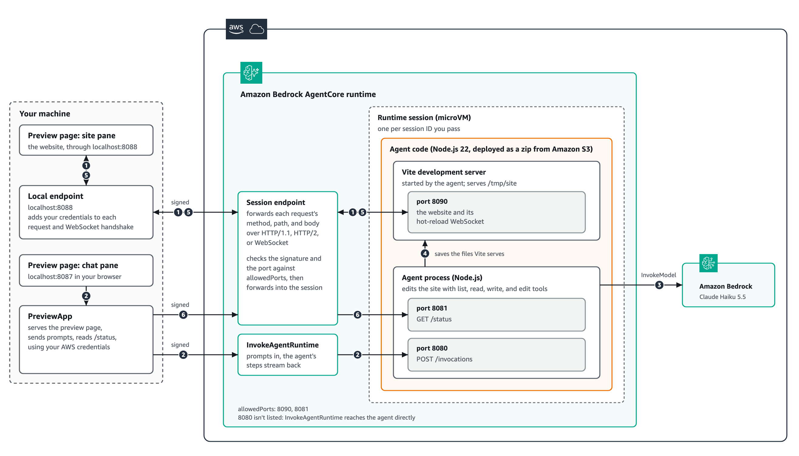

# Preview a web app while your coding agent builds it, with Session endpoints

A coding agent runs in an Amazon Bedrock AgentCore Runtime session and keeps a Vite website running beside it. You open one local page: a chat with the agent on the left, the live website on the right. Ask for a change, follow the agent's steps as they stream in, and watch the website update without a refresh.

The website is reached through a **Session endpoint**: an authenticated URL that Runtime returns for each session and that forwards each request's HTTP method, path, query string, and body, and WebSocket connections, to the ports you list in `allowedPorts`. A browser can't sign its own requests, so the [bedrock-agentcore SDK](https://github.com/aws/bedrock-agentcore-sdk-python) opens a local endpoint on `localhost` that adds your credentials to each request and WebSocket handshake.

## Architecture

1. The site pane loads the website from the local endpoint on `localhost:8088`, which signs each request and the WebSocket handshake and forwards them to the Session endpoint. Runtime checks the signature and the port against `allowedPorts`, then forwards them to the Vite development server on port 8090.
2. A prompt from the chat pane goes to `InvokeAgentRuntime`, and Runtime delivers it to the agent on port 8080.
3. The agent calls Claude Haiku 5.5 in Amazon Bedrock to decide what to change.
4. The agent saves the files it changes, and Vite serves and watches them.
5. Vite pushes each change over its hot-reload WebSocket, back through the Session endpoint and the local endpoint.
6. The notebook reads the agent's `/status` route on port 8081 through the same Session endpoint.

Port 8080 isn't in `allowedPorts`, because `InvokeAgentRuntime` reaches the agent without going through the Session endpoint.

## Prerequisites

- An AWS account in a Region where AgentCore Runtime Session endpoints are available, with credentials configured.
- Permissions to create an IAM role, upload to Amazon S3, and create a runtime, plus `bedrock-agentcore:InvokeAgentRuntime` and `bedrock-agentcore:InvokeAgentRuntimeProxy` on that runtime and its DEFAULT runtime endpoint.
- Amazon Bedrock model access for Anthropic Claude Haiku 5.5.
- Python 3.10 or later with `bedrock-agentcore` 1.26.0 or later.
- Node.js 22 or later with `npm`, which `deploy.py` uses to package the agent and the website.
- A Jupyter environment, such as JupyterLab or Visual Studio Code with the Jupyter extension.

## Run it

Open `session_endpoints_preview.ipynb` and run the cells in order:

1. Install the Python dependencies.
2. `%run deploy.py` packages the agent and the website as a zip in Amazon S3 and creates the runtime with `allowedPorts` 8090 and 8081. This takes a few minutes.
3. `PreviewApp().start()` starts a session, opens a local endpoint for port 8090, and serves the preview page on `http://localhost:8087`.
4. Choose a suggested request on the preview page, or send one from Python with `app.ask(...)`.
5. Run the clean-up cells when you are done.

## Files

| File | Purpose |
|---|---|
| `session_endpoints_preview.ipynb` | The walkthrough |
| `deploy.py` | Builds the agent, packages it with the website, uploads the zip, and creates the runtime |
| `preview_app.py` | Starts a session, opens the local endpoint, and serves the preview page |
| `ui.html` | The preview page: chat on the left, the live website on the right |
| `agent/` | The coding agent (TypeScript, Strands Agents SDK) with list, read, write, and edit tools |
| `site/` | The Vite website the agent edits |
| `cleanup.py` | Deletes the runtime, the uploaded code, and the IAM role |

## Security notes

- The Session endpoint URL is an address, not a credential. Every HTTP request, HTTP/2 stream, and WebSocket handshake is authenticated with SigV4 or a bearer token.
- The local endpoint acts with your credentials, so it listens on `127.0.0.1` only, answers only requests addressed to its own local address, and refuses requests and WebSocket connections that a page on another site starts through your browser. Run it only while you use the preview.
- The website and the agent run in the same session, so give the execution role only the permissions the agent needs.
- The agent's file tools resolve every path inside the site folder and refuse paths outside it.
- Session endpoints are for building, testing, and reviewing what your agent produces, not for serving your users. To serve an app to your users, deploy it to a hosting service such as AWS Amplify Hosting.

## Clean up

Run the last two cells of the notebook, or `python cleanup.py`. This stops the preview and the session, then deletes the runtime, the uploaded code, and the IAM role that `deploy.py` created.

## Learn more

- [Connect to runtime sessions through a session URL](https://docs.aws.amazon.com/bedrock-agentcore/latest/devguide/runtime-remote-access.html)
- [Configure your agent's serving port and invocation path](https://docs.aws.amazon.com/bedrock-agentcore/latest/devguide/runtime-configure-invocation.html)
- [Direct code deployment for Node.js](https://docs.aws.amazon.com/bedrock-agentcore/latest/devguide/runtime-get-started-code-deploy-node.html)
