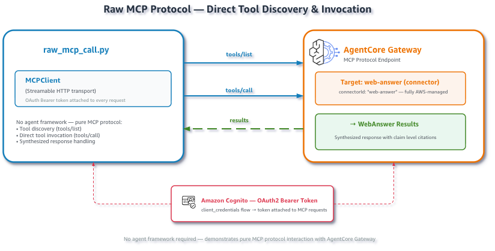

# Raw MCP invocation with [Amazon Bedrock AgentCore Web Answer](https://docs.aws.amazon.com/bedrock-agentcore/latest/devguide/gateway-target-connector-web-answer-tool.html)

This example connects directly to an
[Amazon Bedrock AgentCore Gateway](https://docs.aws.amazon.com/bedrock-agentcore/latest/devguide/gateway.html),
discovers the `WebAnswer` tool with `tools/list`, and invokes it with
`tools/call`. No agent framework is involved, so this is the simplest way to
verify the target and inspect the live tool schema and response.



## Prerequisites

- Python 3.10 or later.
- AWS credentials with IAM, Cognito, and AgentCore Gateway permissions.
- Web Answer availability in `us-east-1`.

```bash
pip install -r ../requirements.txt
```

## Run

From this directory:

```bash
python setup_gateway.py
source .env.web-answer
python raw_mcp_call.py
```

Ask another question:

```bash
python raw_mcp_call.py \
  --question "What is the current long-term support release of Node.js?"
```

The script prints the discovered schema before invoking the tool. The live
schema requires a `query` and also advertises optional location and source
filters. The script maps the user-friendly `--question` option to the discovered
input field. It prints `structuredContent` when available and falls back to the
MCP text content blocks.

## Files

| File | Description |
|:--|:--|
| `setup_gateway.py` | Delegates to the shared Gateway setup utility. |
| `raw_mcp_call.py` | Discovers and invokes `WebAnswer`. |
| `cleanup.py` | Deletes the created Gateway, Cognito pool, and IAM role. |
| `../utils/gateway_auth.py` | Gets a Cognito token and creates the MCP transport. |
| `../utils/gateway_setup.py` | Provisions the Gateway and Web Answer target. |

## Cleanup

Use the identifiers printed by the setup script or loaded from `.env.web-answer`:

```bash
python cleanup.py \
  --gateway-id "$GATEWAY_ID" \
  --user-pool-id "$USER_POOL_ID" \
  --role-name "$ROLE_NAME"
```
