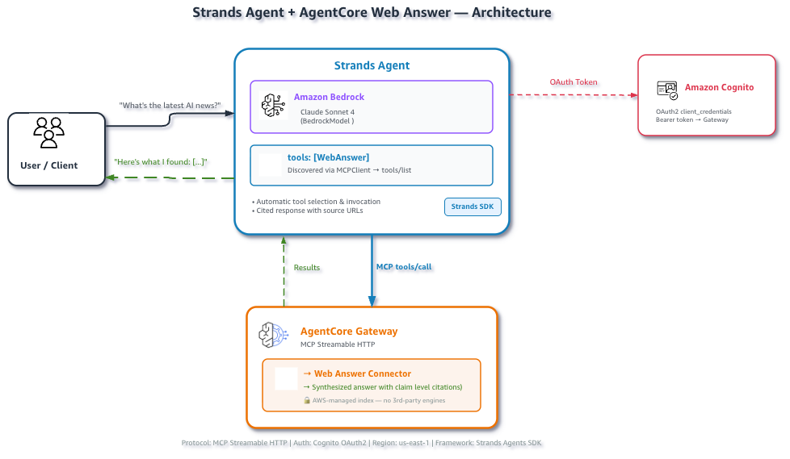

# [Amazon Bedrock AgentCore Web Answer](https://docs.aws.amazon.com/bedrock-agentcore/latest/devguide/gateway-target-connector-web-answer-tool.html) with a Strands agent

This example gives a Strands agent access to the managed `WebAnswer` MCP tool
through an
[Amazon Bedrock AgentCore Gateway](https://docs.aws.amazon.com/bedrock-agentcore/latest/devguide/gateway.html).
For a direct question that requires current information, the agent asks Web
Answer for a server-side synthesized answer and preserves its citations.



## Prerequisites

- Complete the Gateway setup below.
- Enable access to the configured Bedrock model.
- Install the shared dependencies.

```bash
pip install -r ../requirements.txt
```

## Run

From this directory:

```bash
python setup_gateway.py --gateway-name strands-web-answer-gw
source .env.web-answer
python web_answer_strands.py
```

Ask one custom question:

```bash
python web_answer_strands.py \
  --question "What is the latest stable release of Python, and when was it released?"
```

Override the model if needed:

```bash
export BEDROCK_MODEL_ID="global.anthropic.claude-sonnet-4-6"
```

## How it works

1. `gateway_auth.py` obtains a Cognito client-credentials token.
2. Strands connects to the Gateway with MCP Streamable HTTP.
3. `tools/list` discovers `WebAnswer`.
4. The model chooses the tool when the question requires a current fact.
5. Web Answer performs retrieval and synthesis server-side and returns citations.
6. The model presents the grounded answer while preserving source URLs.

## Files

| File | Description |
|:--|:--|
| `setup_gateway.py` | Delegates to the shared setup utility. |
| `web_answer_strands.py` | Runs the Strands agent. |
| `cleanup.py` | Deletes provisioned AWS resources. |
| `../utils/web_answer_agent.py` | Creates the MCP client and Strands agent. |
| `../utils/gateway_auth.py` | Handles Gateway OAuth authentication. |

## Cleanup

```bash
python cleanup.py \
  --gateway-id "$GATEWAY_ID" \
  --user-pool-id "$USER_POOL_ID" \
  --role-name "$ROLE_NAME"
```
