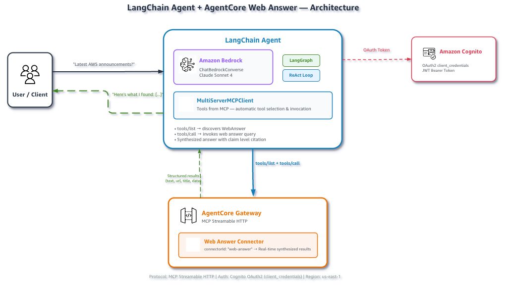

# Web Answer with a LangChain agent

This example connects LangChain to an AgentCore Gateway with
`langchain-mcp-adapters`. The agent discovers the managed `WebAnswer` tool and
uses it for direct factual questions requiring current web information.



## Prerequisites

- Complete the Gateway setup below.
- Enable access to the configured Bedrock model.
- Install the shared dependencies.

```bash
pip install -r ../requirements.txt
```

## Run

From this directory:

```bash
python setup_gateway.py --gateway-name langchain-web-answer-gw
source .env.web-answer
python web_answer_langchain.py
```

Ask another question:

```bash
python web_answer_langchain.py \
  --question "What is the current long-term support release of Node.js?"
```

Override the model if needed:

```bash
export BEDROCK_MODEL_ID="global.anthropic.claude-sonnet-4-6"
```

## How it works

1. The script obtains a Cognito OAuth token.
2. `MultiServerMCPClient` connects to the Gateway over Streamable HTTP.
3. The adapter converts discovered MCP tools into LangChain tools.
4. `create_agent` builds an agent using `ChatBedrockConverse`.
5. The model invokes Web Answer when it needs a current fact.
6. Web Answer returns a grounded answer with citations for the model to present.

## Files

| File | Description |
|:--|:--|
| `setup_gateway.py` | Delegates to the shared setup utility. |
| `web_answer_langchain.py` | Runs the LangChain agent. |
| `cleanup.py` | Deletes provisioned AWS resources. |
| `../utils/gateway_auth.py` | Handles Gateway OAuth authentication. |

## Cleanup

```bash
python cleanup.py \
  --gateway-id "$GATEWAY_ID" \
  --user-pool-id "$USER_POOL_ID" \
  --role-name "$ROLE_NAME"
```
