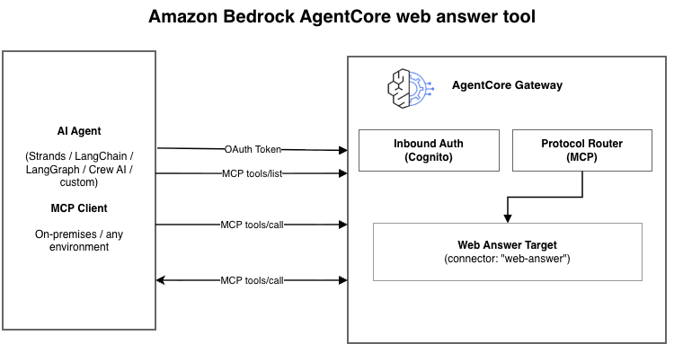
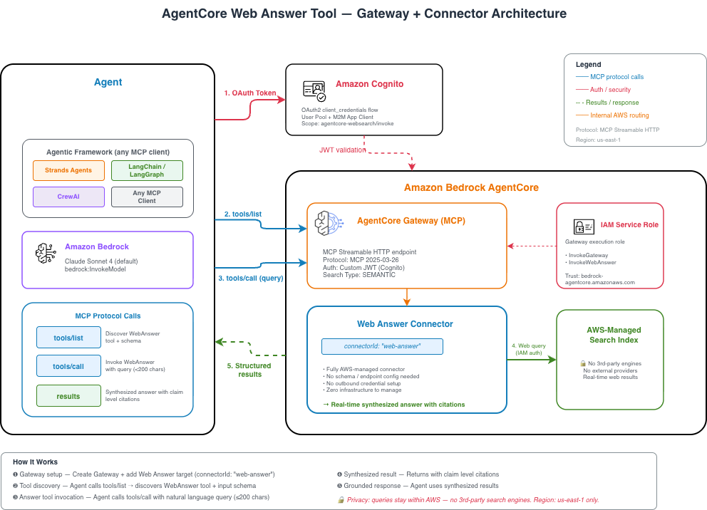

# [Amazon Bedrock AgentCore Web Answer](https://docs.aws.amazon.com/bedrock-agentcore/latest/devguide/gateway-target-connector-web-answer-tool.html)



Amazon Bedrock AgentCore Web Answer turns a natural-language question into
a concise answer grounded in current public-web sources. It is exposed as a
managed MCP connector through an AgentCore Gateway. The service performs retrieval,
page-content lookup, answer synthesis, and citation generation server-side.

Use Web Answer for direct factual questions where the agent needs a finished,
auditable answer. Use Web Search when the agent needs ranked observations so it
can compare sources or control its own synthesis process.

## Key capabilities

- Returns one grounded answer instead of a list of search observations.
- Includes inline source links and structured citation URLs.
- Can use indexed full-page content when a search snippet is insufficient.
- Uses an Amazon-operated web index; queries are not sent to third-party search providers.
- Works with MCP-compatible clients and agent frameworks.
- Uses Gateway target configuration and IAM for centralized access control.

## Examples

| Folder | Description |
|:--|:--|
| [`01-raw-mcp/`](01-raw-mcp/) | Discover and invoke `WebAnswer` directly over MCP. |
| [`02-strands-agent/`](02-strands-agent/) | Let a Strands agent invoke Web Answer for current facts. |
| [`03-langchain-agent/`](03-langchain-agent/) | Use Web Answer with LangChain's MCP adapter. |
| [`04-claude-desktop/`](04-claude-desktop/) | Provision a Gateway for an OAuth-capable desktop MCP client. |

## Prerequisites

- Python 3.10 or later.
- AWS credentials with permission to create IAM, Cognito, and AgentCore Gateway resources.
- An AWS account with Amazon Bedrock and AgentCore enabled.
- Web Answer availability in `us-east-1`.
- Model access for the Strands and LangChain examples.

Install the shared dependencies:

```bash
pip install -r requirements.txt
```

## Architecture



The Gateway service role grants:

```text
bedrock-agentcore:InvokeGateway
bedrock-agentcore:InvokeWebAnswer
```

The managed tool resource is:

```text
arn:aws:bedrock-agentcore:<region>:aws:tool/web-answer.v1
```

## Documentation

- [Amazon Bedrock AgentCore Web Answer documentation](https://docs.aws.amazon.com/bedrock-agentcore/latest/devguide/gateway-target-connector-web-answer-tool.html)
- [Amazon Bedrock AgentCore Gateway](https://docs.aws.amazon.com/bedrock-agentcore/latest/devguide/gateway.html)
- [Built-in Gateway connectors](https://docs.aws.amazon.com/bedrock-agentcore/latest/devguide/gateway-target-connectors.html)

## AgentCore CLI support

The current [AgentCore CLI](https://docs.aws.amazon.com/bedrock-agentcore/latest/devguide/agentcore-get-started-cli.html)
(v1.0.1) does not accept `web-answer` in `agentcore add gateway-connector`.
Its curated connector options are currently `web-search` and
`bedrock-knowledge-bases`. This sample therefore provisions the Web Answer
connector with the supported Boto3 `create_gateway_target` API shown below.

The CLI can invoke an existing Gateway regardless of its target type. After
running the setup and loading `.env.web-answer`, get a token and discover the
Gateway's exact tool names:

```bash
TOKEN=$(python -c \
  'from utils.gateway_auth import get_oauth_token; print(get_oauth_token())')

agentcore gateway invoke \
  --id "$GATEWAY_ID" \
  --method POST \
  --content-type application/json \
  --accept 'application/json, text/event-stream' \
  --bearer-token "$TOKEN" \
  --mcp-protocol-version 2025-03-26 \
  --payload '{"jsonrpc":"2.0","id":1,"method":"tools/list"}'
```

For the default target name created by this sample, invoke Web Answer with:

```bash
agentcore gateway invoke \
  --id "$GATEWAY_ID" \
  --method POST \
  --content-type application/json \
  --accept 'application/json, text/event-stream' \
  --bearer-token "$TOKEN" \
  --mcp-protocol-version 2025-03-26 \
  --payload '{
    "jsonrpc": "2.0",
    "id": 2,
    "method": "tools/call",
    "params": {
      "name": "web-answer-tool___WebAnswer",
      "arguments": {
        "query": "What is the current long-term support release of Node.js?"
      }
    }
  }'

unset TOKEN
```

See [Call a tool in an AgentCore Gateway](https://docs.aws.amazon.com/bedrock-agentcore/latest/devguide/gateway-using-mcp-call.html)
for the MCP request format.

## Quick start

Run these commands from this folder:

```bash
python 01-raw-mcp/setup_gateway.py
source 01-raw-mcp/.env.web-answer
python 01-raw-mcp/raw_mcp_call.py
```

Run an agent-framework example with the same environment variables:

```bash
python 02-strands-agent/web_answer_strands.py
python 03-langchain-agent/web_answer_langchain.py
```

Pass a custom question:

```bash
python 01-raw-mcp/raw_mcp_call.py \
  --question "What is the latest stable release of Python, and when was it released?"
```

## Gateway target configuration

The setup utility creates this connector target:

```python
gateway_client.create_gateway_target(
    gatewayIdentifier=gateway_id,
    name="web-answer-tool",
    targetConfiguration={
        "mcp": {
            "connector": {
                "source": {"connectorId": "web-answer"},
                "configurations": [{"name": "WebAnswer", "parameterValues": {}}],
            }
        }
    },
    credentialProviderConfigurations=[{"credentialProviderType": "GATEWAY_IAM_ROLE"}],
)
```

The live tool schema requires `query`. It also exposes optional `userLocation`
and per-call `filters` for included or excluded domains and publication-date
bounds. The raw MCP example accepts `--question` as a user-friendly CLI option
and maps it to the discovered `query` property.

## Response handling

`tools/call` returns the standard MCP envelope. In the tested service version,
the human-readable answer appears in `content`, while `structuredContent`
contains an `answer` list with answer text and citations:

```json
{
  "answer": [
    {
      "text": "A grounded answer with inline citations.",
      "citations": [
        {
          "domain": "example.com",
          "url": "https://example.com/source"
        }
      ]
    }
  ]
}
```

The raw MCP example prefers `structuredContent` and falls back to the text
content blocks. Treat the schema returned by `tools/list` and `tools/call` as
authoritative because managed-tool response fields can evolve.

## Cleanup

The setup command prints the resource identifiers and stores them in the local
environment file. Delete the created Gateway, Cognito pool, and IAM role with:

```bash
python 01-raw-mcp/cleanup.py \
  --gateway-id "$GATEWAY_ID" \
  --user-pool-id "$USER_POOL_ID" \
  --role-name "$ROLE_NAME"
```

The `.env.web-answer` file contains a Cognito client secret and is ignored by the
repository's `.gitignore`.
