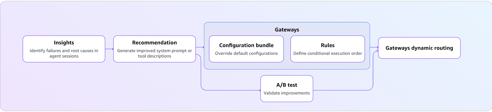

# AgentCore optimization

End-to-end optimization workflow for an HR Assistant agent on Amazon Bedrock AgentCore runtime. Covers automated insights to detect agent failures, run baseline evaluation, get recommendations to improve the agent, and A/B testing via configuration bundles and target-based routing.

### What You Will Learn

| Stage | Concepts Covered |
|-------|-----------------|
| **Insights** | `Builtin.FailureAnalysis` insight evaluator: failures grouped into insights with root causes, suggested fixes, and span-level findings |
| **Baseline evaluation** | Batch evaluations on agent sessions |
| **Recommendations** | System prompt optimization, tool description optimization from production traces |
| **Configuration Bundles** | Versioned config containers, runtime config hooks, baggage-based injection |
| **A/B Test: Config-Bundle Routing** | Prompt-level A/B testing without redeployment, online evaluation, statistical analysis |
| **A/B Test: Target-Based Routing** | Code-level A/B testing, phased rollout (90/10 canary), multi-runtime comparison |



### Key Components

| Component | Service | Purpose |
|-----------|---------|---------|
| AgentCore runtime | `bedrock-agentcore-control` | Hosts the HR Assistant container |
| Configuration Bundle | `bedrock-agentcore-control` | Versioned system prompt and tool description storage |
| Batch evaluation | `bedrock-agentcore` (DP) | Off-line scoring of historical sessions |
| Batch insights | `bedrock-agentcore` (DP) | `Builtin.FailureAnalysis` in a batch evaluation: failure insights, root causes, suggested fixes |
| Recommendation | `bedrock-agentcore` (DP) | AI-generated prompt/tool improvements |
| gateway + Targets | `bedrock-agentcore-control` | Traffic routing for A/B tests |
| Online Eval Config | `bedrock-agentcore-control` | Continuous automatic session scoring |
| A/B Test | `bedrock-agentcore` (DP) | Traffic split + statistical comparison |

## Prerequisites

- AWS account with Bedrock AgentCore access enabled
- AWS CLI configured: `aws configure` (or set `AWS_ACCESS_KEY_ID`, `AWS_SECRET_ACCESS_KEY`, `AWS_DEFAULT_REGION`)
- IAM caller permissions:
  - `bedrock-agentcore:GetConfigurationBundle*`, `ListConfigurationBundleVersions`, `CreateConfigurationBundle`, `UpdateConfigurationBundle`, `DeleteConfigurationBundle`
  - `bedrock-agentcore:StartRecommendation`, `GetRecommendation`
  - `bedrock-agentcore:StartABTest`, `StopABTest`, `GetABTest`, `DeleteABTest`, `ListABTests`
  - `logs:GetLogEvents`, `FilterLogEvents`, `StartQuery`, `GetQueryResults` on `runtimes/*` log groups
  - `iam:CreateRole`, `AttachRolePolicy`, `PassRole` to create the execution role for the A/B test
  - `bedrock:InvokeModel`, `s3:*`, `ecr:*`, `xray:*`
- Python 3.10+
- Access to Amazon Bedrock models (Nova Lite) in your region

> **Timing note:** CloudWatch ingestion takes 2-3 minutes after invoking the agent. Batch evaluations take 1-5 minutes. Recommendations take 2-5 minutes. Budget ~45 minutes for the full workflow.

## Quick Start

```bash
pip install -r requirements.txt

# Deploy v1 HR Assistant to AgentCore runtime
python deploy.py --name HRAssistV1

# Invoke the deployed agent
python invoke.py --name HRAssistV1

# [Optional] Run insights: generate traces then analyze with Builtin.FailureAnalysis
python insights.py --name HRAssistV1 --generate-traces

# Run the full optimization workflow
python optimize.py --name HRAssistV1

# Clean up all resources
python cleanup.py --name HRAssistV1
```

## AgentCore CLI Examples

The following commands reproduce the full optimization workflow from the command line.

Install the AgentCore CLI:

```bash
npm install -g @aws/agentcore@0.30.0
node -e 'process.exit(+process.versions.node.split(".")[0] >= 20 ? 0 : 1)' \
  || { echo "ERROR: Node.js 20+ required by the AgentCore CLI (found $(node -v))"; exit 1; }
agentcore --version | grep -q '^0\.' \
  || { echo "ERROR: these samples need AgentCore CLI v0. Run: npm install -g @aws/agentcore@0.30.0"; exit 1; }
agentcore --version   # 0.20.1 or later
```

### Step 1: Deploy the HR Assistant

```bash
# Scaffold a new AgentCore project (run from this sample directory)
agentcore create --name HRAssistant --framework Strands --model-provider Bedrock --memory none

# Copy the HR assistant implementation and switch to the project directory
cp utils/hr_assistant_agent.py HRAssistant/app/HRAssistant/main.py
cd HRAssistant

# Test locally before deploying
agentcore dev

# Deploy to AWS (builds container, pushes to ECR, creates AgentCore runtime)
agentcore deploy
# Note the runtime ID and ARN from the output.
```

### Step 2: Run Baseline evaluation

```bash
# Invoke the agent to generate traffic
agentcore invoke \
  --runtime HRAssistant \
  --prompt "Employee ID: EMP-001. What is my PTO balance?" \
  --session-id $(python3 -c "import uuid; print(uuid.uuid4())")

# Run batch evaluation across all sessions
agentcore run batch-evaluation \
  --runtime HRAssistant \
  --evaluator Builtin.GoalSuccessRate Builtin.Helpfulness Builtin.Correctness
```

### Step 3: Run Insights

After generating traffic, run insights to understand which sessions are failing and why before optimizing. Insights come from the `Builtin.FailureAnalysis` insight evaluator, which runs in a standard batch evaluation alongside other evaluators such as `Builtin.GoalSuccessRate`.

```bash
# Run FailureAnalysis together with GoalSuccessRate over the agent's sessions:
agentcore run batch-evaluation \
  --runtime HRAssistant \
  --evaluator Builtin.FailureAnalysis Builtin.GoalSuccessRate
# Note the batch evaluation ID from the output.

# View the FailureAnalysis insights for the job:
python -c "import boto3, json; r = boto3.client('bedrock-agentcore').get_batch_evaluation(batchEvaluationId='<batch-evaluation-id>'); print(json.dumps(r.get('insightResults', []), indent=2, default=str))"
```

Notes:
- Insight evaluators are supported in batch evaluations only.
- Resource names must match `^[a-zA-Z][a-zA-Z0-9_]{0,47}$` (letters, numbers, underscores; no hyphens).

### Step 4: Get Recommendations

```bash
# System prompt recommendation (optimize for GoalSuccessRate)
agentcore run recommendation \
  --runtime HRAssistant \
  --type system-prompt \
  --evaluator Builtin.GoalSuccessRate \
  --inline "You are an HR assistant for Acme Corp. Help employees with PTO, policies, benefits, and pay stubs."

# Tool description recommendation
agentcore run recommendation \
  --runtime HRAssistant \
  --type tool-description \
  --tools "get_pto_balance:Get the PTO balance for an employee" \
  --tools "get_policy:Look up an HR policy by name"
```

### Step 5: Create Configuration Bundles

```bash
# Create control bundle (original prompt)
agentcore add config-bundle \
  --name HRControl \
  --components '{"{{runtime:HRAssistant}}": {"configuration": {"systemPrompt": "'"$(cat original_prompt.txt)"'"}}}'
agentcore deploy

# Create treatment bundle (recommended prompt)
agentcore add config-bundle \
  --name HRTreatment \
  --components '{"{{runtime:HRAssistant}}": {"configuration": {"systemPrompt": "'"$(cat recommended_prompt.txt)"'"}}}'
agentcore deploy

# View version IDs (needed for the A/B test below)
agentcore cb versions --bundle HRControl --json
agentcore cb versions --bundle HRTreatment --json
```

### Step 6a: A/B Test -- Config-Bundle Routing

```bash
# Create gateway
agentcore add gateway --name HRGateway --authorizer-type AWS_IAM

# Create gateway target
agentcore add gateway-target \
  --gateway HRGateway \
  --name HRAgentV1 \
  --type mcp-server \
  --runtime HRAssistant

# Create online evaluation config
agentcore add online-eval \
  --name HROnlineEval \
  --runtime HRAssistant \
  --evaluator Builtin.GoalSuccessRate Builtin.Helpfulness \
  --sampling-rate 100 \
  --enable-on-create
agentcore deploy

# Create A/B test with config-bundle routing (50/50 split)
agentcore add ab-test \
  --name HRBundleABTest \
  --runtime HRAssistant \
  --control-bundle HRControl \
  --control-version <control-version-id> \
  --treatment-bundle HRTreatment \
  --treatment-version <treatment-version-id> \
  --control-weight 50 \
  --treatment-weight 50 \
  --online-eval HROnlineEval \
  --enable
agentcore deploy

# Monitor results
agentcore ab-test HRBundleABTest
```

### Step 6b: A/B Test -- Target-Based Routing (Phased Rollout)

```bash
# Add v2 of the agent to the same project (run from the HRAssistant project directory)
agentcore add agent --name HRAssistantV2 --language Python --framework Strands --model-provider Bedrock --memory none
cp ../utils/hr_assistant_agent.py app/HRAssistantV2/main.py
# (Apply v2 code changes to main.py -- e.g. add escalate_to_hr_manager tool)
agentcore deploy

# Add v2 gateway target
agentcore add gateway-target \
  --gateway HRGateway \
  --name HRAgentV2 \
  --type mcp-server \
  --runtime HRAssistantV2

# Create online eval config for v2
agentcore add online-eval \
  --name HROnlineEvalV2 \
  --runtime HRAssistantV2 \
  --evaluator Builtin.GoalSuccessRate Builtin.Helpfulness \
  --sampling-rate 100 \
  --enable-on-create
agentcore deploy

# Create A/B test with target-based routing (90/10 canary)
agentcore add ab-test \
  --name HRTargetABTest \
  --mode target-based \
  --control-endpoint v1 \
  --treatment-endpoint v2 \
  --control-weight 90 \
  --treatment-weight 10 \
  --control-online-eval HROnlineEval \
  --treatment-online-eval HROnlineEvalV2 \
  --enable
agentcore deploy

# Monitor canary results; stop and promote when v2 wins
agentcore ab-test HRTargetABTest
agentcore stop ab-test HRTargetABTest
```

### Step 7: Cleanup

```bash
agentcore stop ab-test HRBundleABTest
agentcore stop ab-test HRTargetABTest
agentcore remove ab-test --name HRBundleABTest
agentcore remove ab-test --name HRTargetABTest
agentcore remove online-eval --name HROnlineEval
agentcore remove online-eval --name HROnlineEvalV2
agentcore remove config-bundle --name HRControl
agentcore remove config-bundle --name HRTreatment
agentcore remove gateway --name HRGateway
agentcore remove agent --name HRAssistant
agentcore remove agent --name HRAssistantV2
agentcore deploy -y
```

## How It Works

### Step 1: Deploy HR Assistant v1 (`deploy.py`)

Creates an IAM execution role, packages `utils/hr_assistant_agent.py` with ARM64 dependencies, uploads to S3, and creates an AgentCore runtime. The agent code is written to `main.py` inside the deployment zip with entry point `["opentelemetry-instrument", "main.py"]` for OTel tracing.

State is saved to `agent_state_{name}.json` for use by subsequent scripts.

The `--version v2` flag builds an enhanced version that adds an `escalate_to_hr_manager` tool and a more detailed system prompt baked into the code. This is the version used in the target-based A/B test.

### Step 2: Insights (`insights.py`)

Sends a set of failure-mode and successful sessions to the agent, waits for traces to propagate to CloudWatch, then calls `start_batch_evaluation` with the `Builtin.FailureAnalysis` insight evaluator and `Builtin.GoalSuccessRate`. Polls until the job completes and prints the evaluator scores and the failure insights, each with its root causes, suggested fixes, and span-level findings.

```python
dp.start_batch_evaluation(
    batchEvaluationName="HRInsights",
    evaluators=[
        {"evaluatorId": "Builtin.FailureAnalysis"},
        {"evaluatorId": "Builtin.GoalSuccessRate"},
    ],
    dataSourceConfig={
        "cloudWatchLogs": {
            "serviceNames": ["<runtime-name>.DEFAULT"],
            "logGroupNames": ["aws/spans", "/aws/bedrock-agentcore/runtimes/<runtime-id>-DEFAULT"],
            "filterConfig": {"timeRange": {"startTime": "...", "endTime": "..."}},
        }
    },
)
```

`Builtin.FailureAnalysis` works in three steps:

1. **Detect:** analyzes every span in each session and records a finding for each span where a failure occurred.
2. **Find the cause:** analyzes the full session (system prompt, tool definitions, tool inputs and outputs) to determine why each failure occurred. The cause can be in an earlier span than the failure.
3. **Group:** groups similar failures from all sessions into insights, and similar causes within each insight into root causes.

Results come back in the `insightResults` field of `get_batch_evaluation`:

| Field | What it contains |
|---|---|
| `insightResults[]` | One entry per failure insight: `type` (`FAILURE`), `name`, `description`, `affectedSessionCount`, `rootCauses[]` |
| `rootCauses[]` | `name`, `explanation` (what fails, why, and the impact), `suggestedFix` (what to change, usually the system prompt or tool descriptions), `affectedSessionCount`, `sampleSessions[]` |
| `sampleSessions[]` | `sessionId` and `findings[]` that show the root cause |
| `findings[]` | `targetId` (span ID), `targetType` (`SPAN_ID`), `category`, `description`, `confidence` (0–1) |

Each finding is assigned to one of the following failure category groups (or `other`):

| Category group | What it means |
|---|---|
| Execution errors | Authentication errors, resource not found, service errors, rate limiting, timeouts, resource exhaustion, tool schema or formatting errors |
| Task and instruction errors | The agent does not follow its instructions or does not identify the problem correctly |
| Incorrect actions | The agent chooses the wrong tool, retrieves poor information, or asks for information it does not need |
| Context handling errors | The agent loses or misuses the context of the conversation |
| Hallucination | The agent invents capabilities, parameters, history, or tool outputs, or misunderstands how to use a tool |
| Repetitive behavior | The agent repeats tool calls, requests, or steps without making progress |
| Orchestration and reasoning errors | The agent's reasoning and actions do not match, it deviates from the goal, or it ends the task too early |
| Nonsensical model output | The model returns malformed or meaningless output |
| Configuration mismatch | A tool definition does not match the behavior of the tool |
| Coding-specific failures | Unhandled edge cases and dependency issues in coding tasks |

Each session also receives a score: `1.0` (`Failures Found`) or `0.0` (`No Failures Found`). A higher average FailureAnalysis score is worse: `0.2` means 20% of the sessions had failures. Compare it with `Builtin.GoalSuccessRate` (higher is better) to separate sessions that missed the goal because of a failure from sessions that reached the goal despite one.

A job ends with status `COMPLETED_WITH_ERRORS` when some sessions fail to evaluate (`errorDetails` reports, for example, `1 of 27 sessions failed during batch evaluation.`) or when the service cannot generate the insights. In the second case `insightResults` is not present and `errorDetails` contains `Insight generation failed for the Builtin.FailureAnalysis evaluator.` In both cases the session scores and the other evaluators' results are still returned.

### Data Source

Insights pull from the `aws/spans` CloudWatch log group, which receives OTel span documents from AgentCore Runtime via the `opentelemetry-instrument` entry point. Each session's tool calls, model calls, and errors are captured as spans and correlated by session ID.

The runtime log group (`/aws/bedrock-agentcore/runtimes/...`) must also be included. Without it, the evaluator cannot resolve the log events that spans reference, which produces incomplete results.


The `--generate-traces` flag sends sessions across several failure categories:
- **Unknown employee IDs** (`EMP-999`, `EMP-003`) -> tool returns "not found" errors
- **Unsupported policy topics** (`sabbatical`, `floating_holiday`, `relocation`) -> tool returns error
- **Unknown benefit types** (`gym`, `commuter`, `wellness`) -> tool returns error
- **Unavailable pay periods** (`2019-12`, `2020-03`) -> tool returns "not found" error
- **Invalid date formats** in PTO requests -> agent confusion / multi-turn failure
- **Normal successful sessions** -> a baseline for comparing GoalSuccessRate with FailureAnalysis

### Reading the FailureAnalysis Output

Example output from `python insights.py --generate-traces` (trimmed). The service generates insight names and grouping, so they can vary between runs over the same sessions.

```
--- Evaluator scores (2 evaluators) ---
  Builtin.GoalSuccessRate   : 0.65  (evaluated: 26)
  Builtin.FailureAnalysis   : 0.7  (evaluated: 27)

--- FailureAnalysis (11 insights) ---

  Insight: Employee Not Found Errors  (3 sessions)
  Description  : Tool errors indicating that a requested employee resource (identified by employee ID)
                 does not exist in the system...

    Root cause   : Invalid Employee ID Backend Lookup Failure  (2 sessions)
    Explanation  : The agent fails when attempting to retrieve employee data using an employee identifier
                   that does not exist in the backend system...
    Suggested fix: Implement upstream validation of employee identifiers before tool invocation to verify
                   the ID exists in the system, and provide users with clear feedback to correct invalid inputs...
      [47f54af1] span 81923a2d5fe1689d  execution-error-resource-not-found (0.9): Tool returned error payload: 'Employee EMP-999 not found.'...

  Insight: Unfounded Tool Constraint Claims  (2 sessions)
  Description  : Agent makes specific claims about tool limitations (e.g., restricted date ranges,
                 unsupported parameters) without any factual basis...

    Root cause   : Hallucinated Tool Constraints Without Invocation  (2 sessions)
    Explanation  : The agent systematically fabricates tool capability boundaries and parameter restrictions
                   without ever invoking the tool to verify actual constraints...
    Suggested fix: Enhance the system prompt with explicit guardrails that prohibit the agent from inferring,
                   assuming, or asserting tool constraints without first invoking the tool...
      [223d8292] span 85f5f89ab3735a65  hallucination-hall-capabilities (0.9): Agent fabricated a specific limitation about the get_pay_stub tool ('only supports pay periods for 2025-12 and 2026-01') without invoking it...
  ...
```

### Chaining Insights into Recommendations

Pass the insights batch evaluation ARN to a recommendation to generate a system prompt that targets the identified failures:

```bash
# CLI:
agentcore run recommendation \
  --batch-evaluation-arn <batch-evaluation-arn> \
  --type system-prompt \
  --inline "You are a helpful HR Assistant for Acme Corp..." \
  --json

# Python (DP client):
dp.start_recommendation(
    name="HRSpRecFromInsights",
    type="SYSTEM_PROMPT_RECOMMENDATION",
    recommendationConfig={
        "systemPromptRecommendationConfig": {
            "systemPrompt": {"text": CURRENT_SYSTEM_PROMPT},
            "agentTraces": {"batchEvaluation": {"batchEvaluationArn": INSIGHTS_EVAL_ARN}},
            "evaluationConfig": {
                "evaluators": [{"evaluatorArn": "arn:aws:bedrock-agentcore:::evaluator/Builtin.GoalSuccessRate"}]
            },
        }
    },
)
```

### Step 3: Configuration Bundles (`optimize.py`)

A **Configuration Bundle** is a versioned container for agent configuration keyed by runtime ARN. The agent reads the bundle at invocation time via `BedrockAgentCoreContext.get_config_bundle()`. Changing the system prompt or tool descriptions does not require redeployment.

Each bundle call returns a `bundleId` (stable) and a `versionId` (immutable snapshot). Pass `parentVersionIds` on updates to track lineage and prevent accidental overwrites. Use `commitMessage` on every create and update to document the change.

#### Bundle lifecycle

| Operation | API | When to use |
|-----------|-----|-------------|
| Create | `create_configuration_bundle` | First time; establishes `bundleId` |
| Update | `update_configuration_bundle` | After evaluation; pass `parentVersionIds` to record lineage |
| Read | `get_configuration_bundle` | Verify current config (always returns latest version) |
| Compare | `get_configuration_bundle_version` | Diff two versions; useful for audits and rollback decisions |

**What we create:**
- **Control (C)** -- original system prompt + original tool descriptions
- **Treatment (T1)** -- recommended system prompt + recommended tool descriptions

### Step 4: Batch evaluation

Baseline batch evaluation discovers sessions from CloudWatch, runs them through built-in LLM evaluators, and returns aggregate scores:

| Evaluator | What it measures |
|-----------|------------------|
| **GoalSuccessRate** | Did the agent complete the user's goal? |
| **Helpfulness** | Was the response useful and actionable? |
| **Correctness** | Did the agent give accurate information? |

### Step 5: Optimization Recommendations

AgentCore analyzes production traces and generates:
- **System Prompt Recommendation**: rewrites your system prompt to improve a target metric
- **Tool Description Recommendation**: improves tool descriptions so the agent selects tools more reliably

Recommendations are returned as text and can be applied immediately via configuration bundles. No code changes needed.

### Step 6: Config-Bundle A/B Test

Use configuration bundle routing when the change is purely configuration: a different system prompt, model ID, or tool descriptions. Both variants run on the same runtime with different bundle versions.

**Architecture:**
```
User Request
     |
     v
[gateway] --50%--> [Control Bundle C]   --|
     |                                    |--> [HR runtime v1] --> CloudWatch
     +--50%--> [Treatment Bundle T1] -----|                            |
                                                [Online Eval Config] <-+
                                                        |
                                                [A/B Test Results]
```

The gateway injects the correct bundle reference into each request via W3C baggage headers. The agent reads it at runtime via `BedrockAgentCoreContext.get_config_bundle()`.

**Session stickiness:** Once a session ID is assigned to a variant, all requests with that session ID go to the same variant. New sessions are distributed across variants by weight.

An **online evaluation config** scores sessions automatically as they close. It watches the agent's CloudWatch log group, detects session close (after `sessionTimeoutMinutes` of inactivity), and runs the configured evaluators.

**Results timeline:** Budget 10-15 minutes from your last request: session timeout (2 min) -> evaluation (2-3 min) -> aggregation (~5 min cycle). Poll until `analysisTimestamp` is populated.

### Step 7: Target-Based A/B Test

When the change involves code (new tools, framework upgrade, different agent implementation), use target-based routing. Traffic splits between two separate runtimes, each registered as a gateway target. Each variant needs its own online evaluation config because they have different log groups.

**Architecture:**
```
User --> [gateway] --90%--> [Target HRAgentV1 -> HR runtime v1 (stable)]  --> CloudWatch
               |                                                                    |
               +--10%--> [Target HRAgentV2 -> HR runtime v2 (canary)]   --> CloudWatch
                                                                              |
                                                         [Online Eval v1 + Online Eval v2]
                                                                              |
                                                                    [A/B Test Results]
```

**Phased rollout:** 10% canary -> validate no regressions -> 50% ramp -> gather statistical significance -> 100% cutover -> decommission old runtime.

**`gatewayFilter.targetPaths`** restricts the A/B routing rule to requests matching the control target's path, so only traffic for this test is affected.

## Key Concepts

### From Triage to Optimization

After insights identifies failure patterns, you can feed those findings into the Recommendations API to generate an improved system prompt:

1. Run `Builtin.FailureAnalysis` to identify recurring failure insights and their root causes.
2. Call `start_recommendation` with your current system prompt, pointing it at the same agent traces (or pass the insights batch evaluation ARN directly).
3. Use A/B testing to compare the original and recommended configurations with live traffic.

The `agentcore run recommendation --batch-evaluation-arn <arn>` CLI command implements this flow.

### Config-Bundle vs. Target-Based A/B Testing

| | Config-Bundle Routing | Target-Based Routing |
|---|---|---|
| **What changes** | System prompt or config (no code change) | Agent code, tools, model, or framework |
| **Redeployment needed** | No -- config applied at request time | Yes -- new runtime required |
| **Runtimes needed** | One shared runtime | Two separate runtimes |
| **Eval configs needed** | One shared online eval config | One per variant (different log groups) |
| **Best for** | Prompt tuning, config experiments | Code releases, version upgrades |
| **Traffic split** | Typically 50/50 | Typically 90/10 canary |
| **Rollback** | Instant -- update bundle version | runtime still running; shift weights back |
| **Risk** | Very low | Higher -- binary change |

### Phased Rollout (Target-Based)

```
10% canary  ->  validate no regressions (errors, latency, quality drop)
      |
50% ramp    ->  gather statistical significance
      |
100% promote ->  complete cutover; decommission old runtime
```

### Configuration Bundle Hook

The agent reads its system prompt and tool descriptions from the bundle on every model call. This supports live prompt updates and A/B testing without redeployment:

```python
from bedrock_agentcore.runtime import BedrockAgentCoreContext
from strands.hooks.events import BeforeModelCallEvent

def _config_bundle_hook(event: BeforeModelCallEvent) -> None:
    bundle = BedrockAgentCoreContext.get_config_bundle()
    system_prompt = DEFAULT_SYSTEM_PROMPT
    tool_descs = {}
    if bundle:
        system_prompt = bundle.get("system_prompt", DEFAULT_SYSTEM_PROMPT)
        tool_descs = bundle.get("tool_descriptions", {})

    event.agent.system_prompt = system_prompt
    if tool_descs:
        for t in event.agent.tools:
            if t.tool_name in tool_descs:
                t.tool_spec["description"] = tool_descs[t.tool_name]

agent.hooks.add_callback(BeforeModelCallEvent, _config_bundle_hook)
```

This supports testing both prompt changes and tool description improvements in the same A/B experiment.

## Next Steps

- **Add custom evaluators**: Lambda-based evaluators for deterministic policy checks
- **Automate the loop**: Run batch evaluations in CI/CD to catch regressions before deployment
- **Use recommendations iteratively**: Re-run after each traffic batch to compound improvements
- **Multi-metric optimization**: Run separate recommendation jobs for different evaluators, then pick the best result
- **Increase canary exposure**: Use `update_ab_test` to gradually raise treatment weight (10% -> 25% -> 50% -> 100%)
- **Continuous monitoring**: Leave online eval configs enabled in production


## Decision Framework

| A/B Test Result | Action |
|-----------------|--------|
| **Config-bundle T1 wins** | Promote treatment bundle (`update_configuration_bundle`) as new default -- no code deployment |
| **Target-based v2 wins** | Ramp to 50%, then 100% cutover; delete v1 runtime |
| **Regression detected** | Stop A/B test immediately (`update_ab_test(executionStatus="STOPPED")`), investigate |
| **Inconclusive** | Continue sending traffic to accumulate sample size (p < 0.05 threshold) |
