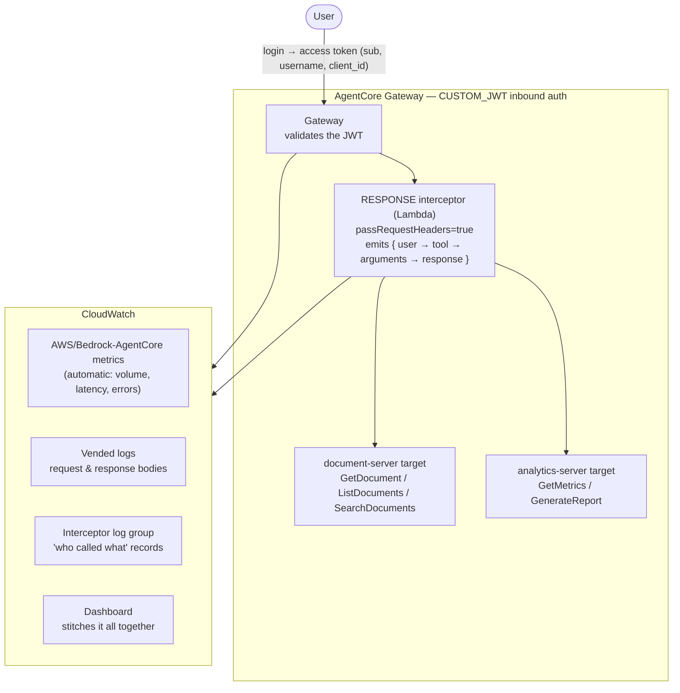
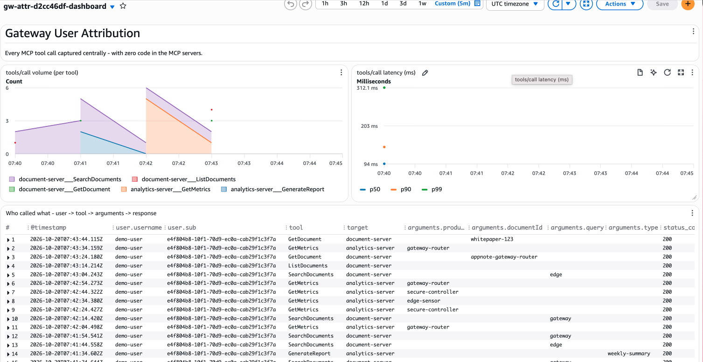

# Gateway User Attribution — "Who Called What" at the MCP Gateway

## Introduction

Capture **which user ran which tool, with which arguments**, centrally at an
Amazon Bedrock AgentCore Gateway — with **zero instrumentation in the MCP
servers**. A gateway **RESPONSE interceptor** reads the already-validated JWT and
the tool result on every call and emits one structured
`user → tool → arguments → response` record, so you get per-user attribution in
one place instead of each MCP server rolling its own.

This complements the [`gateway-observability`](../gateway-observability) sample:
that one turns on CloudWatch/CloudTrail for the gateway (the *what/when/how*);
this one adds the **end-user identity** (the *who*) and the lead-generation
signal story on top.

## Architecture Diagram



The interceptor is the key piece. For an MCP target, a **RESPONSE interceptor**
is invoked **after the target produces a result but before the gateway returns
it** — and its input carries **both** the original request (including the
`Authorization` JWT, because `passRequestHeaders=true`) **and** the response
body. So a single interceptor decodes the JWT claims (no signature check needed
— the gateway already validated the token), reads the tool, arguments, and
result, logs one line tying them together, and passes the response through
unchanged. No cross-log-group join is needed to see identity and result in one
place.

**Example captured record** (one tool call by `demo-user`):

```json
{
  "signal": "mcp.tool_call",
  "user": { "sub": "84180468-...", "username": "demo-user", "client_id": "7qqu..." },
  "tool": "GetMetrics",
  "target": "analytics-server",
  "arguments": { "product": "edge-sensor" },
  "status_code": 200,
  "response": "{\"product\":\"edge-sensor\",\"metrics\":{\"views\":4820,\"downloads\":612,\"inquiries\":44}}"
}
```

> **Note on `email`:** Cognito **access** tokens (what the gateway validates)
> carry `sub` and `username` but not `email`, so `email` is `null` here. If you
> need email for lead-gen, add an `email` claim to the access token or read it
> from the ID token; `sub` already uniquely identifies the user.

## Why it matters — the lead-generation angle

- **Before:** a user downloads a PDF → marketing captures the download event.
- **After:** the user asks an agent for that same content → the gateway captures
  **who** asked, the **exact arguments**, the **response**, and **when** — with
  no work in the MCP server.

`GetDocument(documentId=whitepaper-123)` by `demo-user` is the direct equivalent
of a whitepaper-download event, now available at the gateway. Pipe it onward with
a CloudWatch Logs subscription filter:

```
CloudWatch Logs (interceptor + vended)  →  Subscription Filter  →  Firehose  →  marketing platform / S3 / lake
```

## Prerequisites

- An AWS account with Amazon Bedrock AgentCore available in your region
  (default `us-east-1`).
- Credentials with permission for `bedrock-agentcore-control`, `lambda`, `iam`,
  `cognito-idp`, `logs`, `cloudwatch`, and `sts`.
- Python 3.10+ and `pip install -r requirements.txt`.

## Usage

Everything runs from the single notebook
[`gateway-user-attribution.ipynb`](./gateway-user-attribution.ipynb), top to
bottom. It is self-contained and idempotent; a short random suffix keeps every
resource name unique per run:

1. Prerequisites & configuration
2. Create the Cognito user pool + a `demo-user`
3. Deploy the two MCP tool Lambdas + the interceptor Lambda
4. Create the IAM role and the AgentCore Gateway (CUSTOM_JWT)
5. Attach the two Lambda targets
6. Attach the RESPONSE interceptor (`passRequestHeaders=true`)
7. Enable gateway vended logging (request/response bodies)
8. Create the CloudWatch dashboard
9. Generate traffic — authenticate as `demo-user`, call several tools
10. Inspect the "who called what" records (Logs Insights)
11. Clean up (see below)

## Sample Prompts

The notebook drives the gateway over MCP directly, but the same tool calls are
what an agent would make from these natural-language prompts:

- *"List the available documents."* → `document-server___ListDocuments`
- *"Get me the whitepaper-123 document."* → `document-server___GetDocument {documentId: whitepaper-123}`
- *"Search the documents for anything about edge."* → `document-server___SearchDocuments {query: edge}`
- *"What are the engagement metrics for the edge-sensor product?"* → `analytics-server___GetMetrics {product: edge-sensor}`
- *"Generate a weekly summary report."* → `analytics-server___GenerateReport {type: weekly-summary}`

Each produces one `user → tool → arguments` attribution record in the
interceptor's log group.

## Clean Up

The final notebook section (**11. Cleanup**) deletes **every** resource it
created — the gateway and its targets, the three Lambdas, the IAM roles, the
Cognito user pool, the log groups, the log-delivery setup, and the dashboard.
Each step is wrapped so one failure does not stop the rest. Run it when you are
done to avoid any ongoing CloudWatch charges.

### Cost

The resources are tiny (mock Lambdas, one user pool, one gateway). Cost is
dominated by CloudWatch logs/metrics retention. The notebook sets a 7-day log
retention and the cleanup section removes everything. Enabling account-level
CloudWatch Transaction Search (optional, for traces) adds span-ingestion cost
and is left off by default.

## Files

| File | Purpose |
|---|---|
| `gateway-user-attribution.ipynb` | The full runnable walkthrough + cleanup |
| `lambdas/document_server.py` | MCP tool target: document tools |
| `lambdas/analytics_server.py` | MCP tool target: analytics tools |
| `lambdas/interceptor.py` | The RESPONSE interceptor that attributes each call to a user and captures its result |
| `requirements.txt` | Python dependencies |
| `images/` | Dashboard screenshots |

## Screenshots

The CloudWatch dashboard surfaces per-tool call volume and latency (emitted
automatically by the gateway) alongside the table that makes this sample
distinct: **"Who called what — user → tool → arguments → response"**, built from
the single RESPONSE interceptor log group.


