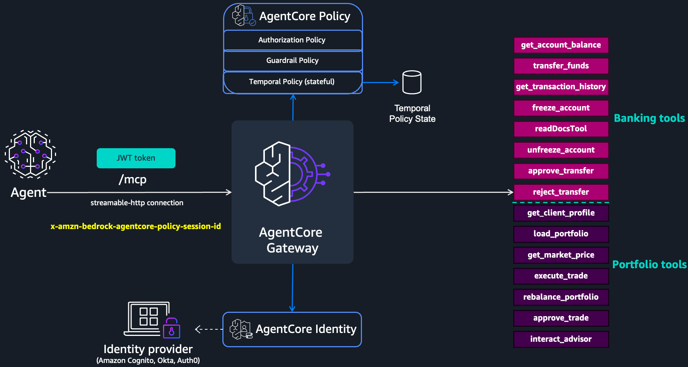

# Banking Assistant: Temporal Policies Sample

Explore how an agent's **earlier tool calls affect what it may do next**. This lab uses 14 simulated banking and portfolio tools behind an MCP server on AgentCore Runtime, reached through AgentCore Gateway. No real accounts or money are involved.

A transfer can be well-formed but still be inappropriate: the agent may never have looked up the destination, its quote may be stale, or it may have already consumed an approval. You will add temporal policies at the gateway, then compare allowed and denied sequences in separate sessions.

Start with [deployment and the web app](#step-1-amazon-cognito-setup), then try the [banking policies](#step-5-add-temporal-policies-banking-tools) and [portfolio policies](#step-6-add-temporal-policies-portfolio-tools). Finish with [owned-resource cleanup](#cleanup).

**Lab boundaries:** balances are in-memory demo data, not tenant-isolated banking records. Approval tools record supplied names; they do not authenticate a human approver. Policy enforcement applies to the gateway path, not direct Runtime calls. Keep the Runtime credential out of the conversational agent, use only synthetic data, and do not expose this development UI as a production service.



### Prerequisites

- **Python 3.12+** and **uv** ([install uv](https://docs.astral.sh/uv/getting-started/installation/)) for the MCP server and setup scripts
- **Node.js 24 LTS** and **npm** for the CLI and web app (Step 4)
- **[AgentCore CLI](https://www.npmjs.com/package/@aws/agentcore) 1.2.0**. Install the checked-in project lock, then use its small launcher for every CLI command in this guide:

  ```bash
  npm ci
  export BANKING_SAMPLE_ROOT="$PWD"
  agentcore() { npm --prefix "$BANKING_SAMPLE_ROOT" run --silent agentcore -- "$@"; }
  agentcore --version # 1.2.0
  ```

  The launcher uses `.sample-cli-home/` for CLI preferences/key storage. It enables
  the supported self-managed dependency setting for the pinned CDK pair and
  disables automatic account-level transaction-search setup. Your global CLI
  preferences are unchanged. Do not bypass it with a globally installed CLI.
  AWS configuration/credential file references and the selected profile are
  preserved; credentials are not copied. Keep this private directory out of Git.

  If you use SSO or another HOME-relative auth cache, authenticate in this private
  environment rather than copying an existing token cache. For SSO, with your
  intended sandbox profile already configured:

  ```bash
  export AWS_CONFIG_FILE="${AWS_CONFIG_FILE:-$HOME/.aws/config}"
  export AWS_SHARED_CREDENTIALS_FILE="${AWS_SHARED_CREDENTIALS_FILE:-$HOME/.aws/credentials}"
  HOME="$BANKING_SAMPLE_ROOT/.sample-cli-home" aws sso login --profile "${AWS_PROFILE:?Select your sandbox profile first}"
  ```

- **AWS credentials** configured with permissions to create IAM and AgentCore resources, and to invoke Amazon Bedrock (the web app calls the Converse API)

### Control SDK/model preflight (before creating anything)

The control scripts use the exact published graph in `requirements-control.txt`,
not the Runtime's `uv.lock`. Install it with hashes and check **the loaded model**:

```bash
uv venv --python 3.12 .control-venv
uv pip install --python .control-venv/bin/python --require-hashes -r requirements-control.txt
.control-venv/bin/python policy_contract.py
```

This preflight is offline: no AWS clients or credentials are needed. The scripts
repeat it before provisioning/deletion. A version label alone is insufficient:
`~/.aws/models` or `AWS_DATA_PATH` can shadow the genuine packaged model. A mismatch
is refused, never patched/injected or silently ignored. Preflight follows actual
client selection: configured `api_versions` first, otherwise the latest API directory.
A divergent selection is refused before clients or intents, even if the fixed
`2023-06-05` directory is valid. Control clients use that same verified session and
explicit API version; unsupported configuration is not silently overridden.
Do not delete global models/settings or edit ledgers to bypass this refusal. If your normal HOME has
an intentional model override, run this sample in a **private model environment**
while keeping your authorized credential/config locations explicit:

```bash
export AWS_CONFIG_FILE="${AWS_CONFIG_FILE:-$HOME/.aws/config}"
export AWS_SHARED_CREDENTIALS_FILE="${AWS_SHARED_CREDENTIALS_FILE:-$HOME/.aws/credentials}"
export BANKING_CONTROL_HOME="$PWD/.control-home"
mkdir -p "$BANKING_CONTROL_HOME"
banking_control() { env -u AWS_DATA_PATH HOME="$BANKING_CONTROL_HOME" "$PWD/.control-venv/bin/python" "$@"; }
banking_control policy_contract.py
```

Use `banking_control` below from `bankingassistant/`; it does not copy credentials
or alter global settings. Preserve any selected `AWS_PROFILE`. If using expiring
credentials, refresh through your existing authorized workflow, not this helper.
The locked botocore **1.44.9** supports policy `enforcementMode` and both
`definition.cedar`/`definition.policy`. An older AWS CLI parser can omit fields
that the installed SDK supports. This lab submits the portable `cedar` wrapper
and uses the checked SDK for full policy readiness reads; do not invent model fields.

Set these variables once. All commands below reference them:

```bash
export ACCOUNT_ID=$(aws sts get-caller-identity --query Account --output text)
export REGION=us-east-1
export AWS_REGION="$REGION"
```

Run from `bankingassistant/`. **Scope: a fresh-checkout CLI v1 port, not a
safe in-place upgrade of an existing deployed stack.** This checkout is a v1
**empty project** (schema version 2); Step 2 registers the existing MCP code.
Existing deployments require a separate reviewed migration and physical/logical
resource-ID comparison. A populated-v0 compatibility migration is **NOT RUN**.
The project name and
`migratedFrom: "v1"` preserve v0 naming. Do not remove that marker on deployed
projects. For an existing deployment, preserve `agentcore/aws-targets.json`,
`agentcore/.cli/`, `.env.local`, and `setup_config.json` and review the native
`agentcore migrate` plan in the original v0 checkout before applying this patch.
Do not replace deployed state with the example's empty state.

**Ownership:** CDK/CLI manages the Runtime and OAuth credential declaration.
`oauth_provider.py` first reserves a uniquely tagged provider and records its
identity before CLI can reuse/update it; `setup.py` manages the separate gateway,
engine, target and base policies. Do not
also declare that gateway/engine in `agentcore.json`. Temporal policy steps below
use the control-plane API because this lab deliberately teaches incremental
policy authoring, not CDK ownership of those resources.

For concurrent fresh labs, choose unique `GATEWAY_NAME`, `GATEWAY_ROLE_NAME`,
`ENGINE_NAME`, `MCP_CREDENTIAL_NAME`, project name and Cognito stack name **before** creating anything.
Keep the target name `banking-assistant-tools` (it is part of every Cedar action).
Do not rename an existing deployment. Setup records account, region and names;
an unrecorded existing IAM role is not silently adopted.

**Enforcement:** the gateway attachment uses `ENFORCE`, not `LOG_ONLY`.
`LOG_ONLY` logs decisions but permits traffic; none of the DENY assertions in
this lab are valid in that mode. Three distinct checks matter: engine lifecycle
`status: ACTIVE`, policy lifecycle `status: ACTIVE` (ready for use), and policy
`enforcementMode: ACTIVE` rather than `LOG_ONLY`. These do not replace the Gateway
attachment's `ENFORCE` mode. Setup explicitly creates and verifies ACTIVE policy
enforcement; a ready engine/policy alone proves no enforced decision.
`validationMode` controls analyzer findings, not enforcement. If calibrating in
LOG_ONLY, use only simulated traffic and restore both Gateway ENFORCE and policy
ACTIVE enforcement before testing denials.

These are simulated, in-memory banking tools, not a production banking system.
Approval tools record caller-supplied names rather than authenticate a human;
temporal gates do not make them trusted approvals. Signed trade `cost` and the
minimal system prompt are intentional test inputs. Policy ALLOW is distinct
from successful tool execution (e.g. insufficient cash). Direct Runtime access
with the MCP client credential bypasses the gateway: keep that credential only
in the gateway/deployer path, not with the conversational agent.

Offline regression checks (no AWS calls):

```bash
npm ci --prefix agentcore/cdk
npm test --prefix agentcore/cdk
for test_region in us-east-1 us-west-2; do
  for suite in test_migration.py test_safety.py test_completion.py test_policy_contract.py test_selected_model.py; do
    REGION="$test_region" banking_control -m unittest discover -s tests -p "$suite" -v
  done
done
# Optional exact pinned CLI upsert-contract check (fake Identity, no CLI entrypoint execution):
node tests/oauth_cli_contract.cjs node_modules/@aws/agentcore/dist/main.js
uv run --project app/banking_assistant_tools --frozen python -m unittest discover -s tests -p test_tools.py -v
# Optional real Runtime packaging + IAM synthesis (requires cached host/Linux ARM64 dependencies offline):
# Run under the app environment so the artifact validator uses locked packaging dependencies.
uv run --project app/banking_assistant_tools --frozen -- env BANKING_TEST_PACKAGE=1 npm test --prefix agentcore/cdk
```

Cloud deployment, both MCP protocols and temporal decisions still require
verification in a supported region; mock UI tests do not prove enforcement.

---

### Step 1: Amazon Cognito Setup

> [!NOTE]
> In this sample, AgentCore gateway is configured with Amazon Cognito for inbound authentication. This is done to keep the focus on AgentCore gateway patterns. For your enterprise workloads, you can configure any OAuth 2.0 compliant identity provider for inbound authentication (e.g., Entra ID, Auth0, Okta): see [identity provider setup](https://docs.aws.amazon.com/bedrock-agentcore/latest/devguide/identity-idps.html). For outbound authorization between AgentCore gateway and your targets, we recommend setting up [AgentCore gateway identity credential management](https://docs.aws.amazon.com/bedrock-agentcore/latest/devguide/what-is-bedrock-agentcore.html).

Deploy the Amazon Cognito User Pool stack:

> [!IMPORTANT]
> This Amazon Cognito stack is designed for **tutorial and testing purposes only**. MFA is disabled, the password policy is relaxed, and advanced security features are not enabled. **Do not deploy this stack to production environments without a thorough security review.** For production workloads, enable MFA, enforce a strong password policy, and configure advanced security features per your organization's requirements.

| Region    | Launch                                                                                                                                                                                                                                                                                                                                                                            |
| :-------- | :-------------------------------------------------------------------------------------------------------------------------------------------------------------------------------------------------------------------------------------------------------------------------------------------------------------------------------------------------------------------------------- |
| us-east-1 | [](https://console.aws.amazon.com/cloudformation/home?region=us-east-1#/stacks/new?stackName=agentcore-gateway-lab&templateURL=https://ws-assets-prod-iad-r-iad-ed304a55c2ca1aee.s3.us-east-1.amazonaws.com/015a2de4-9522-4532-b2eb-639280dc31d8/cognito-dev-stack-no-prod.yaml) |
| us-west-2 | [](https://console.aws.amazon.com/cloudformation/home?region=us-west-2#/stacks/new?stackName=agentcore-gateway-lab&templateURL=https://ws-assets-prod-iad-r-pdx-f3b3f9f1a7d6a3d0.s3.us-west-2.amazonaws.com/015a2de4-9522-4532-b2eb-639280dc31d8/cognito-dev-stack-no-prod.yaml) |

Or deploy via the CLI using the template bundled with this sample:

```bash
export COGNITO_STACK_NAME="agentcore-gateway-lab"

aws cloudformation deploy \
  --template-file cloudformation/cognito/cognito-signup-stack.yaml \
  --stack-name $COGNITO_STACK_NAME \
  --no-fail-on-empty-changeset \
  --region ${REGION}
```

Once deployed, capture the outputs you will need for later steps:

```bash
export COGNITO_STACK_NAME="agentcore-gateway-lab"

export DISCOVERY_URL=$(aws cloudformation describe-stacks \
  --stack-name $COGNITO_STACK_NAME \
  --query 'Stacks[0].Outputs[?OutputKey==`DiscoveryUrl`].OutputValue' --output text \
  --region ${REGION})

export GATEWAY_CLIENT_ID=$(aws cloudformation describe-stacks \
  --stack-name $COGNITO_STACK_NAME \
  --query 'Stacks[0].Outputs[?OutputKey==`GatewayClientId`].OutputValue' --output text \
  --region ${REGION})

export USER_POOL_ID=$(aws cloudformation describe-stacks \
  --stack-name $COGNITO_STACK_NAME \
  --query 'Stacks[0].Outputs[?OutputKey==`UserPoolId`].OutputValue' --output text \
  --region ${REGION})

export GATEWAY_CLIENT_SECRET=$(aws cognito-idp describe-user-pool-client \
  --user-pool-id $USER_POOL_ID \
  --client-id $GATEWAY_CLIENT_ID \
  --query 'UserPoolClient.ClientSecret' --output text \
  --region ${REGION})
```

### Step 2: Deploy the MCP server to AgentCore Runtime

The MCP server at `app/banking_assistant_tools/main.py` exposes all 14 tools (banking + portfolio) as a single FastMCP server. It is deployed to AgentCore Runtime, where the gateway discovers tools via `tools/list` and invokes them via `tools/call`.

#### Banking tools

| Tool                      | Description                                                                                                                                           |
| :------------------------ | :---------------------------------------------------------------------------------------------------------------------------------------------------- |
| `get_account_balance`     | Look up an account and return its current balance, owner, and frozen status.                                                                          |
| `transfer_funds`          | Transfer money between two accounts. Policy 1 matches `to_account` to the prior response event's `input.account_id` from `get_account_balance`.       |
| `get_transaction_history` | Return recent transactions for an account, up to an optional limit.                                                                                   |
| `freeze_account`          | Freeze an account, preventing all transfers to or from it. Accepts an optional reason.                                                                |
| `unfreeze_account`        | Remove the freeze on a previously frozen account.                                                                                                     |
| `approve_transfer`        | Record a human approval for a pending high-value transfer. Required by the gateway before `transfer_funds` calls above $10,000 (Step 5, Policy 2).    |
| `reject_transfer`         | Record a human rejection for a pending transfer. Mutually exclusive with `approve_transfer` for the same session within 5 minutes (Step 5, Policy 5). |

#### Portfolio tools

| Tool                  | Description                                                                                                                                                                              |
| :-------------------- | :--------------------------------------------------------------------------------------------------------------------------------------------------------------------------------------- |
| `get_client_profile`  | Retrieve a client's risk tolerance, investment policy, account restrictions, and associated portfolio IDs.                                                                               |
| `load_portfolio`      | Retrieve a client's portfolio holdings and current positions.                                                                                                                            |
| `get_market_price`    | Fetch the current market price for a security.                                                                                                                                           |
| `execute_trade`       | Execute a buy or sell order against a portfolio. The gateway enforces integrity, freshness, budget cap, and approval gate policies.                                                      |
| `rebalance_portfolio` | Adjust portfolio allocations across holdings. Requires prior `load_portfolio` and a recent `interact_advisor` in the session (Step 6, Policy 6).                                         |
| `approve_trade`       | Record advisor approval for a large trade. Required by the gateway before `execute_trade` calls above $25,000. Each approval is consumed by a single trade (Step 6, Policy 3).           |
| `interact_advisor`    | Record an advisor interaction to reset the 15-minute trust-decay clock. Without this, the agent loses access to `rebalance_portfolio` after 15 minutes of inactivity (Step 6, Policy 6). |

Export the MCP client credentials from the Cognito stack (the MCP server uses these for inbound auth):

```bash
export MCP_CLIENT_ID=$(aws cloudformation describe-stacks \
  --stack-name $COGNITO_STACK_NAME \
  --query 'Stacks[0].Outputs[?OutputKey==`MCPClientId`].OutputValue' --output text \
  --region ${REGION})

export MCP_CLIENT_SECRET=$(aws cognito-idp describe-user-pool-client \
  --user-pool-id $USER_POOL_ID \
  --client-id $MCP_CLIENT_ID \
  --query 'UserPoolClient.ClientSecret' --output text \
  --region ${REGION})
```

Register and deploy the MCP server:

```bash
agentcore add runtime \
  --name banking_assistant_tools \
  --language python \
  --protocol MCP \
  --authorizer-type CUSTOM_JWT \
  --authorizer-configuration "$(python3 -c 'import json, os; print(json.dumps({"customJwtAuthorizer": {"discoveryUrl": os.environ["DISCOVERY_URL"], "allowedClients": [os.environ["MCP_CLIENT_ID"]], "allowedScopes": ["api/mcp"]}}))')"

# v1's credential provisioner updates an existing same-vendor provider by name,
# even with empty CLI state. Reserve a NEW uniquely tagged provider first.
# This prints and durably records a random safe name (or checks an explicit name).
# A collision/access error stops here; never proceed to CLI on failure.
MCP_CREDENTIAL_NAME=$(printf '%s' "$MCP_CLIENT_SECRET" | banking_control oauth_provider.py) || exit 1
export MCP_CREDENTIAL_NAME
# Pass the secret via stdin (not process arguments or a committed JSON file).
printf '%s' "$MCP_CLIENT_SECRET" | agentcore add credentials oauth \
  --name "$MCP_CREDENTIAL_NAME" \
  --client-id "$MCP_CLIENT_ID" \
  --discovery-url "$DISCOVERY_URL" \
  --scopes api/mcp \
  --client-secret -
unset MCP_CLIENT_SECRET

agentcore build
# Required immediately before EVERY deploy while this credential is declared.
# Explicit intentional reuse: verifies tag, creation identity, client/discovery,
# exact provider/secret ARN and account/region; it does not rotate the secret.
MCP_CREDENTIAL_NAME=$(banking_control oauth_provider.py --reuse-owned) || exit 1
export MCP_CREDENTIAL_NAME
agentcore deploy --target default --region "$REGION"
```

Run the two `add` commands only once. Keep `oauth_provider_state.json` alongside
CLI state through failures and cleanup. The reservation uses **create**, never
update; even a collision between lookup and create fails closed. The deployer
needs `GetOauth2CredentialProvider` and `ListTagsForResource` reads in addition to
permission for tagged `CreateOauth2CredentialProvider`. Ownership tags are read
separately with `ListTagsForResource` for the already validated exact provider ARN;
the SDK's Get-provider response is not assumed to contain tags. A lost create
response can be recovered with `--reuse-owned` only if the durable intent's unique
tag and configuration match. Any existing unowned provider (including same-vendor
and same-client) is refused. Do not delete the ledger or choose a new name to hide
an uncertain create. Reuse/import of an unrelated or legacy provider and secret
rotation are **unsupported**, requiring a separate ownership review. Run only one
provisioning process at a time; an external concurrent administrator mutation is
not made atomic with CLI deployment by this preflight.

The `add` commands generate v1 declarations, preserve
`app/banking_assistant_tools/main.py`, and save the OAuth secret in gitignored
`agentcore/.env.local`. Inspect the generated declaration: CodeZip, MCP,
`app/banking_assistant_tools`, entrypoint `main.py`, and `customJwtAuthorizer`
(lowercase `Jwt` in v1 Runtime JSON). Setup's SDK Gateway authorizer uses the
service's different `customJWTAuthorizer` spelling. Do not change one to match
the other. The CLI creates the default target from your account/region on first
deploy. Inspect it before subsequent deploys. On a pre-bootstrapped account,
use `--skip-bootstrap`; never reconfigure a shared bootstrap for this tutorial.
Review any account-level observability changes before deployment. The custom
CDK permissions boundary limits the simulated tools Runtime to its code ZIP,
name/ID-delimited log writes, and required regional telemetry. X-Ray ingestion
and sampling use `Resource: "*"` because those actions have no resource scope,
with `aws:RequestedRegion` restricted to the deployment region. Metrics additionally
require namespace `bedrock-agentcore`; log-group discovery is read-only regional
metadata. Log stream writes cannot match a different similarly-prefixed Runtime
name. Resource-policy writes are restricted to this Runtime's log-group ARNs,
not account-wide policies. Broad default model, identity and configuration-bundle grants are not
effective through that boundary. The Node client, not the tools Runtime, invokes
Bedrock. This boundary is locally synthesized, not cloud-verified in this sample.
If the existing bootstrap bucket uses a customer-managed KMS key, the deployer
can set `AGENTCORE_SAMPLE_ASSET_KMS_KEY_ARN` to that **existing** key ARN; the
boundary allows only S3-mediated decryption of this artifact/bucket context.
Do not create/alter a shared key or broaden the boundary to make setup pass.

The configured CodeZip launcher is `opentelemetry-instrument ./main.py`.
Custom CDK uses the explicit relative path and `main.py` has an executable Python
shebang: OTel execs its argument rather than interpreting a non-executable script.
This retains the CodeConfiguration maximum of two entrypoint items.
`app/banking_assistant_tools/pyproject.toml` and `uv.lock` include the required
`aws-opentelemetry-distro[patch]` and its instrumentation/exporter dependencies
(the `patch` extra supplies botocore for AWS SigV4 and EMF export). Keep
instrumentation enabled. The optional packaging regression checks the actual
launcher, module/metadata dependency closure, locked versions, and Linux ARM64
Python 3.14 native wheel compatibility, not just ZIP existence. A host launcher
smoke test is not Linux ARM64 execution or proof of cloud telemetry delivery.

### Step 3: Create the gateway, policy engine, and MCP server target

Run the setup script. It creates the gateway IAM role, policy engine, gateway (with the engine attached in ENFORCE mode), the MCP server target (pointing to the Runtime URL from Step 2), and the base (non-temporal) permits. Re-runs verify ownership, reconcile the gateway's complete configuration (including JWT authentication and ENFORCE), and wait for recorded resources to become ready. Target endpoint, provider type/ARN and scopes must match exactly; drift is refused, not silently rewritten. Base policy IDs are recorded and each policy must reach lifecycle ACTIVE with the exact intended definition and enforcementMode ACTIVE, on create, retry and name-conflict paths.

Setup atomically persists create intents and stable idempotency tokens **before**
requests. Retry with the same ledger and inputs after response loss or a failed
checkpoint. IAM has no create token: recovery requires the prior durable intent
and unique ownership tag from that request, never just an existing role name.
Run only one setup/cleanup process at a time. Keep `setup_config.json` through
failures; timeouts and access failures are not absence or success. Cleanup refuses
unresolved create intents, including targets and base policies whose create
response/ID checkpoint was lost: recover them via setup before attempting cleanup.
Even though their parents are dedicated, cleanup does not guess whether an
unresolved child request was accepted or discard its recovery token.
If a retry cannot recover an accepted request (for example an expired service
idempotency window), retain state for an operator audit; do not generate new tokens.
Changing a definition wrapper is also a request change: an unresolved older intent
with different parameters is refused, not rewritten. Preserve the original request
and token for an ownership audit rather than editing them to make a retry pass.

Legacy `setup_config.json` files without ownership metadata/tags are not supported
by this fresh-lab workflow. Preserve them and the deployed CLI state for a separate
reviewed migration. Do not add guessed ownership fields/tags or replace the ledger
with empty state to adopt or clean up existing resources.

First, export the MCP server URL and credential provider ARN from Step 2:

```bash
agentcore status --target default --json > runtime-status.json
export MCP_SERVER_URL=$(python3 runtime_access.py url < runtime-status.json)
export MCP_CREDENTIAL_PROVIDER_ARN=$(python3 runtime_access.py credential < runtime-status.json)
rm runtime-status.json

echo "MCP_SERVER_URL: $MCP_SERVER_URL"
echo "MCP_CREDENTIAL_PROVIDER_ARN: $MCP_CREDENTIAL_PROVIDER_ARN"
```

Then run the setup:

The separate Gateway role is reconciled independently of the Runtime boundary.
After ownership tag/ARN/immutable RoleId validation, each retry reapplies exact
service + SourceAccount + Gateway ARN trust; `trust_scoped` is only history.
Before Gateway creation the role gets only the exact engine authorization grant;
after creation, setup adds the exact Gateway and the returned workload identity,
the ownership-verified OAuth provider, and its returned exact secret ARN. Missing
or changed identities stop setup, rather than falling back to wildcards.

The four engine/Gateway actions include `CheckAuthorizePermissions`, a
permission-only action required by the Gateway authorization contract. Both exact
engine and Gateway ARNs are used; absence of a public botocore method does not
negate that permission. OAuth's workload-directory/default and token-vault/default
**root ARNs** are the only shared-resource exceptions in the tested grant contract:
workload-token actions use directory + identity; OAuth token/complete-auth use
vault + provider + directory + identity. Roots are not `/*` and do not grant
unrelated children. There are no wildcard grants in this separate Gateway policy.
Local tests check exact action/resource sets and unrelated-resource negatives;
actual service authorization remains an operator cloud check.

```bash
banking_control setup.py
```

> [!NOTE]
> AgentCore Policy is deny-by-default, so every tool that should be callable needs a plain `permit`. `setup.py` creates base permits for the read, prerequisite, and record tools (`get_account_balance`, `approve_transfer`, `get_client_profile`, `get_market_price`, `interact_advisor`, and so on). All tools are exposed under the single target name `banking-assistant-tools`. The four write tools that the workshop gates with temporal policies (`transfer_funds`, `load_portfolio`, `rebalance_portfolio`, `execute_trade`) are deliberately left without a base permit: they are authorized solely by the temporal permits you add in Steps 5 and 6. A tool with no permit is denied, and a denied action records no history for later temporal conditions to match (see `docs/predicates.md`, "The Dependency Trap").

When complete, capture the exported IDs for the policy steps:

```bash
export ENGINE_ID=$(python3 -c "import json; print(json.load(open('setup_config.json'))['engine_id'])")
export GATEWAY_ID=$(python3 -c "import json; print(json.load(open('setup_config.json'))['gateway_id'])")
export GATEWAY_ARN=$(python3 -c "import json; print(json.load(open('setup_config.json'))['gateway_arn'])")
export ENGINE_ARN=$(python3 -c "import json; print(json.load(open('setup_config.json'))['engine_arn'])")
```

### Step 4: Start the web app

The agent runs as a small web app: a Node backend (holds the Cognito token, drives the Bedrock Converse tool loop, and speaks MCP to the gateway) plus a React UI. Open a **second terminal** and start it there. Keep it running for the rest of the lab: you will chat with the agent in the browser while you add and test policies from your first terminal (Steps 5 and 6).

```bash
cd client
npm ci
npm run dev
```

Then open [http://localhost:5173](http://localhost:5173).

> [!NOTE]
> The backend reads the gateway URL from `setup_config.json` automatically. Export the following in this second terminal:
>
> ```bash
> export REGION=us-east-1
> export COGNITO_STACK_NAME="agentcore-gateway-lab"
>
> export DISCOVERY_URL=$(aws cloudformation describe-stacks \
>   --stack-name $COGNITO_STACK_NAME \
>   --query 'Stacks[0].Outputs[?OutputKey==`DiscoveryUrl`].OutputValue' --output text \
>   --region ${REGION})
>
> export GATEWAY_CLIENT_ID=$(aws cloudformation describe-stacks \
>   --stack-name $COGNITO_STACK_NAME \
>   --query 'Stacks[0].Outputs[?OutputKey==`GatewayClientId`].OutputValue' --output text \
>   --region ${REGION})
>
> export USER_POOL_ID=$(aws cloudformation describe-stacks \
>   --stack-name $COGNITO_STACK_NAME \
>   --query 'Stacks[0].Outputs[?OutputKey==`UserPoolId`].OutputValue' --output text \
>   --region ${REGION})
>
> export GATEWAY_CLIENT_SECRET=$(aws cognito-idp describe-user-pool-client \
>   --user-pool-id $USER_POOL_ID \
>   --client-id $GATEWAY_CLIENT_ID \
>   --query 'UserPoolClient.ClientSecret' --output text \
>   --region ${REGION})
> ```

In the UI:

- Click **New Session** and pick a protocol: `2025-11-25` (handshake, via the official MCP SDK) or `2026-07-28` (stateless). Each session tracks its own transcript.
- The session header shows two IDs: the **MCP Session ID** (the transport `Mcp-Session-Id`; shown as `n/a (stateless)` for `2026-07-28`) and the **Policy Session ID** (the AgentCore temporal-policy session). The policy ID starts blank and is captured from the gateway response on the first tool call (see `../docs/sessions.md`).
- Create multiple sessions and switch between them in the sidebar to compare policy windows.

At this point only the base-permitted tools respond (the read, lookup, and record tools from Step 3). Send a few prompts to confirm the agent is wired up correctly:

```
Check the balance of ACC-1001.
Show transaction history for ACC-1001.
Get the client profile for CLIENT-001.
Get the current market price for AAPL.
```

> [!NOTE]
> The write tools that the temporal policies govern (`transfer_funds`, `load_portfolio`, `rebalance_portfolio`, `execute_trade`) have no base permit yet, so they are denied for now. That is expected: they become callable only once you add their temporal permits in Steps 5 and 6. A prompt like "Transfer $100 from ACC-1001 to ACC-2002" will be blocked at this stage.
>
> No live gateway yet? Start the app with `MOCK_MCP=1 MOCK_LLM=1 npm run dev` to explore the UI, sessions, and both protocol badges with canned data.

Once you confirm the base tools respond, keep this app running and return to your first terminal to add temporal policies in the next step.

### Step 5: Add temporal policies (banking tools)

Use Bash with history expansion disabled (`set +H`) for the policy commands
below; Cedar's `!` must reach JSON unchanged. Do not insert `\!` into JSON.
After **each** create-policy command in Steps 5 and 6, record its returned
`policyId`, then poll the checked SDK (older AWS CLI GetPolicy parsers drop
`enforcementMode`):

```bash
banking_control policy_contract.py get-policy --policy-engine-id "$ENGINE_ID" \
  --policy-id "<returned-policy-id>" --region "$REGION" > policy-status.json
```

Do not run the test table until policy lifecycle `status` **and** policy
`enforcementMode` are both `ACTIVE`, and `definition.cedar.statement` (or the
published equivalent `definition.policy.statement`) exactly matches the submitted
statement. The AWS CLI commands below use `definition.cedar`, accepted by both
CLI 2.34.7 and the pinned SDK. They rely on the service's documented default
`enforcementMode: ACTIVE`; the subsequent full SDK read must confirm it. Do not
infer that mode from an older parser's missing field.
A create response or a ready engine alone does not establish policy readiness;
stop on failure, drift, access error or timeout and retain the policy ID.
The transfer predicates below match `input.account_id` on a response event, not
`output.account_id`; they prove a prior lookup for that destination, not that an
arbitrary tool response was a successful verification. Keep these predicates
unchanged when reproducing this lab's baseline tests.

> [!NOTE]
> These policies are additive and you create them in order, so at the moment you run each policy's test table, policies 1 through N are all active. The sample prompts are written to satisfy every earlier policy, not just the one being demonstrated. Because temporal history is per-session, run each numbered scenario in a fresh session unless the row says to continue a prior one. Ensure `${ENGINE_ID}` and `${GATEWAY_ARN}` are set from Step 3.
>
> `transfer_funds` has no base permit (see Step 3). It is authorized only by the two `permit` policies below, split by amount so they never overlap: Policy 1 handles transfers of $10,000 or less, Policy 2 handles transfers above $10,000. Every other banking policy is a `forbid` that carves exceptions out of those permits.

**Policy 1: Output-to-input integrity and freshness (transfers up to $10,000)**
Permits `transfer_funds` of $10,000 or less only when a `get_account_balance` response for the same destination account (`to_account`) occurred within the last 2 minutes. This single permit enforces two things at once: output-to-input integrity (the destination must match an account the system actually returned, blocking fabricated or injected IDs) and freshness (the lookup must be recent, not stale from earlier in the session).

<details>
<summary>Policy statement and test sequences</summary>

```cedar
permit(
  principal,
  action == AgentCore::Action::"banking-assistant-tools___transfer_funds",
  resource == AgentCore::Gateway::"<GATEWAY_ARN>"
)
when temporal {
  formerly within 2m
    AgentCore::Action::"banking-assistant-tools___get_account_balance"::response{
      eventResource: resource,
      input.account_id: context.input.to_account
    }
}
when { context.input.amount <= 10000 };
```

| #   | Sample prompt                                  | `to_account` | Expected                                                         |
| :-- | :--------------------------------------------- | :----------- | :--------------------------------------------------------------- |
| 1   | Check the balance of ACC-2002                  | -            | ALLOW                                                            |
| 2   | , then transfer $500 from ACC-1001 to ACC-2002 | ACC-2002     | ALLOW                                                            |
| 3   | Transfer $500 from ACC-1001 to ACC-9999        | ACC-9999     | DENY (destination does not match the looked-up account ACC-2002) |

</details>

```bash
aws bedrock-agentcore-control create-policy \
  --policy-engine-id ${ENGINE_ID} \
  --name transfer_integrity_freshness \
  --description "transfer_funds <= 10000 requires a get_account_balance response for the same destination within 2m" \
  --validation-mode IGNORE_ALL_FINDINGS \
  --definition "{\"cedar\":{\"statement\":\"permit(principal, action == AgentCore::Action::\\\"banking-assistant-tools___transfer_funds\\\", resource == AgentCore::Gateway::\\\"${GATEWAY_ARN}\\\") when temporal { formerly within 2m AgentCore::Action::\\\"banking-assistant-tools___get_account_balance\\\"::response{ eventResource: resource, input.account_id: context.input.to_account } } when { context.input.amount <= 10000 };\"}}" \
  --region ${REGION}
```

**Policy 2: Approval gate for high-value transfers (above $10,000)**
Permits `transfer_funds` above $10,000 only when both hold: a `get_account_balance` response for the destination within 2 minutes (same integrity and freshness rule as Policy 1), and an `approve_transfer` response within 30 minutes that has not yet been consumed by a completed `transfer_funds`. Because this is the only permit for amounts above $10,000, a large transfer without a fresh, unconsumed approval has no permit and is denied.

<details>
<summary>Policy statement and test sequences</summary>

```cedar
permit(
  principal,
  action == AgentCore::Action::"banking-assistant-tools___transfer_funds",
  resource == AgentCore::Gateway::"<GATEWAY_ARN>"
)
when temporal {
  formerly within 2m
    AgentCore::Action::"banking-assistant-tools___get_account_balance"::response{
      eventResource: resource,
      input.account_id: context.input.to_account
    }
  && !AgentCore::Action::"banking-assistant-tools___transfer_funds"::response{ eventResource: resource }
     since within 30m
     AgentCore::Action::"banking-assistant-tools___approve_transfer"::response{ eventResource: resource }
}
when { context.input.amount > 10000 };
```

| #   | Sample prompt                                                                                      | Amount  | Expected                                |
| :-- | :------------------------------------------------------------------------------------------------- | :------ | :-------------------------------------- |
| 1   | Check the balance of ACC-2002, then transfer $5,000 from ACC-1001 to ACC-2002                      | $5,000  | ALLOW (Policy 1 path, at or below $10k) |
| 2   | Transfer $15,000 from ACC-1001 to ACC-2002                                                         | $15,000 | DENY (above $10k, no approval)          |
| 3   | Approve transfer REQ-001 on behalf of manager@bank.com, transfer $15,000 from ACC-1001 to ACC-2002 | $15,000 | ALLOW                                   |

</details>

> [!IMPORTANT]
> Policy 2 uses `since` to make each approval one-time-use: once a `transfer_funds` completes (records a `::response`), the approval is consumed and the next high-value transfer requires a fresh `approve_transfer`. See [Temporal Operators](../docs/operators.md) for a full explanation of `!L since within W R`.

```bash
aws bedrock-agentcore-control create-policy \
  --policy-engine-id ${ENGINE_ID} \
  --name approval_gate \
  --description "Transfers above 10000 require a fresh destination lookup and an unconsumed approve_transfer" \
  --validation-mode IGNORE_ALL_FINDINGS \
  --definition "{\"cedar\":{\"statement\":\"permit(principal, action == AgentCore::Action::\\\"banking-assistant-tools___transfer_funds\\\", resource == AgentCore::Gateway::\\\"${GATEWAY_ARN}\\\") when temporal { formerly within 2m AgentCore::Action::\\\"banking-assistant-tools___get_account_balance\\\"::response{ eventResource: resource, input.account_id: context.input.to_account } && !AgentCore::Action::\\\"banking-assistant-tools___transfer_funds\\\"::response{ eventResource: resource } since within 30m AgentCore::Action::\\\"banking-assistant-tools___approve_transfer\\\"::response{ eventResource: resource } } when { context.input.amount > 10000 };\"}}" \
  --region ${REGION}
```

**Policy 3: Cumulative daily transfer cap**
Sums `amount` across all `transfer_funds` requests in the session within the last 24 hours. Denies once the running total reaches $60,000. This `forbid` overrides the permits above, so a transfer that Policy 1 would allow is still blocked once the session total crosses the cap.

<details>
<summary>Policy statement and test sequences</summary>

```cedar
forbid(
  principal,
  action == AgentCore::Action::"banking-assistant-tools___transfer_funds",
  resource == AgentCore::Gateway::"<GATEWAY_ARN>"
)
when temporal {
  exists (total: Long).
  (sum amt for (amt: Long), (t: Timepoint).
    where (formerly within 24h (
      AgentCore::Action::"banking-assistant-tools___transfer_funds"::request{
        eventResource: resource,
        input.amount: amt
      } && tp(t)
    ))
  ) == total && total >= 60000
};
```

Each row keeps the destination balance fresh (Policy 1) and every amount is at or below $10,000 so Policy 1 authorizes it. The rate limit (Policy 4) does not exist yet at this point, so six transfers in one session is fine. Run all six in one session so the running total accumulates.

| #   | Sample prompt                                                                  | Amount  | Running total | Expected             |
| :-- | :----------------------------------------------------------------------------- | :------ | :------------ | :------------------- |
| 1   | Check the balance of ACC-2002, then transfer $10,000 from ACC-1001 to ACC-2002 | $10,000 | $10,000       | ALLOW                |
| 2   | Re-check ACC-2002 and transfer another $10,000 from ACC-1001 to ACC-2002       | $10,000 | $20,000       | ALLOW                |
| 3   | Re-check ACC-2002 and transfer another $10,000 from ACC-1001 to ACC-2002       | $10,000 | $30,000       | ALLOW                |
| 4   | Re-check ACC-2002 and transfer another $10,000 from ACC-1001 to ACC-2002       | $10,000 | $40,000       | ALLOW                |
| 5   | Re-check ACC-2002 and transfer another $10,000 from ACC-1001 to ACC-2002       | $10,000 | $50,000       | ALLOW                |
| 6   | Re-check ACC-2002 and transfer another $10,000 from ACC-1001 to ACC-2002       | $10,000 | $60,000       | DENY (total >= $60k) |

</details>

```bash
aws bedrock-agentcore-control create-policy \
  --policy-engine-id ${ENGINE_ID} \
  --name daily_transfer_cap \
  --description "Block once cumulative transfers in the session reach 60000 in 24h" \
  --validation-mode IGNORE_ALL_FINDINGS \
  --definition "{\"cedar\":{\"statement\":\"forbid(principal, action == AgentCore::Action::\\\"banking-assistant-tools___transfer_funds\\\", resource == AgentCore::Gateway::\\\"${GATEWAY_ARN}\\\") when temporal { exists (total: Long). (sum amt for (amt: Long), (t: Timepoint). where (formerly within 24h ( AgentCore::Action::\\\"banking-assistant-tools___transfer_funds\\\"::request{ eventResource: resource, input.amount: amt } && tp(t) ))) == total && total >= 60000 };\"}}" \
  --region ${REGION}
```

**Policy 4: Session rate limit**
Counts `transfer_funds` requests within the last 5 minutes. Denies the 6th and beyond in that window.

<details>
<summary>Policy statement and test sequences</summary>

```cedar
forbid(
  principal,
  action == AgentCore::Action::"banking-assistant-tools___transfer_funds",
  resource == AgentCore::Gateway::"<GATEWAY_ARN>"
)
when temporal {
  count for (t: Timepoint).
    where (formerly within 5m (
      AgentCore::Action::"banking-assistant-tools___transfer_funds"::request{
        eventResource: resource
      } && tp(t)
    )) > 5
};
```

Use small $100 amounts and a fresh session so the $60,000 cap from Policy 3 is not also in play. Each transfer still needs a fresh destination balance check (Policy 1).

| #   | Sample prompt                                              | Expected                          |
| :-- | :--------------------------------------------------------- | :-------------------------------- |
| 1   | Check ACC-2002 and transfer $100 from ACC-1001 to ACC-2002 | ALLOW                             |
| 2   | transfer $100 from ACC-1001 to ACC-2002 five times         | ALLOW 4 transfers by 5th one DENY |

</details>

```bash
aws bedrock-agentcore-control create-policy \
  --policy-engine-id ${ENGINE_ID} \
  --name transfer_rate_limit \
  --description "At most 5 transfer_funds calls per 5-minute window" \
  --validation-mode IGNORE_ALL_FINDINGS \
  --definition "{\"cedar\":{\"statement\":\"forbid(principal, action == AgentCore::Action::\\\"banking-assistant-tools___transfer_funds\\\", resource == AgentCore::Gateway::\\\"${GATEWAY_ARN}\\\") when temporal { count for (t: Timepoint). where (formerly within 5m ( AgentCore::Action::\\\"banking-assistant-tools___transfer_funds\\\"::request{ eventResource: resource } && tp(t) )) > 5 };\"}}" \
  --region ${REGION}
```

**Policy 5: Mutual exclusion (approve and reject)**
Two symmetric `forbid` rules prevent `approve_transfer` and `reject_transfer` from both occurring within 5 minutes. Whichever runs first blocks the other. These act on the `approve_transfer` and `reject_transfer` tools, which are base-permitted in Step 3, so no transfer setup is needed to test them.

<details>
<summary>Policy statements and test sequences</summary>

```cedar
// mutual_exclusion_approve
forbid(
  principal,
  action == AgentCore::Action::"banking-assistant-tools___reject_transfer",
  resource == AgentCore::Gateway::"<GATEWAY_ARN>"
)
when temporal {
  formerly within 5m
    AgentCore::Action::"banking-assistant-tools___approve_transfer"::request{ eventResource: resource }
};

// mutual_exclusion_reject
forbid(
  principal,
  action == AgentCore::Action::"banking-assistant-tools___approve_transfer",
  resource == AgentCore::Gateway::"<GATEWAY_ARN>"
)
when temporal {
  formerly within 5m
    AgentCore::Action::"banking-assistant-tools___reject_transfer"::request{ eventResource: resource }
};
```

| #   | Sample prompt                                                      | Expected |
| :-- | :----------------------------------------------------------------- | :------- |
| 1   | **New Session** Approve transfer TRF-001 on behalf of ops@bank.com | ALLOW    |
| 2   | Reject transfer TRF-001 with reason 'changed mind'                 | DENY     |
| 3   | **New Session** reject TRF-002                                     | ALLOW    |
| 4   | Allow TRF-002 on behalf of ops@bank.com with valid reason          | DENY     |

</details>

```bash
aws bedrock-agentcore-control create-policy \
  --policy-engine-id ${ENGINE_ID} \
  --name mutual_exclusion_approve \
  --description "Cannot reject a transfer after approving one in the same 5-minute window" \
  --validation-mode IGNORE_ALL_FINDINGS \
  --definition "{\"cedar\":{\"statement\":\"forbid(principal, action == AgentCore::Action::\\\"banking-assistant-tools___reject_transfer\\\", resource == AgentCore::Gateway::\\\"${GATEWAY_ARN}\\\") when temporal { formerly within 5m AgentCore::Action::\\\"banking-assistant-tools___approve_transfer\\\"::request{ eventResource: resource } };\"}}" \
  --region ${REGION}

aws bedrock-agentcore-control create-policy \
  --policy-engine-id ${ENGINE_ID} \
  --name mutual_exclusion_reject \
  --description "Cannot approve a transfer after rejecting one in the same 5-minute window" \
  --validation-mode IGNORE_ALL_FINDINGS \
  --definition "{\"cedar\":{\"statement\":\"forbid(principal, action == AgentCore::Action::\\\"banking-assistant-tools___approve_transfer\\\", resource == AgentCore::Gateway::\\\"${GATEWAY_ARN}\\\") when temporal { formerly within 5m AgentCore::Action::\\\"banking-assistant-tools___reject_transfer\\\"::request{ eventResource: resource } };\"}}" \
  --region ${REGION}
```

### Step 6: Add temporal policies (portfolio tools)

> [!NOTE]
> As in Step 5, these policies are additive and created in order, so each policy's test table runs with policies 1 through N active. The prompts spell out the full prerequisite sequence (`get_client_profile` then `get_market_price` then `execute_trade`, and so on) so every row is valid against the policies in effect when you run it. All policies use the single target name `banking-assistant-tools`. Ensure `${ENGINE_ID}` and `${GATEWAY_ARN}` are set from Step 3.
>
> `load_portfolio`, `rebalance_portfolio`, and `execute_trade` have no base permit (see Step 3); they are authorized only by the temporal permits below. `execute_trade` is split by cost so its two permits never overlap: Policy 2 handles trades of $25,000 or less, Policy 3 handles trades above $25,000. Both require the same integrity and freshness prerequisites, so a trade is authorized only when every required prior step is present, not when any single one is.

**Policy 1: Workflow sequencing (load_portfolio)**

`load_portfolio` requires a prior `get_client_profile` response within 5 minutes. An agent that skips the profile step is denied regardless of its instructions. (Sequencing for `rebalance_portfolio` is handled in Policy 6, combined with trust decay.)

<details>
<summary>Policy statement and test sequences</summary>

```cedar
permit(
  principal,
  action == AgentCore::Action::"banking-assistant-tools___load_portfolio",
  resource == AgentCore::Gateway::"<GATEWAY_ARN>"
)
when temporal {
  formerly within 5m
    AgentCore::Action::"banking-assistant-tools___get_client_profile"::response{ eventResource: resource }
};
```

| #   | Sample prompt                                                        | Expected                |
| :-- | :------------------------------------------------------------------- | :---------------------- |
| 1   | Load portfolio PORT-8821                                             | DENY (no prior profile) |
| 2   | Get the client profile for CLIENT-001, then load portfolio PORT-8821 | ALLOW                   |

</details>

```bash
aws bedrock-agentcore-control create-policy \
  --policy-engine-id ${ENGINE_ID} \
  --name portfolio_sequence_load \
  --description "load_portfolio requires prior get_client_profile within 5 minutes" \
  --validation-mode IGNORE_ALL_FINDINGS \
  --definition "{\"cedar\":{\"statement\":\"permit(principal, action == AgentCore::Action::\\\"banking-assistant-tools___load_portfolio\\\", resource == AgentCore::Gateway::\\\"${GATEWAY_ARN}\\\") when temporal { formerly within 5m AgentCore::Action::\\\"banking-assistant-tools___get_client_profile\\\"::response{ eventResource: resource } };\"}}" \
  --region ${REGION}
```

**Policy 2: Trade sequencing and freshness (trades up to $25,000)**

Permits `execute_trade` of $25,000 or less only when both hold: a `get_client_profile` response within 24 hours (sequencing, ensuring the agent looked up the client before trading), and a `get_market_price` response within the last 30 seconds (freshness, blocking trades on stale quotes).

<details>
<summary>Policy statement and test sequences</summary>

```cedar
permit(
  principal,
  action == AgentCore::Action::"banking-assistant-tools___execute_trade",
  resource == AgentCore::Gateway::"<GATEWAY_ARN>"
)
when temporal {
  formerly within 24h
    AgentCore::Action::"banking-assistant-tools___get_client_profile"::response{
      eventResource: resource
    }
  && formerly within 30s
    AgentCore::Action::"banking-assistant-tools___get_market_price"::response{ eventResource: resource }
}
when { context.input.cost <= 25000 };
```

| #   | Sample prompt                                                                                                    | Expected                     |
| :-- | :--------------------------------------------------------------------------------------------------------------- | :--------------------------- |
| 1   | Get the client profile for CLIENT-001, get the market price for AAPL, then buy $15,000 of AAPL in PORT-8821      | ALLOW                        |
| 2   | **New Session** Get the client profile for CLIENT-001, then buy $15,000 of AAPL in PORT-8821 with no price check | DENY (no fresh market price) |

</details>

```bash
aws bedrock-agentcore-control create-policy \
  --policy-engine-id ${ENGINE_ID} \
  --name portfolio_trade_integrity_freshness \
  --description "execute_trade <= 25000 requires a client profile within 24h and a market price within 30s" \
  --validation-mode IGNORE_ALL_FINDINGS \
  --definition "{\"cedar\":{\"statement\":\"permit(principal, action == AgentCore::Action::\\\"banking-assistant-tools___execute_trade\\\", resource == AgentCore::Gateway::\\\"${GATEWAY_ARN}\\\") when temporal { formerly within 24h AgentCore::Action::\\\"banking-assistant-tools___get_client_profile\\\"::response{ eventResource: resource } && formerly within 30s AgentCore::Action::\\\"banking-assistant-tools___get_market_price\\\"::response{ eventResource: resource } } when { context.input.cost <= 25000 };\"}}" \
  --region ${REGION}
```

**Policy 3: Human approval gate (trades above $25,000)**

Permits `execute_trade` above $25,000 only when the same sequencing and freshness prerequisites hold (client profile within 24h, market price within 30s) and an `approve_trade` response with status `approved` occurred within 24 hours that has not yet been consumed by a completed `execute_trade`. Because this is the only permit for trades above $25,000, a large trade without a fresh unconsumed approval has no permit and is denied.

<details>
<summary>Policy statement and test sequences</summary>

```cedar
permit(
  principal,
  action == AgentCore::Action::"banking-assistant-tools___execute_trade",
  resource == AgentCore::Gateway::"<GATEWAY_ARN>"
)
when temporal {
  formerly within 24h
    AgentCore::Action::"banking-assistant-tools___get_client_profile"::response{
      eventResource: resource
    }
  && formerly within 30s
    AgentCore::Action::"banking-assistant-tools___get_market_price"::response{ eventResource: resource }
  && !AgentCore::Action::"banking-assistant-tools___execute_trade"::response{ eventResource: resource }
     since within 24h
     AgentCore::Action::"banking-assistant-tools___approve_trade"::response{
       input.status: "approved",
       eventResource: resource
     }
}
when { context.input.cost > 25000 };
```

| #   | Sample prompt                                                                                                                    | Trade cost | Expected                                |
| :-- | :------------------------------------------------------------------------------------------------------------------------------- | :--------- | :-------------------------------------- |
| 1   | Get the client profile for CLIENT-001, get the price for AAPL, then buy $15,000 of AAPL in PORT-8821                             | $15,000    | ALLOW (Policy 2 path, at or below $25k) |
| 2   | Get the profile and price, then buy $30,000 of AAPL in PORT-8821 with no approval                                                | $30,000    | DENY (above $25k, no approval)          |
| 3   | Approve trade TRD-001 via advisor by sending status "approved", get the profile and price, then buy $30,000 of AAPL in PORT-8821 | $30,000    | ALLOW                                   |

</details>

```bash
aws bedrock-agentcore-control create-policy \
  --policy-engine-id ${ENGINE_ID} \
  --name portfolio_approval_gate \
  --description "Trades above 25000 require sequencing, freshness, and an unconsumed approve_trade" \
  --validation-mode IGNORE_ALL_FINDINGS \
  --definition "{\"cedar\":{\"statement\":\"permit(principal, action == AgentCore::Action::\\\"banking-assistant-tools___execute_trade\\\", resource == AgentCore::Gateway::\\\"${GATEWAY_ARN}\\\") when temporal { formerly within 24h AgentCore::Action::\\\"banking-assistant-tools___get_client_profile\\\"::response{ eventResource: resource } && formerly within 30s AgentCore::Action::\\\"banking-assistant-tools___get_market_price\\\"::response{ eventResource: resource } && !AgentCore::Action::\\\"banking-assistant-tools___execute_trade\\\"::response{ eventResource: resource } since within 24h AgentCore::Action::\\\"banking-assistant-tools___approve_trade\\\"::response{ input.status: \\\"approved\\\", eventResource: resource } } when { context.input.cost > 25000 };\"}}" \
  --region ${REGION}
```

**Policy 4: Cumulative budget cap**

Sums the `cost` field across all `execute_trade` requests in the session within the last 24 hours. Denies once the running total reaches $60,000. This `forbid` overrides the trade permits, so an otherwise-valid trade is blocked once the session total crosses the cap. The ALLOW and DENY outcomes below are the gateway's policy decisions on each request, evaluated before the tool executes.

<details>
<summary>Policy statement and test sequences</summary>

```cedar
forbid(
  principal,
  action == AgentCore::Action::"banking-assistant-tools___execute_trade",
  resource == AgentCore::Gateway::"<GATEWAY_ARN>"
)
when temporal {
  exists (total: Long).
  (sum amount for (amount: Long), (t: Timepoint).
    where (formerly within 24h (
      AgentCore::Action::"banking-assistant-tools___execute_trade"::request{
        eventResource: resource,
        input.cost: amount
      } && tp(t)
    ))
  ) == total && total >= 60000
};
```

Run all three in one session, each with a fresh profile and price so Policy 2 authorizes them, and each at or below $25,000 so no approval is needed.

| #   | Sample prompt                                                                            | Trade cost | Running total | Expected             |
| :-- | :--------------------------------------------------------------------------------------- | :--------- | :------------ | :------------------- |
| 1   | Get the profile for CLIENT-001 and price for AAPL, then buy $20,000 of AAPL in PORT-8821 | $20,000    | $20,000       | ALLOW                |
| 2   | Refresh the price, then buy another $20,000 of AAPL in PORT-8821                         | $20,000    | $40,000       | ALLOW                |
| 3   | Refresh the price, then buy another $20,000 of AAPL in PORT-8821                         | $20,000    | $60,000       | DENY (total >= $60k) |

</details>

```bash
aws bedrock-agentcore-control create-policy \
  --policy-engine-id ${ENGINE_ID} \
  --name portfolio_budget_cap \
  --description "Total trade cost per session cannot exceed 60000 in 24h" \
  --validation-mode IGNORE_ALL_FINDINGS \
  --definition "{\"cedar\":{\"statement\":\"forbid(principal, action == AgentCore::Action::\\\"banking-assistant-tools___execute_trade\\\", resource == AgentCore::Gateway::\\\"${GATEWAY_ARN}\\\") when temporal { exists (total: Long). (sum amount for (amount: Long), (t: Timepoint). where (formerly within 24h ( AgentCore::Action::\\\"banking-assistant-tools___execute_trade\\\"::request{ eventResource: resource, input.cost: amount } && tp(t) ))) == total && total >= 60000 };\"}}" \
  --region ${REGION}
```

**Policy 5: Mutual exclusion (buy then sell at a loss)**

Forbids selling a security at a loss (a `SELL` with negative `cost`) when that same security was bought within the last 5 minutes. The contradiction is the signal that something has gone wrong. As a `forbid`, it overrides the trade permits.

<details>
<summary>Policy statement and test sequences</summary>

```cedar
forbid(
  principal,
  action == AgentCore::Action::"banking-assistant-tools___execute_trade",
  resource == AgentCore::Gateway::"<GATEWAY_ARN>"
)
when temporal {
  formerly within 5m
    AgentCore::Action::"banking-assistant-tools___execute_trade"::request{
      input.symbol: context.input.symbol,
      input.action: "buy",
      eventResource: resource
    }
}
when { context.input.action == "sell" && context.input.cost < 0 };
```

Each trade below requires a fresh profile and price first (to satisfy Policy 2). Buy amounts are at or below $25,000.

| #   | Sample prompt                                                                                                                                                                    | Symbol | Cost | Time gap    | Expected                          |
| :-- | :------------------------------------------------------------------------------------------------------------------------------------------------------------------------------- | :----- | :--- | :---------- | :-------------------------------- |
| 1   | Get the client profile for CLIENT-001, get the market price for AAPL, buy 10 shares of AAPL in PORT-8821 with cost 1785, then sell 10 shares of AAPL in PORT-8821 with cost -500 | AAPL   | -500 | same window | DENY                              |
| 2   | Do the same buy setup, pause more than 5 minutes, then send "Get the market price for AAPL and sell 10 shares of AAPL in PORT-8821 with cost -500"                               | AAPL   | -500 | > 5 min     | ALLOW (buy outside 5m window)     |
| 3   | Get the profile and price for AAPL, buy 10 shares of AAPL in PORT-8821 with cost 1785, then get the price for MSFT and sell 10 shares of MSFT in PORT-8821 with cost -500        | MSFT   | -500 | same window | ALLOW (different symbol from buy) |
| 4   | Get the profile and price for AAPL, buy 10 shares of AAPL in PORT-8821 with cost 1785, then sell 10 shares of AAPL in PORT-8821 with cost 500                                    | AAPL   | 500  | same window | ALLOW (cost not negative)         |

</details>

```bash
aws bedrock-agentcore-control create-policy \
  --policy-engine-id ${ENGINE_ID} \
  --name portfolio_mutual_exclusion \
  --description "Cannot sell a security at a loss after buying it in the same 5-minute window" \
  --validation-mode IGNORE_ALL_FINDINGS \
  --definition "{\"cedar\":{\"statement\":\"forbid(principal, action == AgentCore::Action::\\\"banking-assistant-tools___execute_trade\\\", resource == AgentCore::Gateway::\\\"${GATEWAY_ARN}\\\") when temporal { formerly within 5m AgentCore::Action::\\\"banking-assistant-tools___execute_trade\\\"::request{ input.symbol: context.input.symbol, input.action: \\\"buy\\\", eventResource: resource } } when { context.input.action == \\\"sell\\\" && context.input.cost < 0 };\"}}" \
  --region ${REGION}
```

**Policy 6: Rebalance sequencing and progressive trust decay**

Permits `rebalance_portfolio` only when a `load_portfolio` response occurred within 5 minutes (sequencing) and an `interact_advisor` response occurred within 15 minutes (trust decay). After 15 minutes without advisor engagement, rebalancing is denied until the advisor re-engages.

> [!NOTE]
> Trust decay is applied to `rebalance_portfolio` rather than `execute_trade` because `execute_trade` already requires a `get_market_price` within 30 seconds (Policies 2 and 3), so it can never run far from recent activity. `rebalance_portfolio` has no such freshness requirement, so a decay window is where it adds protection. Combining sequencing and trust decay in one permit also keeps the policy within the three-operator limit (see `docs/limits.md`).

<details>
<summary>Policy statement and test sequences</summary>

```cedar
permit(
  principal,
  action == AgentCore::Action::"banking-assistant-tools___rebalance_portfolio",
  resource == AgentCore::Gateway::"<GATEWAY_ARN>"
)
when temporal {
  formerly within 5m
    AgentCore::Action::"banking-assistant-tools___load_portfolio"::response{ eventResource: resource }
  && formerly within 15m
    AgentCore::Action::"banking-assistant-tools___interact_advisor"::response{ eventResource: resource }
};
```

| #   | Sample prompt                                                                                                                                                                              | Expected                     |
| :-- | :----------------------------------------------------------------------------------------------------------------------------------------------------------------------------------------- | :--------------------------- |
| 1   | Get the client profile for CLIENT-001, load portfolio PORT-8821, interact with advisor ADV-001, then rebalance portfolio PORT-8821 with target allocations AAPL 50% and MSFT 50%           | ALLOW                        |
| 2   | **New Session** Get the client profile for CLIENT-001, load portfolio PORT-8821, then rebalance portfolio PORT-8821 with target allocations AAPL 50% and MSFT 50% (no advisor interaction) | DENY (no advisor within 15m) |

</details>

```bash
aws bedrock-agentcore-control create-policy \
  --policy-engine-id ${ENGINE_ID} \
  --name portfolio_rebalance_trust \
  --description "rebalance_portfolio requires load_portfolio within 5m and interact_advisor within 15m" \
  --validation-mode IGNORE_ALL_FINDINGS \
  --definition "{\"cedar\":{\"statement\":\"permit(principal, action == AgentCore::Action::\\\"banking-assistant-tools___rebalance_portfolio\\\", resource == AgentCore::Gateway::\\\"${GATEWAY_ARN}\\\") when temporal { formerly within 5m AgentCore::Action::\\\"banking-assistant-tools___load_portfolio\\\"::response{ eventResource: resource } && formerly within 15m AgentCore::Action::\\\"banking-assistant-tools___interact_advisor\\\"::response{ eventResource: resource } };\"}}" \
  --region ${REGION}
```

### Cleanup

Run cleanup in the same account/region. Before any deletion it validates the
ledger's ARN/account/region/ID/name consistency, reads current identities and
unique ownership tags, and checks the gateway's role and engine references.
Legitimate recorded partial creates need not be READY to clean up. Any mismatch,
unresolved intent or uncertain read retains the ledger without deleting anything.
The script deletes all policies on the
dedicated engine, then targets and gateway, then the engine and recorded IAM
role. It verifies each asynchronous deletion. Any error retains
`setup_config.json` for retry; do not delete it manually to hide incomplete
cleanup. Stop the web app first.

```bash
banking_control cleanup.py
# Only after setup-owned resources no longer reference the Runtime/provider:
agentcore remove all --yes
agentcore deploy --target default --yes --region "$REGION"
```

Migrated projects retain OAuth providers because v0 could share their names.
If `$MCP_CREDENTIAL_NAME` was created solely for this lab, first recheck the
recorded ownership (including creation time) before explicitly deleting it and
recording/verifying the associated secret lifecycle. Do not remove the OAuth
ledger until provider and secret absence is confirmed:

```bash
MCP_CREDENTIAL_NAME=$(banking_control oauth_provider.py --reuse-owned) || exit 1
export MCP_CREDENTIAL_NAME
agentcore identity oauth2-credential-provider get --name "$MCP_CREDENTIAL_NAME" --region "$REGION" --json
agentcore identity oauth2-credential-provider delete --name "$MCP_CREDENTIAL_NAME" --region "$REGION"
```

Delete the Cognito stack only if no other tutorial uses it, and wait for deletion:

```bash
aws cloudformation delete-stack --stack-name "$COGNITO_STACK_NAME" --region "$REGION"
aws cloudformation wait stack-delete-complete --stack-name "$COGNITO_STACK_NAME" --region "$REGION"
```

Verify that the Runtime stack, gateway/targets, engine/policies, dedicated role,
provider and Cognito stack are absent. Inventory retained logs, code artifacts
and secrets separately; delete only resources recorded as owned by this lab.
Keep shared CDK bootstrap and account-level observability settings unchanged.
Remove local `agentcore/.env.local` only when it no longer contains credentials
needed elsewhere. `deploy_lambda.py` is an older, unused Lambda alternative;
this MCP Runtime workflow does not create or clean up those Lambda resources.
