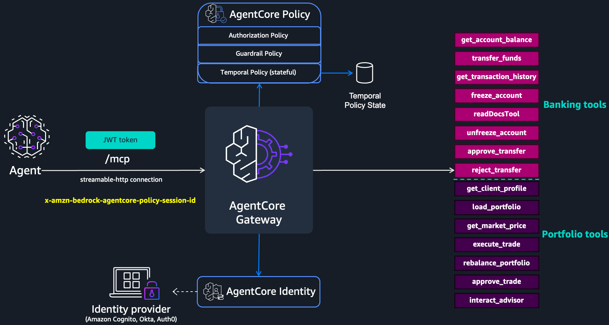

# Banking Assistant: learn temporal policies with simulated tools

What should an agent be allowed to do **after** it has looked up an account,
requested approval, or used an old market quote?

This lab puts 14 simulated banking and portfolio tools behind an AgentCore
Gateway. You add temporal policies, then compare allowed and denied sequences
in a small chat UI. The exercise is about enforcing a workflow at the gateway,
not trusting the agent's prompt to enforce it.



## Start with one transfer

After deploying the lab and adding the first transfer policy:

1. In a fresh session, ask for a transfer to `ACC-2002` without a destination
   lookup. The intended policy result is **DENY**.
2. Look up the balance of `ACC-2002`, then request a small transfer to it within
   two minutes. The intended policy result is **ALLOW**.
3. Switch to a new session and repeat the transfer without a lookup. History
   from the earlier session must not satisfy the prerequisite.

A policy ALLOW is not a successful transfer: the tool can still reject frozen
accounts, invalid quantities, or insufficient funds. Inspect both the gateway
policy decision and the tool result.

Ready to try it? Follow the **[deployment and policy guide](DEPLOYMENT.md)**.
It contains the complete setup, policy statements, expected sequences, and cleanup.

## What you will build

| Component                                | Responsibility                                                              |
| ---------------------------------------- | --------------------------------------------------------------------------- |
| React UI and Node backend                | Keep chat sessions, call Bedrock, and send MCP requests through the gateway |
| AgentCore Gateway and policy engine      | Authenticate inbound calls and evaluate temporal rules                      |
| AgentCore Runtime                        | Serve the FastMCP banking and portfolio tools                               |
| Cognito and an OAuth credential provider | Supply the lab's gateway and Runtime authentication                         |

The first exercise covers lookup-before-transfer and freshness. Continue with
one-use approvals, cumulative limits, mutually exclusive actions, portfolio
sequencing, and advisor-engagement windows. All 12 policy statements remain in
the [full workshop](DEPLOYMENT.md#step-5-add-temporal-policies-banking-tools).

## Prerequisites

- Python 3.13, `uv`, and Node.js 24 LTS with npm.
- A fresh checkout and a sandbox AWS identity with the permissions needed by
  the [deployment guide](DEPLOYMENT.md#prerequisites), including model access.
- Unique resource names, an explicit account and region, and a plan for AWS
  charges and cleanup.

Run commands from this `bankingassistant/` directory. Install the local CLI:

```bash
npm ci
npm run --silent agentcore -- --version
```

The root lock pins AgentCore CLI 1.2.0; the CDK project separately pins its
library and executable. Use `npm run --silent agentcore -- <command>` so the
small launcher applies this sample's private CLI preferences. It permits the
newer, explicitly locked CDK pair and skips account-wide transaction-search
setup without changing your global CLI preferences. Keep these locks and
validate them together when upgrading.

The launcher references your existing AWS configuration and credential files;
it does not copy credentials. Its CLI HOME is `.sample-cli-home/`. If your auth
flow uses a HOME-relative cache (for example SSO), authenticate in that private
environment as described in the [guide](DEPLOYMENT.md#prerequisites).

## Deploy, explore, clean up

Use the guide in this order; do not run a later step after an earlier failure.

1. [Create the dedicated Cognito resources](DEPLOYMENT.md#step-1-amazon-cognito-setup).
2. [Register and build the MCP Runtime](DEPLOYMENT.md#step-2-deploy-the-mcp-server-to-agentcore-runtime).
   Reserve an owned OAuth provider before allowing the CLI to provision it.
3. [Create the gateway, engine, and base permits](DEPLOYMENT.md#step-3-create-the-gateway-policy-engine-and-mcp-server-target).
   Verify gateway `ENFORCE` and policy `ACTIVE` enforcement—not just readiness.
4. [Start the UI](DEPLOYMENT.md#step-4-start-the-web-app) and try the first transfer
   exercise before proceeding to the rest of the policies.
5. [Clean up owned resources](DEPLOYMENT.md#cleanup) and verify their absence.

Keep the local ownership records through failures and cleanup. An access error
is not proof that a resource is absent. This sample does not adopt an existing
v0 deployment or recover ownership by guessing names.

## Check locally

Start with dependency installation and the in-process tool checks:

```bash
uv sync --project app/banking_assistant_tools --frozen
uv run --project app/banking_assistant_tools --frozen \
  python -m unittest discover -s tests -p test_tools.py -v
npm ci --prefix agentcore/cdk
npm test --prefix agentcore/cdk
npm ci --prefix client
npm run build --prefix client
```

The [control SDK/model preflight](DEPLOYMENT.md#control-sdkmodel-preflight-before-creating-anything)
and regression instructions cover policy serialization, model shadowing,
ownership, retries, and cleanup failures. The real CodeZip/IAM test is opt-in;
its skip is **not** a packaging pass. A built ARM64 ZIP is not ARM64 execution,
and neither local tests nor a mock UI prove live policy enforcement.

## Lab boundaries

- **No real money or banking records.** Data is simulated, in memory, and not a
  tenant-isolated datastore. Use synthetic inputs only.
- **Approvals are simulated records.** Supplied approver names are not proof of
  authenticated human approval. The signed trade-cost field is an intentional
  policy-test input, not a trustworthy financial valuation.
- **The gateway is the enforcement path.** Direct Runtime access bypasses its
  policies. Do not give the conversational agent the Runtime client credential.
- **The UI is for local development.** Do not expose it as a production service.
  Review identity, authorization, data isolation, and resource limits separately
  for a real application.
- **Fresh deployment only.** Preserve an existing deployment's configuration and
  state for a separately reviewed migration; do not overwrite or silently reuse it.

Review current dependency advisories and the PR's testing evidence before use.
This workshop demonstrates specific controls; it is not a production-security
certification.
