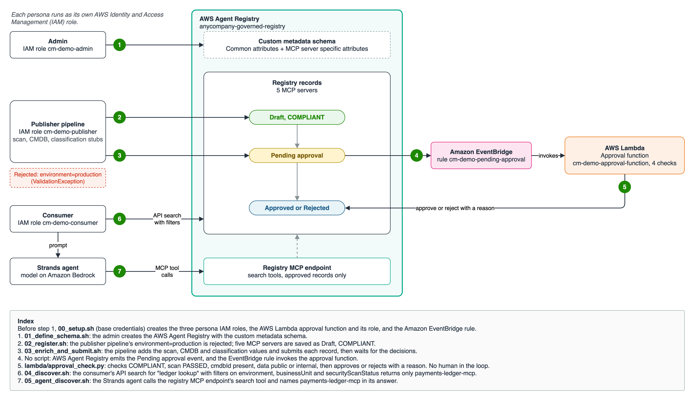

# Govern and discover MCP servers with custom metadata in AWS Agent Registry

> [!CAUTION]
> The examples provided in this repository are for experimental and educational purposes only. They demonstrate concepts and techniques but are not intended for direct use in production environments.

## Overview

[Custom metadata](https://docs.aws.amazon.com/bedrock-agentcore/latest/devguide/registry-custom-metadata-schema.html) lets a registry administrator define the fields every record in an AWS Agent Registry must carry, such as an environment, an owning business unit, a data classification or a security scan result. The administrator sets the field names, types (Text, Enum, URL, Boolean), allowed values and required fields once on the registry. The registry then validates every record against that schema:

- A value outside an Enum, an unknown field, or a missing required field is rejected with a `ValidationException`.
- A record created with no custom metadata is saved as `NON_COMPLIANT` and can't be submitted for approval.
- Approval logic reads the values on the record, and consumers [filter search results](https://docs.aws.amazon.com/bedrock-agentcore/latest/devguide/registry-search-records.html) on them.

This sample registers five MCP servers against one schema. An AWS Lambda function approves or rejects each one from its custom metadata, with no human in the loop. A consumer then finds the right server two ways: an API search with metadata filters, and a Strands agent that searches through the registry's MCP endpoint. Each persona runs as its own IAM role.



### How it works

1. **Admin** creates `anycompany-governed-registry` with a custom metadata schema and manual approval.
2. **Publisher pipeline** registers the MCP servers. `environment=production` is rejected; the five records with valid values are saved as `COMPLIANT` drafts.
3. **Publisher pipeline** reads each record, adds the scan result, CMDB ID and data classification, writes the full map back, and submits the record for approval.
4. **Approval function** (AWS Lambda) receives the [pending-approval event](https://docs.aws.amazon.com/bedrock-agentcore/latest/devguide/registry-notifications-approvals.html) from an Amazon EventBridge rule and checks four values: `COMPLIANT`, scan `PASSED`, `cmdbId` present, data `public` or `internal`. It approves or rejects the record with a reason that names the values. Nobody approves by hand.
5. **Consumer** searches "ledger lookup" through the API, filtered on `environment`, `businessUnit` and `securityScanStatus`. Then a Strands agent gets the same request in plain language, connects to the [registry MCP endpoint](https://docs.aws.amazon.com/bedrock-agentcore/latest/devguide/registry-mcp-endpoint.html) and picks its own search calls and filters. Only approved records are returned. Any MCP client, such as Kiro, can point at the same endpoint.

### Custom metadata schema

| Field | Type and values | Required |
|:---|:---|:---|
| `environment` | Enum: `prod`, `staging`, `dev` | yes |
| `businessUnit` | Text | yes |
| `securityScanStatus` | Enum: `PENDING`, `PASSED`, `FAILED` | yes |
| `ownerTeam` | Text | no |
| `cmdbId` | Text | no |
| `dataClassification` | Enum: `public`, `internal`, `confidential`, `restricted` | no |
| `securityScanReportUrl` | URL | no |
| `networkEgress` (MCP server records only) | Enum: `none`, `vpc-only`, `allowlisted-internet` | no |

### Personas

| Persona | IAM role | Can | Cannot |
|:---|:---|:---|:---|
| Admin | `cm-demo-admin` | Create, update and delete the registry and its schema | Write records, approve |
| Publisher pipeline | `cm-demo-publisher` | Create, update and submit records | Approve, change the schema |
| Approval function (AWS Lambda) | `cm-demo-approval-function` | Read records, approve or reject | Edit custom metadata, so it can't change the evidence it judges |
| Consumer and agent | `cm-demo-consumer` | Search approved records through the API or the registry MCP endpoint, invoke the Amazon Bedrock model | See unapproved records, write anything |

### Records

| Record | `environment` | `businessUnit` | Scan | `dataClassification` | Decision and reason |
|:---|:---|:---|:---|:---|:---|
| `payments-ledger-mcp` | `prod` | `payments` | `PASSED` | `internal` | Approved: `prod, payments, internal data, CMDB CI-20417, scan PASSED` |
| `payments-ledger-sandbox-mcp` | `dev` | `payments` | `PASSED` | `internal` | Approved; the `environment=prod` filter leaves it out |
| `marketing-analytics-mcp` | `prod` | `marketing` | `PASSED` | `internal` | Approved; a different business unit |
| `refunds-mcp` | `prod` | `payments` | `FAILED` | `internal` | Rejected: `Automated check failed: securityScanStatus=FAILED` |
| `customer-pii-mcp` | `prod` | `payments` | `PASSED` | `restricted` | Rejected: `Automated check failed: dataClassification=restricted (needs manual review)` |

Only `payments-ledger-mcp` passes the approval checks and the consumer's filters.

## Tutorial Details

| Information | Details |
|:---|:---|
| Tutorial type | Step by step scripts |
| AgentCore components | AWS Agent Registry |
| Agentic framework | Strands Agents |
| LLM model | `us.anthropic.claude-sonnet-5-5` on Amazon Bedrock |
| Record types | MCP |
| Approval mode | Manual (`autoApprovalRules: []`), decided by AWS Lambda |
| Tutorial components | AWS Agent Registry, Amazon EventBridge, AWS Lambda, Amazon Bedrock, Strands Agents, AWS IAM |
| Example complexity | Beginner to intermediate |
| SDK used | boto3, Strands Agents, mcp-proxy-for-aws |

## Prerequisites

- Python 3.11 or later
- AWS credentials (default profile) with these permissions:

  | Service | Permissions |
  |:---|:---|
  | AWS Agent Registry | `ListRegistries`, `GetRegistry`, `DeleteRegistry`, `ListRegistryRecords`, `GetRegistryRecord`, `DeleteRegistryRecord` (cleanup; the steps run as the persona roles) |
  | AWS IAM | `CreateRole`, `GetRole`, `TagRole`, `UpdateAssumeRolePolicy`, `PutRolePolicy`, `DeleteRolePolicy`, `DeleteRole`, `PassRole` on `cm-demo-approval-function` |
  | AWS STS | `AssumeRole` on the `cm-demo-*` roles, `GetCallerIdentity` |
  | AWS Lambda | `CreateFunction`, `GetFunction`, `UpdateFunctionCode`, `AddPermission`, `DeleteFunction` |
  | Amazon EventBridge | `PutRule`, `PutTargets`, `RemoveTargets`, `DeleteRule` |
  | Amazon CloudWatch Logs | `DeleteLogGroup` |
  | Amazon Bedrock | `InvokeModel` (`00_setup.sh` checks that the model responds) |

- A Region where [AWS Agent Registry is available](https://docs.aws.amazon.com/bedrock-agentcore/latest/devguide/agentcore-regions.html). The default is `us-east-1`.
- Access to `us.anthropic.claude-sonnet-5-5` enabled in Amazon Bedrock (step 05 uses it; set `MODEL_ID` to use another).

## AWS Resources Created

| Resource | Name | Purpose |
|:---|:---|:---|
| Registry | `anycompany-governed-registry` | Holds the custom metadata schema and the records |
| Registry records | `payments-ledger-mcp`, `payments-ledger-sandbox-mcp`, `marketing-analytics-mcp`, `refunds-mcp`, `customer-pii-mcp` | The MCP servers being governed |
| IAM roles | `cm-demo-admin`, `cm-demo-publisher`, `cm-demo-consumer`, `cm-demo-approval-function` | One per persona, plus the approval function's execution role |
| Lambda function | `cm-demo-approval-function` | Approves or rejects each submitted record (`lambda/approval_check.py`) |
| CloudWatch log group | `/aws/lambda/cm-demo-approval-function` | One JSON line per decision |
| EventBridge rule | `cm-demo-pending-approval` | Matches `aws.agent-registry` "Registry Record State changed to Pending Approval" and invokes the function |

`00_setup.sh` bundles boto3 into the function's .zip because the Lambda runtime's built-in boto3 doesn't include AWS Agent Registry yet. `99_cleanup.sh` deletes all of these resources.

## Usage

```bash
./setup.sh                  # once: .venv with boto3, Strands Agents and mcp-proxy-for-aws
./00_setup.sh               # IAM roles, approval function, EventBridge rule, model check
./01_define_schema.sh       # admin: registry with the custom metadata schema
./02_register.sh            # publisher pipeline: one rejected value, then five drafts
./03_enrich_and_submit.sh   # publisher pipeline: add evidence, submit, wait for the decisions
./04_discover.sh            # consumer: API search with custom metadata filters
./05_agent_discover.sh      # consumer: Strands agent searches through the registry MCP endpoint
```

Each `.sh` activates `.venv` and runs the matching file in `steps/`, which you can also run directly with `python steps/<file>.py` after `pip install -r requirements.txt`. Set `BASE_PROFILE=<name>`, `REGION=<region>` or `MODEL_ID=<model>` to change the profile, Region or model.

The scanner, CMDB and classification calls in `steps/03_enrich_and_submit.py` are stubs to replace with your own tools.

## Sample prompt and output

Step 05 sends the agent this prompt:

```
Find a production MCP server for payments ledger lookups that passed its security scan.
```

These are the key lines each step prints (IDs omitted). The model picks its own search calls, filters and wording, so your step 05 output can differ.

```
$ ./02_register.sh
ValidationException: Custom metadata validation failed for record type MCP: /environment: does not have a value in the enumeration ["prod", "staging", "dev"]
payments-ledger-mcp: status=DRAFT customMetadataSchemaComplianceStatus=COMPLIANT
...one line for each of the five records

$ ./03_enrich_and_submit.sh
waiting for cm-demo-approval-function to decide
record                       | status   | statusReason
payments-ledger-mcp          | APPROVED | prod, payments, internal data, CMDB CI-20417, scan PASSED
payments-ledger-sandbox-mcp  | APPROVED | dev, payments, internal data, CMDB CI-20418, scan PASSED
marketing-analytics-mcp      | APPROVED | prod, marketing, internal data, CMDB CI-31502, scan PASSED
refunds-mcp                  | REJECTED | Automated check failed: securityScanStatus=FAILED
customer-pii-mcp             | REJECTED | Automated check failed: dataClassification=restricted (needs manual review)

$ ./04_discover.sh
search 'ledger lookup', no filters (approved records only):
  payments-ledger-mcp: environment=prod, businessUnit=payments, securityScanStatus=PASSED
  payments-ledger-sandbox-mcp: environment=dev, businessUnit=payments, securityScanStatus=PASSED

search 'ledger lookup' where environment=prod AND businessUnit=payments AND securityScanStatus=PASSED:
  payments-ledger-mcp: environment=prod, businessUnit=payments, securityScanStatus=PASSED
excluded by the filter: payments-ledger-sandbox-mcp (environment=dev)

$ ./05_agent_discover.sh
tools: search_discoverable_registry_records, list_discoverable_registry_records, batch_get_discoverable_registry_record
model: us.anthropic.claude-sonnet-5-5
tool call: search_discoverable_registry_records {"searchQuery": "payments ledger lookups", "filter": {"$and": [{"recordType": {"$eq": "MCP"}}, {"customMetadata.environment": {"$eq": "prod"}}, {"customMetadata.securityScanStatus": {"$eq": "PASSED"}}]}}
tool result: 1 records: payments-ledger-mcp (environment=prod, businessUnit=payments, securityScanStatus=PASSED, dataClassification=internal)
tool call: search_discoverable_registry_records {"searchQuery": "payments ledger lookups"}
tool result: 2 records: payments-ledger-mcp (environment=prod, businessUnit=payments, securityScanStatus=PASSED, dataClassification=internal); payments-ledger-sandbox-mcp (environment=dev, businessUnit=payments, securityScanStatus=PASSED, dataClassification=internal)

answer:
**Match: `payments-ledger-mcp`** (version 1.0.0, status APPROVED)
- **Description:** Read-only MCP server for payments ledger lookups.
...
**Near miss (found by searching without the filter):**
- `payments-ledger-sandbox-mcp` is ruled out by `environment`, which is `dev` instead of `prod`. ...
```

## Clean up

```bash
./99_cleanup.sh
```

This deletes the five registry records, the registry, the EventBridge rule and its target, the Lambda function and its log group, and the four IAM roles.

## Files

| File | What it does |
|:---|:---|
| `steps/common.py` | Assumes each persona's IAM role, waits for asynchronous state changes, and saves IDs to `.state/state.json` (gitignored) so later steps can read them |
| `steps/00_setup.py` | Creates the three persona roles, the approval function and its role, and the EventBridge rule; checks the Amazon Bedrock model |
| `steps/01_define_schema.py` | Admin: creates the registry with the custom metadata schema |
| `steps/02_register.py` | Publisher pipeline: shows a rejected value, then registers five records |
| `steps/03_enrich_and_submit.py` | Publisher pipeline: adds scan, CMDB and classification values, submits, and prints the approval function's decisions |
| `lambda/approval_check.py` | Approval function: runs the four checks and approves or rejects with a reason |
| `steps/04_discover.py` | Consumer: API search with custom metadata filters, and the records the filters exclude |
| `steps/05_agent_discover.py` | Consumer: Strands agent that searches through the registry MCP endpoint and prints each tool call and the answer |
| `steps/99_cleanup.py` | Deletes everything the sample created |

## Documentation

- [Define a custom metadata schema](https://docs.aws.amazon.com/bedrock-agentcore/latest/devguide/registry-custom-metadata-schema.html)
- [Set custom metadata values on a record](https://docs.aws.amazon.com/bedrock-agentcore/latest/devguide/registry-custom-metadata-values.html)
- [Search for registry records](https://docs.aws.amazon.com/bedrock-agentcore/latest/devguide/registry-search-records.html)
- [Notifications for pending approvals](https://docs.aws.amazon.com/bedrock-agentcore/latest/devguide/registry-notifications-approvals.html)
- [Using the Registry MCP endpoint](https://docs.aws.amazon.com/bedrock-agentcore/latest/devguide/registry-mcp-endpoint.html)
- [AWS Agent Registry Developer Guide](https://docs.aws.amazon.com/bedrock-agentcore/latest/devguide/registry.html)
