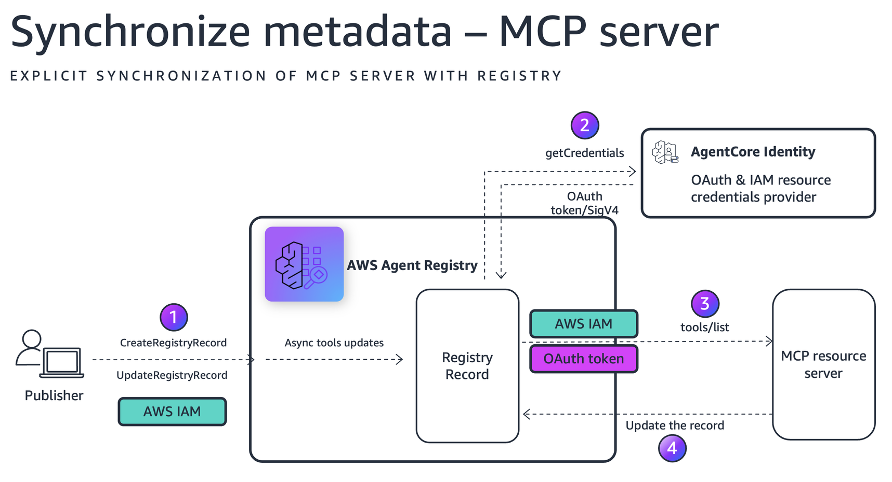

# Synchronize an MCP server's metadata to AWS Agent Registry

Create one **draft** MCP record by URL. Registry connects to the endpoint and extracts its descriptor; you don't have to maintain a duplicate tool schema. The example stops at DRAFT. It does not approve records, invoke tools, deploy a Runtime, or create an identity provider.



## Prepare

Use Python 3.12+, short-lived AWS credentials, and an existing **READY sandbox registry with no automatic approval rules**. For registry administration, see [the separate setup and governance tutorial](../../01-registry-end-to-end/). This example uses boto3's `agent-registry-control` client, not preview APIs. Before attempting to use old preview records, consult the [namespace migration guide](../../04-migrate-to-new-namespace/).

From the sample directory, set `AWS_PROFILE`, `AWS_DEFAULT_REGION` and `REGISTRY_ID`, then verify the account with `aws sts get-caller-identity`. Ask the registry owner for permission to get this registry and create/get/delete **your sample record**. You do not need to create IAM roles, Cognito identities, ECR repositories or AgentCore Runtimes. Work in a new private directory per record:

```bash
set -euo pipefail
sample=$PWD
cd "$(mktemp -d)"; pwd  # retain this path until cleanup succeeds
python3 -m venv .venv
.venv/bin/python -m pip install -r "$sample/requirements.txt"
```

## Choose one source

**Public server (simplest):** synchronize the AWS Knowledge MCP server. There are no outbound credentials.

```bash
.venv/bin/python "$sample/registry_synchronize_mcpserver.py" sync --registry-id "$REGISTRY_ID" --mode public
```

**IAM-protected server:** use an existing MCP Runtime in your account and Region. `INVOKE_ROLE_ARN` is an owner-approved role trusted by **`agent-registry.amazonaws.com`**, limited to invoking that Runtime. It is not the Runtime's execution role. See the [Registry synchronization role guidance](../../04-migrate-to-new-namespace/docs/iam.md#synchronized-records-update-the-roles-trust-policy). The script does not modify the role or assume it locally.

```bash
.venv/bin/python "$sample/registry_synchronize_mcpserver.py" sync --registry-id "$REGISTRY_ID" \
  --mode iam --runtime-arn "$RUNTIME_ARN" --role-arn "$INVOKE_ROLE_ARN"
```

**OAuth-protected server:** use an existing JWT-protected MCP Runtime, an authorized AgentCore Identity OAuth provider for its issuer, and a client-credentials scope accepted by that Runtime. The owner must authorize Registry to use the provider. Pass its ARN, **not** a token or client secret. Each `--scope` supplies one scope. Use only those needed for tool discovery.

```bash
.venv/bin/python "$sample/registry_synchronize_mcpserver.py" sync --registry-id "$REGISTRY_ID" \
  --mode oauth --runtime-arn "$RUNTIME_ARN" --provider-arn "$PROVIDER_ARN" --scope mcp-server/invoke
```

All three paths print the new record ARN after Registry returns DRAFT with descriptor data. Inspect the record in Registry; a published or approved record is **not** created by this tutorial. A timeout or authorization failure is not a successful sync. Retry `status` from the same directory after fixing the source, or clean up.

## Cleanup

```bash
.venv/bin/python "$sample/registry_synchronize_mcpserver.py" cleanup
```

Keep `registry-sync-receipt.json` private and use the original account. The script acts only on the returned record ID/ARN and will not delete pending or promoted records. It never enumerates or deletes other records, the registry, or the source resources. Don't change or promote the record concurrently. If AWS may have accepted a create but no record ID was received, reconcile its unique name, client token and registry with your operation history; do not fill in an ID by guessing. After an abrupt interruption, remove the local `.lock` only after verifying no operation is active. Older Toolkit deployments must be reconciled separately using their original identifiers.
