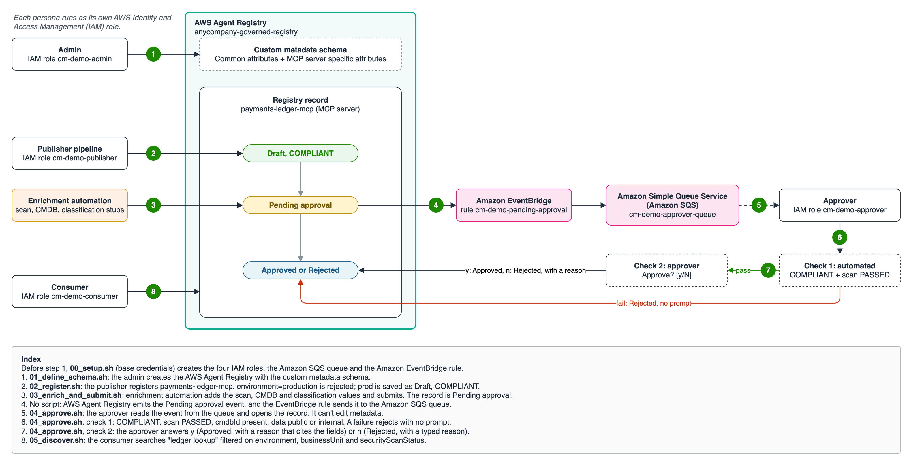

# Govern and discover MCP servers with custom metadata in AWS Agent Registry

> [!CAUTION]
> The examples provided in this repository are for experimental and educational purposes only. They demonstrate concepts and techniques but are not intended for direct use in production environments.

## Overview

[Custom metadata](https://docs.aws.amazon.com/bedrock-agentcore/latest/devguide/registry-custom-metadata-schema.html) lets a registry administrator define the fields every record in an AWS Agent Registry must carry, such as an environment, an owning business unit, a data classification or a security scan result. The administrator sets the field names, types (Text, Enum, URL, Boolean), allowed values and required fields once on the registry. The registry then validates every record against that schema:

- A value outside an Enum, an unknown field, or a missing required field is rejected with a `ValidationException`.
- A record created with no custom metadata is saved as `NON_COMPLIANT` and can't be submitted for approval.
- Approvers read the values on the record, and consumers [filter search results](https://docs.aws.amazon.com/bedrock-agentcore/latest/devguide/registry-search-records.html) on them.

This sample follows one MCP server, `payments-ledger-mcp`, from schema definition to filtered discovery, with each persona running as its own IAM role.



### How it works

1. **Admin** creates `anycompany-governed-registry` with a custom metadata schema and manual approval.
2. **Publisher** registers `payments-ledger-mcp`. `environment=production` is rejected; `prod` is accepted as a `COMPLIANT` draft.
3. **Enrichment automation** reads the record, adds the scan result, CMDB ID and data classification, writes the full map back, and submits the record for approval.
4. **Approver** receives the [pending-approval event](https://docs.aws.amazon.com/bedrock-agentcore/latest/devguide/registry-notifications-approvals.html) through Amazon EventBridge and Amazon SQS, then runs two checks: an automated check (`COMPLIANT`, scan `PASSED`, `cmdbId` present, data `public` or `internal`), then a yes/no prompt. A failed automated check rejects the record without asking.
5. **Consumer** searches "ledger lookup" filtered on `environment`, `businessUnit` and `securityScanStatus`. Only approved records are returned.

### Custom metadata schema

| Field | Type and values | Required |
|:---|:---|:---|
| `environment` | Enum: `prod`, `staging`, `dev` | yes |
| `businessUnit` | Text | yes |
| `securityScanStatus` | Enum: `PENDING`, `PASSED`, `FAILED` | yes |
| `ownerTeam` | Text | no |
| `cmdbId` | Text | no |
| `dataClassification` | Enum: `public`, `internal`, `confidential`, `restricted` | no |
| `securityScanReportUrl` | URL | no |
| `networkEgress` (MCP server records only) | Enum: `none`, `vpc-only`, `allowlisted-internet` | no |

### Personas

| Persona | IAM role | Can | Cannot |
|:---|:---|:---|:---|
| Admin | `cm-demo-admin` | Create, update and delete the registry and its schema | Write records, approve |
| Publisher and its pipeline automation | `cm-demo-publisher` | Create, update and submit records | Approve, change the schema |
| Approver | `cm-demo-approver` | Read records, approve or reject, read the approver queue | Edit custom metadata (step 4 shows the `AccessDeniedException`) |
| Consumer | `cm-demo-consumer` | Search approved records | See unapproved records, write anything |

## Tutorial Details

| Information | Details |
|:---|:---|
| Tutorial type | Step by step scripts |
| AgentCore components | AWS Agent Registry |
| Record types | MCP |
| Approval mode | Manual (`autoApprovalRules: []`) |
| Tutorial components | AWS Agent Registry, Amazon EventBridge, Amazon SQS, AWS IAM |
| Example complexity | Beginner to intermediate |
| SDK used | boto3 |

## Prerequisites

- Python 3.11 or later
- AWS credentials (default profile) that can create IAM roles and call AWS Agent Registry, Amazon SQS and Amazon EventBridge:

  | Service | Permissions |
  |:---|:---|
  | AWS Agent Registry | `agent-registry:*` on the sample's registry (the persona roles get narrower policies) |
  | AWS IAM | `CreateRole`, `TagRole`, `UpdateAssumeRolePolicy`, `PutRolePolicy`, `DeleteRolePolicy`, `DeleteRole` |
  | AWS STS | `AssumeRole` on the `cm-demo-*` roles, `GetCallerIdentity` |
  | Amazon SQS | `CreateQueue`, `GetQueueUrl`, `GetQueueAttributes`, `SetQueueAttributes`, `DeleteQueue` |
  | Amazon EventBridge | `PutRule`, `PutTargets`, `RemoveTargets`, `DeleteRule` |

- A Region where [AWS Agent Registry is available](https://docs.aws.amazon.com/bedrock-agentcore/latest/devguide/agentcore-regions.html). The default is `us-east-1`.

## AWS Resources Created

| Resource | Name | Purpose |
|:---|:---|:---|
| Registry | `anycompany-governed-registry` | Holds the custom metadata schema and the record |
| Registry record | `payments-ledger-mcp` | The MCP server being governed |
| IAM roles | `cm-demo-admin`, `cm-demo-publisher`, `cm-demo-approver`, `cm-demo-consumer` | One per persona |
| EventBridge rule | `cm-demo-pending-approval` | Matches `aws.agent-registry` "Registry Record State changed to Pending Approval" |
| SQS queue | `cm-demo-approver-queue` | The approver's inbox for pending-approval events |

`99_cleanup.sh` deletes all of them.

## Usage

```bash
./setup.sh                  # once: .venv with boto3 from requirements.txt
./00_setup.sh               # IAM roles, SQS queue, EventBridge rule
./01_define_schema.sh       # admin: registry with the custom metadata schema
./02_register.sh            # publisher: rejected, then accepted
./03_enrich_and_submit.sh   # automation: add evidence, submit for approval
./04_approve.sh             # approver: automated check, then asks y/N
./05_discover.sh            # consumer: filtered search
```

Each `.sh` activates `.venv` and runs the matching file in `steps/`, which you can also run directly with `python steps/<file>.py` after `pip install -r requirements.txt`. To see the automated rejection, run `./03_enrich_and_submit.sh --fail-scan`. `./04_approve.sh --yes` or `--no` answers the prompt without asking. Set `BASE_PROFILE=<name>` or `REGION=<region>` to change the profile or Region.

The scanner, CMDB and classification calls in `steps/03_enrich_and_submit.py` are stubs to replace with your own tools.

## Sample output

This sample has no agent, so there are no prompts. These are the key lines each step prints (IDs omitted):

```
02_register  ValidationException: Custom metadata validation failed for record type MCP: /environment:
             does not have a value in the enumeration ["prod", "staging", "dev"]
             payments-ledger-mcp: status=DRAFT customMetadataSchemaComplianceStatus=COMPLIANT
03_enrich    payments-ledger-mcp: status=PENDING_APPROVAL customMetadataSchemaComplianceStatus=COMPLIANT
04_approve   AccessDeniedException: the approver can't edit metadata, only approve or reject
             PASS  securityScanStatus=PASSED   PASS  cmdbId=CI-20417   ...
             Approve payments-ledger-mcp? [y/N] y
             payments-ledger-mcp: status=APPROVED statusReason='prod, payments, internal data, CMDB CI-20417, scan PASSED'
05_discover  payments-ledger-mcp (MCP): environment=prod, businessUnit=payments, ..., securityScanStatus=PASSED
```

## Clean up

```bash
./99_cleanup.sh
```

This deletes the registry record, the registry, the EventBridge rule, the SQS queue and the four IAM roles. If you run `00_setup.sh` again within a minute, it waits 60 seconds, because SQS won't reuse a deleted queue name sooner.

## Files

| File | What it does |
|:---|:---|
| `steps/common.py` | Assumes each persona's IAM role, waits for asynchronous state changes, and saves IDs to `.state/state.json` (gitignored) so later steps can read them |
| `steps/00_setup.py` | Creates the four persona roles, the SQS queue and the EventBridge rule |
| `steps/01_define_schema.py` | Admin: creates the registry with the custom metadata schema |
| `steps/02_register.py` | Publisher: shows a rejected value, then registers the record |
| `steps/03_enrich_and_submit.py` | Automation: adds scan, CMDB and classification values, then submits |
| `steps/04_approve.py` | Approver: reads the SQS event, runs the automated check, then asks y/N |
| `steps/05_discover.py` | Consumer: searches with custom metadata filters |
| `steps/99_cleanup.py` | Deletes everything the sample created |
| `images/flow.drawio` | Source of the diagram above |

## Documentation

- [Define a custom metadata schema](https://docs.aws.amazon.com/bedrock-agentcore/latest/devguide/registry-custom-metadata-schema.html)
- [Set custom metadata values on a record](https://docs.aws.amazon.com/bedrock-agentcore/latest/devguide/registry-custom-metadata-values.html)
- [Search for registry records](https://docs.aws.amazon.com/bedrock-agentcore/latest/devguide/registry-search-records.html)
- [Notifications for pending approvals](https://docs.aws.amazon.com/bedrock-agentcore/latest/devguide/registry-notifications-approvals.html)
- [AWS Agent Registry Developer Guide](https://docs.aws.amazon.com/bedrock-agentcore/latest/devguide/registry.html)
