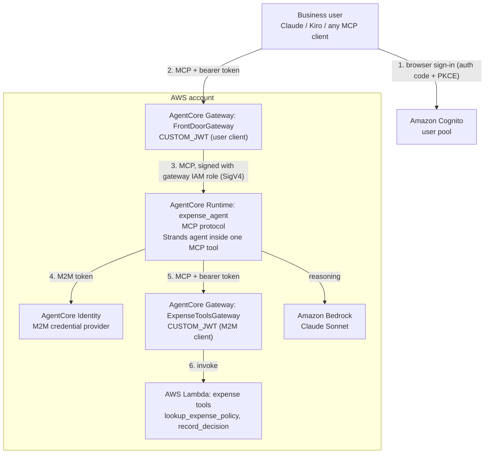

# Agent as an MCP Server

## Introduction

This sample shows how to host a full reasoning agent on Amazon Bedrock AgentCore Runtime and expose it to any MCP client (Claude, Kiro, Claude Code, Amazon Quick, ...) as an ordinary MCP tool.

The MCP client sees one tool, `process_expense_report`. Inside that tool handler, a [Strands](https://strandsagents.com) agent runs a multi-step workflow on Amazon Bedrock. It parses a free-text expense report, converts the currency, looks up company policy, decides approve or reject, and records the decision. The client only receives the final plain-language answer. It cannot tell that an agent did the work, and it doesn't need to.

MCP appears on both sides of the agent:

- **Inbound:** the agent runtime is an MCP server, published to users through an AgentCore Gateway with OAuth sign-in.
- **Outbound:** the agent is an MCP client of a second AgentCore Gateway, where its business tools (a Lambda) are registered as MCP targets.

Business users connect from their chat client with their normal browser sign-in. They need no AWS credentials.

| | |
|---|---|
| Vertical | Finance / back office (expense approval) |
| Complexity | Intermediate |
| AgentCore features | Runtime (MCP protocol), Gateway (two: Lambda target and runtime target), Identity (OAuth credential provider), Observability |
| Agent framework | Strands Agents |
| Deploy | AgentCore CLI + CDK, one command |

## Architecture



| Hop | Authentication |
|---|---|
| User → FrontDoorGateway | OAuth authorization code + PKCE against Cognito. Public client, no secret. |
| FrontDoorGateway → Runtime | The gateway's IAM role signs requests (SigV4). Nothing leaves AWS. |
| Runtime → ExpenseToolsGateway | OAuth client credentials (M2M). The client secret lives in the AgentCore Identity token vault; the agent fetches tokens with `@requires_access_token`. |
| ExpenseToolsGateway → Lambda | The gateway's IAM role. |

One Cognito user pool backs both gateways. Each gateway's authorizer accepts only its own app client, so a user token can't call the tools gateway directly and bypass the agent.

### Project layout

```
agent-as-mcp-server/
├── deploy.sh / destroy.sh          # one-command deploy and teardown
├── agentcore/
│   ├── agentcore.json              # runtime, credential provider, both gateways
│   └── cdk/lib/cdk-stack.ts        # Lambda, placeholder patching, front-door runtime target
├── app/expense_agent/main.py       # FastMCP server; the Strands agent runs inside the tool
├── lambdas/
│   ├── expense_tools/handler.py    # mock business tools
│   └── schemas/expense_tools.json  # MCP tool schemas for the Lambda target
└── scripts/
    ├── setup_cognito.sh            # user pool, M2M client, user client, demo user
    └── test_frontdoor.py           # end-to-end test as a non-AWS client (OAuth)
```

### Why the front-door target is in CDK

`agentcore.json` declares both gateways, but the front door's target (the runtime as an MCP server, reached with the gateway's IAM role) is added in `cdk-stack.ts` with an L1 `CfnGatewayTarget`. At the time of writing, the AgentCore CLI schema can't express this combination on an MCP gateway: `httpRuntime` and `passthrough` targets require a non-MCP gateway, and `mcpServer` targets don't accept `GATEWAY_IAM_ROLE` outbound auth. The CloudFormation resource supports it. The target needs an `iamCredentialProvider` with `service: bedrock-agentcore`.

## Prerequisites

- An AWS account with access to Claude Sonnet 4.6 on Amazon Bedrock, in a region where AgentCore is available (default `us-east-1`)
- AWS CLI v2, configured with credentials for that account
- Node.js 20 or later
- AgentCore CLI: `npm install -g @aws/agentcore`
- [uv](https://docs.astral.sh/uv/getting-started/installation/) and Python 3.10 or later
- An MCP client. This sample was tested with Claude Desktop and with Kiro.

## Usage

### 1. Deploy

```bash
./deploy.sh us-east-1
```

The script:

1. Creates the Cognito user pool, two app clients, and a demo user (`scripts/setup_cognito.sh`). Values go to `.env`, which is gitignored.
2. Registers the M2M client with AgentCore Identity (`agentcore add credential`).
3. Runs `agentcore deploy`, which creates one CloudFormation stack: Lambda, both gateways, and the runtime.

It prints the front-door URL, the runtime's IAM endpoint, and the demo user name when done. The demo password is in `.env` as `DEMO_PASSWORD`.

### 2. Smoke test as a non-AWS client

```bash
uv run --no-project --with-requirements scripts/requirements.txt python scripts/test_frontdoor.py
```

This signs in as the demo user (authorization code + PKCE), calls the front door over MCP, lists the tool, and runs one expense report through the agent.

### 3. Connect an MCP client

Cognito doesn't support Dynamic Client Registration, so OAuth clients must be given the user client ID (`FRONTDOOR_USER_CLIENT_ID` in `.env`). It's a public client ID, not a secret. If your identity provider supports Dynamic Client Registration, clients only need the URL.

**Claude (custom connector).** In Claude, add a custom connector with the front-door URL. Under advanced settings, enter the user client ID and leave the secret empty. When you connect, Claude opens the Cognito sign-in page; sign in as the demo user. Organization admins can roll the connector out to all users so nobody enters anything.

**Claude Desktop with local servers only, or any stdio-only client.** Use [mcp-remote](https://www.npmjs.com/package/mcp-remote) as a local bridge that performs the OAuth sign-in. In `claude_desktop_config.json`:

```json
{
  "mcpServers": {
    "expense-agent": {
      "command": "npx",
      "args": [
        "-y", "mcp-remote@latest",
        "<FrontDoorMcpUrl>",
        "3334",
        "--static-oauth-client-info", "{\"client_id\":\"<FRONTDOOR_USER_CLIENT_ID>\"}",
        "--static-oauth-client-metadata", "{\"scope\":\"openid email profile agentcore/invoke\"}"
      ]
    }
  }
}
```

Port 3334 matches the `http://localhost:3334/oauth/callback` callback that `setup_cognito.sh` registers. Restart Claude Desktop; a browser tab opens for sign-in.

**Kiro or Claude Code, with AWS credentials (developer path).** Skip OAuth and call the runtime directly with SigV4 through [MCP Proxy for AWS](https://github.com/aws/mcp-proxy-for-aws). Use the `RuntimeMcpEndpoint` stack output:

```json
{
  "mcpServers": {
    "expense-agent-iam": {
      "command": "uvx",
      "args": ["mcp-proxy-for-aws@latest", "<RuntimeMcpEndpoint>"],
      "env": { "AWS_REGION": "us-east-1" }
    }
  }
}
```

### 4. See what happened behind the tool call

- Runtime logs (CloudWatch, log group `/aws/bedrock-agentcore/runtimes/agentAsMcpServer_expense_agent-*`): the tools discovered from the gateway and each tool call the agent made.
- Lambda logs (`AgentCore-agentAsMcpServer-dev-ExpenseToolsLogGroup*`): one `[gateway-invoke]` line per tool call with the arguments the agent chose, and an `[expense-system]` line with the recorded decision.
- Traces: CloudWatch GenAI Observability, AgentCore section.

### Run the agent locally

```bash
cd app/expense_agent
uv sync
uv run python main.py        # http://localhost:8000/mcp
```

Without `AGENTCORE_GATEWAY_URL`, the agent uses in-process mock tools, so you only need Bedrock model access.

## Sample prompts

Type these in your MCP client as plain sentences. You don't name the tool; the client picks it.

| Prompt | Expected result |
|---|---|
| "This is Alex. Team dinner last night with the design team, 60 euros, receipt attached." | Approved: about $65 is under the $75 meals limit and the receipt is present. |
| "This is Kaan. I bought a second monitor for my home office, it was 4000 lira. I lost the receipt." | Rejected: about $96 is under the $200 office limit, but office expenses over $50 need a receipt. |
| "This is Sam. Flight to the Berlin offsite, 420 GBP, receipt attached." | Rejected: about $533 is over the $500 travel limit. |
| "This is Maria. I'm expensing a 15 dollar software subscription for my IDE, receipt attached." | Approved: under the $100 software limit. |

The second prompt is a good test of reasoning: the amount is within the limit, so a correct rejection requires applying the receipt rule.

Include a name. If the report has no employee name, the agent asks for one instead of deciding. Chat clients such as Claude often fill the name in from context when they call the tool.

## Clean up

```bash
./destroy.sh us-east-1
```

This deletes the CloudFormation stack, the AgentCore Identity credential provider, and the Cognito user pool created by the sample, then removes `.env` and the local deployment state. CloudWatch log groups created by the service and the CDK bootstrap stack are left in place.

## Production notes

- **Identity provider:** replace the Cognito demo user with federation to your IdP (Okta, Microsoft Entra ID, ...), and point both `CUSTOM_JWT` authorizers at it.
- **Business tools:** replace the Lambda's mock functions with calls to your systems, or register existing APIs as gateway targets (OpenAPI, Smithy, API Gateway).
- **Network exposure:** the front-door gateway is public and protected by OAuth. If your MCP client calls from a known set of IP addresses, you can also restrict it with AWS WAF.
- **Long-running workflows:** runtime sessions can last up to 8 hours. For workflows longer than a chat turn, expose `start_job` and `get_job_status` tools instead of one blocking tool.
- **Per-user identity:** the front door validates the user's JWT. To make decisions per user (for example, record who submitted the expense), pass identity claims through to the runtime.
