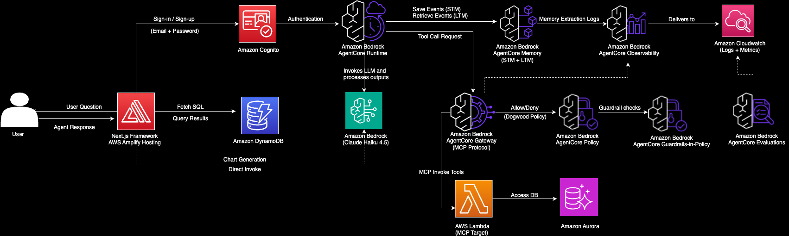

# Data Analyst Conversational Assistant

A full-stack Strands agent for natural-language analysis of the included video-game
sales dataset: PostgreSQL queries, streamed answers, tables/charts, and conversation
memory. Uses AgentCore Runtime, Memory, MCP Gateway, Policy Engine, custom evaluators
and log/trace delivery, with Cognito authentication and an Amplify/Next.js frontend.

**CLI v1 custom port, fresh stacks only.** No existing-stack adoption is supported.
Offline synthesis, dependency/import tests and a frontend production build are not
cloud validation. Cloud deployment, policy enforcement, model calls, evaluations
and cleanup still require the bounded validation in [MIGRATION.md](MIGRATION.md).



## Request path and isolation

1. A signed-in Cognito user receives temporary IAM credentials and a Cognito ID token.
2. The browser invokes Runtime with SigV4 and sends its ID token in the payload.
3. Runtime independently verifies RS256 signature, issuer, audience, expiry and
   `token_use`; the verified `sub`, never an arbitrary payload actor, owns the request.
4. Strands retrieves `/facts/{actorId}` and uses actor-scoped short-term sessions.
5. A SigV4-authenticated MCP connection invokes Gateway's `DatabaseToolsTarget`.
6. Gateway applies its `ENFORCE` policy engine, then Lambda queries Aurora with a
   SELECT-only secret. Runtime itself has no database/Secrets Manager access.
7. A post-Gateway tool hook stores bounded results under `actor#prompt_uuid` in
   DynamoDB. Runtime's authenticated read operations supply tables and Memory facts;
   the browser has **no direct DynamoDB or Memory grants**.
8. The UI uses the returned rows to request chart **data** from the configured
   Bedrock model. It validates a small schema before building application-owned
   ApexCharts options. Supported charts are bar, line, area, pie and donut, with
   decimal, integer, percent or USD formatting (up to 200 categories/8 series).
   Model-supplied JavaScript, arbitrary ApexCharts options and HTML are rejected;
   custom executable formatters are intentionally unsupported.

Use the included public dataset or synthetic inputs. Traces, Memory and evaluation
may contain analysis content; fixed routine log messages are not a guarantee that
telemetry is suitable for confidential data.

The custom stack retains four Cedar/guardrails-in-policy definitions and two LLM
judges (SQL accuracy at TRACE and response quality at SESSION). Regional policy
support and actual enforcement need cloud tests; SQL field checks are defense in
depth, not a substitute for database grants or proof of guardrail enforcement.

## Prerequisites

- Node.js 22+, Python 3.13, npm; frontend pnpm **10.11.0** (a local package-manager
  install is sufficient). CLI **`@aws/agentcore@1.2.0`**, not a global prerelease.
- An ARM64-capable Docker daemon for the Runtime image. Synthesis does not build it.
- For authorized cloud testing only: an approved account/region, existing CDK
  bootstrap, Aurora/RDS prerequisites, Cognito, Bedrock Haiku model access, and
  regional support for Gateway policies and the evaluation APIs. Aurora/NAT incur
  ongoing charges. Never create account-level prerequisites implicitly.

## Offline setup

From this directory:

```bash
npm ci --prefix cdk-data-analyst-assistant-agentcore-strands --ignore-scripts
python3.13 -m venv .venv
.venv/bin/pip install --require-hashes -r \
  cdk-data-analyst-assistant-agentcore-strands/data-analyst-assistant-agentcore-strands/requirements.txt
npm install --prefix .tools --no-save @aws/agentcore@1.2.0
export PATH="$PWD/.tools/node_modules/.bin:$PATH"
export DATA_ANALYST_CLI_HOME=$(mktemp -d)
HOME="$DATA_ANALYST_CLI_HOME" agentcore config disableDependencyManagement true
HOME="$DATA_ANALYST_CLI_HOME" agentcore config transactionSearch false
HOME="$DATA_ANALYST_CLI_HOME" agentcore config telemetry.enabled false
agentcore --version                 # must print 1.2.0
HOME="$DATA_ANALYST_CLI_HOME" agentcore build                    # target-less custom CDK synthesis, not image publication
.venv/bin/python -B -m unittest discover -s tests -v
npm test --prefix agentcore/cdk
(cd amplify-data-analyst-conversational-assistant-agentcore-strands && pnpm install --frozen-lockfile)
node tests/streaming.cjs
```

`agentcore/cdk` is a symlink to the existing custom backend directory. There is
**one stack owner**, not a generated replacement stack. The backend uses npm's
lock; the frontend uses pnpm's lock. `pnpm build` selects Next.js's supported webpack
builder; Turbopack is not the validated production-build path for this sample.
See [MIGRATION.md](MIGRATION.md) for the
ownership boundary and build limitations.

## Fresh deployment — only after cloud approval

Do not run these steps during offline review. Confirm the chosen new stack name
is unused remotely; absence of local state is not evidence that it is unused.

1. **Deploy frontend auth first.** In the frontend directory, install from its
   frozen pnpm lock and run the approved Amplify sandbox workflow. Leave
   `AGENT_RUNTIME_ARN` unset for this first pass: this creates Cognito without a
   wildcard Runtime grant. `amplify_outputs.json` is generated by Amplify, not
   checked-in sample account state.
2. **Configure a unique v1 target** (local file operation):

   ```bash
   python deploy.py --fresh --project-name DataAnalystUnique \
     --account YOUR_12_DIGIT_ACCOUNT --region YOUR_REGION
   export DATA_ANALYST_FRESH_STACK=AgentCore-DataAnalystUnique-dev
   # Read these two non-secret identifiers from amplify_outputs.json:
   export COGNITO_USER_POOL_ID=YOUR_USER_POOL_ID
   export COGNITO_CLIENT_ID=YOUR_USER_POOL_CLIENT_ID
   ```

   The configurator refuses legacy state, a v0 manifest, and non-empty/legacy targets.
   Do not delete state to bypass it. A fresh-port marker admits only this port's
   subsequent v1 stack state, including the CLI's pre-synth empty-credentials state.
3. **Review and deploy the custom stack.** `agentcore build` must succeed with the
   target and Cognito configuration. Inspect the template and ARM64 image. CLI
   1.2.0 supports disabling account-level Transaction Search through its **public
   global configuration**, not a deploy flag. Use a dedicated HOME (never copy
   `.aws`, keychain or other credential stores into it), disable telemetry and
   IMDS, and verify the setting through the public CLI before deployment:

   ```bash
   export DATA_ANALYST_CLI_HOME=$(mktemp -d)
   mkdir -m 700 "$DATA_ANALYST_CLI_HOME/.agentcore"
   printf '%s\n' '{"disableDependencyManagement":true,"transactionSearch":false,"telemetry":{"enabled":false}}' > "$DATA_ANALYST_CLI_HOME/.agentcore/config.json"
   export HOME="$DATA_ANALYST_CLI_HOME"
   export AWS_CONFIG_FILE=/dev/null AWS_SHARED_CREDENTIALS_FILE=/dev/null
   export AWS_EC2_METADATA_DISABLED=true AGENTCORE_DISABLE_KEYCHAIN=1
   export AGENTCORE_TELEMETRY_DISABLED=1
   agentcore --version                       # must be 1.2.0
   agentcore config transactionSearch        # must print false
   # Only the authorized operator supplies short-lived credentials to this process.
   agentcore deploy --target dev --skip-bootstrap
   ```

   Keep that same HOME/config for native deployment; this does not authorize any
   account changes. Alternatively, the custom CDK app can still be used directly
   (`npm run cdk -- deploy "$DATA_ANALYST_FRESH_STACK"` in `agentcore/cdk`). This
   path does not create CLI project deployment state; use service-level CLI
   commands with actual Runtime IDs/ARNs, not invented state. Never bootstrap or
   change IAM account prerequisites merely to get a test through.
4. **Finish frontend binding.** From this directory, run
   `./setup-frontend.sh --stack-name "$DATA_ANALYST_FRESH_STACK" --region YOUR_REGION`.
   It writes `.env.local` from outputs, without installing packages. Export the
   exact `AGENT_RUNTIME_ARN` to the Amplify backend shell and redeploy its sandbox
   to attach the scoped invoke policy. Start `pnpm dev` in the frontend directory.
   No separate database loader scripts are needed: the CDK Provider loads CSV data
   and provisions the read-only user.

Use `agentcore runtime get --id "$RUNTIME_ID" --region "$AWS_REGION"` to inspect
Runtime. For CLI invocation use `agentcore runtime invoke --id "$RUNTIME_ID"
--payload - --region "$AWS_REGION" < request.json`. Keep token-bearing request
files private and delete them after use; the browser supplies the same contract:

```json
{"prompt":"Which genres sell best?","session_id":"UUID","prompt_uuid":"UUID","id_token":"SHORT_LIVED_COGNITO_ID_TOKEN"}
```

Omitting the token, substituting another issuer/client, or spoofing `user_id` fails
before Memory or model access. Use the same session UUID to continue a conversation.

## Evaluations

After a successful bounded query and approved trace ingestion, pass **both actual
custom evaluator ARNs** from stack outputs:

```bash
.venv/bin/python evaluations/evaluate.py --region "$AWS_REGION" \
  --agent-runtime-arn "$AGENT_RUNTIME_ARN" \
  --sql-evaluator-arn "$SQL_EVALUATOR_ARN" \
  --response-evaluator-arn "$RESPONSE_EVALUATOR_ARN" \
  --id-token-file /private/path/cognito-id-token --use-agentcore-evals
```

The harness invokes models and creates a managed dataset; it is not an offline
unit test. Token files must be short-lived and private. Both custom judges are
included in batch and optional session evaluation, alongside the built-ins.
All eight one-turn scenarios and all four evaluators must have complete success
counters; invocation failures or missing coverage fail the run, retaining diagnostics.
A new private `evaluations/eval_results_<run-id>.json` journal records the returned
dataset ID **before** readiness/publication. `--results-file NEW_PATH` chooses an
explicit new journal; existing files are refused. `--keep-dataset` preserves the
exact owned dataset. To retry incomplete cleanup (including a failed publication),
use `python evaluations/evaluate.py --cleanup-results-file EXACT_JOURNAL_PATH`.
Cleanup errors are nonzero, never mistaken for absence or used to hide the original
failure. Recovery never scans or adopts resources by name.

## Cleanup

Keep a ledger of the unique backend stack, Amplify sandbox, evaluation dataset,
log groups, image assets and generated token files. Delete evaluation datasets
first, then only the test Amplify sandbox and the exact custom CDK stack with
`npm run cdk -- destroy "$DATA_ANALYST_FRESH_STACK"`. **Do not use generic
`agentcore remove all`**: the manifest is not the full custom-resource inventory,
and the adapter intentionally rejects deleting its required primitives. Verify
all resources against the ledger, including retained bootstrap image assets;
never delete shared bootstrap resources or reset shared account observability.
See [MIGRATION.md](MIGRATION.md) for negative checks and cleanup verification.
