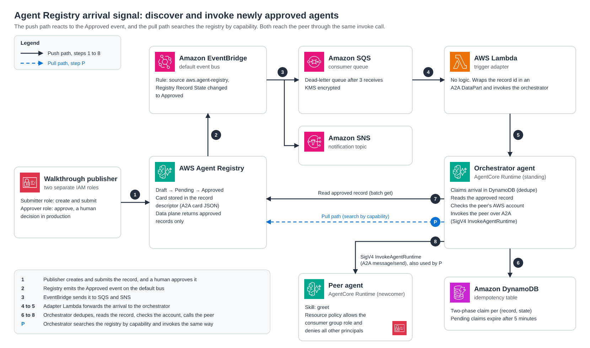

# Agent Registry arrival signal: discover and invoke newly approved agents

## Introduction

This sample shows how a standing orchestrator agent on Amazon Bedrock AgentCore
Runtime finds and calls a peer agent as soon as the peer is approved in AWS
Agent Registry. It demonstrates two discovery paths that share one invoke path:

- **Push.** When a peer's registry record reaches `APPROVED`, Agent Registry
  emits a `Registry Record State changed to Approved` event (source
  `aws.agent-registry`) on the default Amazon EventBridge bus. The event reaches
  the orchestrator through Amazon SQS and a logic-free AWS Lambda adapter. The
  orchestrator reads the approved record, checks the peer's AWS account, and
  calls the peer's `greet` skill over A2A. Nothing polls the registry.
- **Pull.** The orchestrator searches the registry by capability, selects the
  intended peer, and invokes it the same way.

Supported Region: us-east-1. Other Regions where Agent Registry is available
are untested.

> **Important:** This is sample code, for non-production usage. You should work
> with your security and legal teams to meet your organizational security,
> regulatory and compliance requirements before deployment.

The sample favors clarity and least privilege over production hardening. Read
[SECURITY.md](SECURITY.md) before you adapt the auto-invoke pattern, and read
the two gotchas below before you deploy.

## Architecture



1. The walkthrough publisher creates the peer's registry record and submits it
   under a submitter role. A separate approver role approves it. In production,
   approval is a human decision.
2. Agent Registry emits the Approved event on the default EventBridge bus.
3. An EventBridge rule that matches only the Approved transition sends the
   event to an SQS queue and an SNS topic. The queue moves a message to a
   dead-letter queue after three failed receives.
4. The trigger-adapter Lambda reads the queue one message at a time. It holds
   no logic: it wraps the record id and registry id in an A2A DataPart and
   invokes the orchestrator with `InvokeAgentRuntime`.
5. The orchestrator routes the DataPart straight to its event path, without
   involving the model.
6. The event path claims the arrival in a DynamoDB idempotency table keyed on
   (record id, state), so a redelivered event does not invoke the peer twice.
   EventBridge and SQS deliver at least once, and an adapter timeout or a
   failure after the peer call causes SQS to retry. The claim is marked
   complete only after the peer call succeeds. The greet skill is harmless to
   repeat, but the peer skills you adopt may not be, so keep this ledger when
   you adapt the pattern.
7. It reads the approved record from the registry data plane
   (`batch_get_discoverable_registry_record`) and parses the A2A card from
   `descriptors.a2aAgentCard.data`. The data plane returns approved records
   only.
8. It checks that the peer runtime belongs to an allowed AWS account, then
   calls the peer with SigV4 `InvokeAgentRuntime` (an A2A `message/send`). The
   peer's resource-based policy allows the orchestrator's execution role and
   denies every other principal.

On the pull path (P), the orchestrator calls
`search_discoverable_registry_records`, selects the peer by a stable
identifier, and reuses step 8.

## Code map

Code comments refer to the sample's components by these short codes.

| Code | Component | Location |
| --- | --- | --- |
| U0 | SDK reconciliation and verified API helpers (`record_id_from_arn`, `assert_card_access`, `find_record_id_by_name`) | `agent_registry_sample/sdk_reconciliation/` |
| U1 | Event infrastructure (CDK): EventBridge rule, SQS and dead-letter queue, SNS topic, adapter Lambda, DynamoDB table, publisher roles, KMS keys | `agent_registry_sample/infrastructure/`, `app.py` |
| U2 | Orchestrator agent | `agent_registry_sample/orchestrator/`, `orchestrator-host/` |
| U3 | Peer agent | `agent_registry_sample/peer/`, `peer-host/` |
| U4 | Publisher: create, submit, approve | `agent_registry_sample/publisher/` |
| U5 | Push path: arrival routing, dedupe, the shared `verify_and_invoke` helper | `orchestrator/arrival_executor.py`, `orchestrator/event_path.py`, `orchestrator/verify_and_invoke.py`, `infrastructure/adapter_src/` |
| U6 | Pull path: search and invoke | `orchestrator/search_path.py` |
| U7 | Walkthrough and teardown | `agent_registry_sample/walkthrough/` |

The reconciliation module's check ids (for example `R-U0-02`) name its
individual SDK contract checks.

## Prerequisites

- An AWS account with Agent Registry available in us-east-1, and an existing
  registry. The walkthrough does not create one. To create one:

  ```bash
  uv run python -c "import boto3; print(boto3.client('agent-registry-control', region_name='us-east-1').create_registry(name='arrival-signal-sample')['registryArn'])"
  ```

  The registry id is the last segment of the returned ARN.
- **Python 3.12** and [`uv`](https://docs.astral.sh/uv/).
- **Node.js** and the **AWS CDK** CLI (`npm i -g aws-cdk`).
- The **AgentCore CLI**, `@aws/agentcore` (see the first gotcha).
- `boto3 >= 1.43.116`, the first version that ships the `agent-registry` and
  `agent-registry-control` clients. This repo's `uv` lockfile pins it.
- Your AWS account id in both `orchestrator-host/agentcore/aws-targets.json`
  and `peer-host/agentcore/aws-targets.json`. They ship with the
  `000000000000` placeholder.
- `cdk bootstrap aws://<account>/us-east-1`, run once in the target account.
- Credentials for an identity that can deploy CDK stacks and AgentCore
  runtimes, assume the two publisher roles the stack creates, and call Agent
  Registry.

```bash
uv sync
uv run ruff check . && uv run pytest tests/ -q
```

## Gotchas (read before you deploy)

### 1. The `agentcore` CLI shadow

Two different tools are named `agentcore`. This sample requires
**`@aws/agentcore`**, not the legacy Bedrock AgentCore Starter Toolkit. The
Starter Toolkit does not deploy this sample's project shape. Check which one
you have:

```bash
agentcore --version      # @aws/agentcore prints a version (for example 0.31.1)
which -a agentcore       # list every agentcore on your PATH
```

The Starter Toolkit has no `--version` flag. If `agentcore --version` errors or
prints nothing, you are running the Starter Toolkit. Install `@aws/agentcore`
and fix your `PATH` order.

### 2. The generated-manifest `boto3` floor

When you scaffold an agent with `agentcore create`, the generated project
manifest pins an older `boto3` than this sample needs. Raise it to
`>= 1.43.116`, or the registry calls raise `UnknownServiceError` at runtime.
This repo's manifests already carry the higher floor.

## Usage

The walkthrough has a **deploy** phase and a **demo** phase. Deploy captures
every value the demo needs and writes them to a values file, so you supply only
inputs you know before deploying.

```bash
uv run python -m agent_registry_sample.walkthrough.walkthrough run \
  --registry-id  "<your registry id>" \
  --registry-arn "arn:aws:agent-registry:us-east-1:<account>:registry/<id>"
```

| Command | What it does |
| --- | --- |
| `run` | Deploy, then prove both paths. |
| `deploy` | Run the deploy sequence and write the values file (`walkthrough-env.json`). |
| `demo` | Read the values file and prove both paths. Safe to repeat against a standing deploy. |

Other options: `--region`, `--repo-root`, `--orchestrator-project-dir`,
`--peer-project-dir`, `--peer-name`, `--search-query`, `--values-file`, and
`--result-file`. The values file holds only non-secret identifiers (ARNs, URLs,
ids, names) and is gitignored. Running `demo` before `deploy` exits with a
message instead of a traceback.

**What `deploy` does, in order:**

1. Writes the orchestrator's environment variables (`AGENT_REGISTRY_ID`,
   `IDEMPOTENCY_TABLE_NAME`) into `orchestrator-host/agentcore/agentcore.json`,
   runs `agentcore deploy`, and reads the runtime ARN, id, role ARN, invocation
   URL, and log group from `agentcore status --json`. Because this edits a
   tracked file, do not commit the registry-specific values it writes.
2. Runs `cdk deploy` for the event infrastructure, passing the orchestrator
   runtime and registry ARNs as CDK context, and captures the two publisher role
   ARNs from `--outputs-file`.
3. Registers the orchestrator in the registry so it is a standing consumer from
   the start. A re-run reuses the existing record.
4. Runs `agentcore deploy` for the peer and captures its invocation URL and
   runtime ARN.
5. Attaches the resource-based policy to the peer runtime and its DEFAULT
   endpoint. The policy allows the orchestrator's execution role, plus your own
   identity for the local pull demo, and denies all other principals.

**What `demo` does:**

- **Push:** deletes any earlier peer record so the Approved event fires again,
  publishes and approves a fresh record, then reads the orchestrator's log group
  for the `completed` log line.
- **Pull:** runs `search_and_invoke` locally with your credentials. In
  production the pull path runs inside the orchestrator under its execution
  role, and your identity would not be in the peer's policy.

Expected result in `walkthrough-result.json`:

```json
{
  "pushProof": "hello arrival-signal-sample",
  "pushRecordId": "<record id>",
  "pullProof": "hello arrival-signal-sample",
  "bothPathsProven": true
}
```

You can also watch the push path with `agentcore logs` in `orchestrator-host/`.

If a step fails, the walkthrough stops and reports the error. It does not roll
anything back. Fix the cause and run it again: every step is safe to repeat,
and the teardown removes whatever was created.

### Orchestrator discoverability

The orchestrator registers itself so it has a record, but it is not an
intended search target. The pull demo discovers the peer.

## Sample prompts

The sample has no chat interface. Both paths run without a person typing a
prompt, and these are the inputs that drive them.

| Path | Input | Where it comes from | Expected reply |
| --- | --- | --- | --- |
| Push | The Approved event for the peer's record | The demo publishes and approves the record | `hello arrival-signal-sample` in the orchestrator's `completed` log line |
| Pull | Search query `greeter` | `--search-query` on `deploy` or `run` (default `greeter`) | `hello arrival-signal-sample` returned by `search_and_invoke` |

On both paths the orchestrator sends the peer an A2A `message/send` with the
name `arrival-signal-sample`, and the peer's `greet` skill returns
`hello {name}`.

The search query is set at deploy time and saved in the values file, so pass
`--search-query` to `deploy` or `run` to try a different one. If no approved
record matches, the pull path returns no peer instead of raising.
`pullProof` is `null`, `bothPathsProven` is `false`, and the script exits
with code 1.

You can also prompt the peer directly from `peer-host/`, because the deploy
step adds your identity to the peer's resource policy:

```bash
cd peer-host
agentcore invoke --prompt "Michael" --json
```

The peer is backed by a model, so the wording of a direct reply can vary. The
walkthrough checks for a successful response and does not depend on the exact
text of this one.

## Clean up

Teardown is destructive.

```bash
uv run python -m agent_registry_sample.walkthrough.teardown \
  --registry-id "<your registry id>" \
  --record-id   "<peer record id>" \
  --record-id   "<orchestrator record id>" \
  --repo-root . --orchestrator-project-dir orchestrator-host --peer-project-dir peer-host
```

For each record, teardown sets the status to `DEPRECATED` (with a
`statusReason`) and deletes it. It then runs `cdk destroy --all --force` in each
runtime's `agentcore/cdk` directory and `cdk destroy` for the infrastructure
stack. Each step tolerates resources that are already gone, so a re-run
finishes the job. The registry itself is not deleted.

## Layout

```
agent_registry_sample/   # the sample package (see the code map)
orchestrator-host/       # AgentCore CLI project for the orchestrator (U2)
peer-host/               # AgentCore CLI project for the peer (U3)
app.py                   # CDK app for the event infrastructure (U1)
tests/                   # pytest suite
architecture.png
SECURITY.md
```

The AgentCore CLI packages each runtime from its `app/` directory without
building source distributions, so each host project carries a copy of the
package it needs: `orchestrator-host/app/orchestrator/agent_registry_sample/`
(orchestrator, peer, and sdk_reconciliation) and
`peer-host/app/peer/agent_registry_sample/` (peer). After you change
`agent_registry_sample/`, copy the changed subpackages into those directories
before you deploy.
