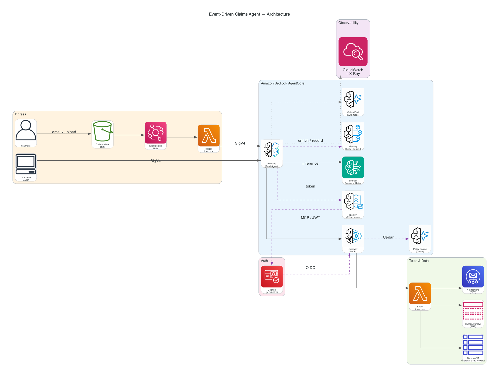

# Event-Driven Claims Processing Agent

An insurance claims workflow on **Amazon Bedrock AgentCore**:

```
S3 claim/email → EventBridge → Trigger Lambda → IAM-authenticated Runtime
  Phase 1: Sonnet + policy lookup → structured ACCEPT/REJECT
  Phase 2: Haiku validator → confidence + routing
  Phase 3: deterministic MCP calls (no third LLM)
    → Cognito M2M Gateway → Cedar ENFORCE → Lambda tools → DynamoDB/SNS/SES
```

The sample preserves Memory (SEMANTIC + SUMMARIZATION, 90 days), online evaluation,
a custom evaluator, six Gateway tools, three tables, an inbox, DLQ and alarm.
It is educational, not a production claims adjudicator. Use synthetic claims:
model traces, Memory and evaluation can contain claim content. Fixed application
status/error messages do not make telemetry safe for confidential submissions.

**CLI 1.2.0 custom v1 port; fresh stacks only.** The custom CDK app is not a
replaceable scaffold. Existing v0 deployments and their bare/shared Cognito
providers are **not adopted**. Use a fresh checkout and unique identity; never
remove old state to bypass a refusal. See [migration boundaries](docs/MIGRATION.md).
Cloud deployment/testing is **NOT RUN** in the offline migration validation.

## Quick start

### Local prerequisites and checks

Start here to try the claims workflow without an AWS account, an email recipient,
Docker, or model calls. The commands below need Node.js 20+, Python 3.12 and uv
0.9.28. Dependency installation needs registry access; the tests run offline.

For deployment, use the [deployment guide](docs/deployment.md) and its pinned
AgentCore CLI **1.2.0**. The lifecycle helper checks provider ownership and CLI
settings for that version; do not bypass its version check. Testing the actual
container also requires Docker or Finch with ARM64 support.

```bash
cd event-driven-claims-agent
npm --prefix agentcore/cdk ci --ignore-scripts
npm --prefix agentcore/cdk run build
(cd app/claimsagent && uv sync --frozen --no-dev --no-install-project --python 3.12)
app/claimsagent/.venv/bin/python tests/run_offline.py
node --require ./tests/offline.cjs tests/test_cdk_wiring.cjs
```

The Python runner blocks sockets and unstubbed AWS calls. Tests use real locked
SDK result mapping, real Cedar WASM and Lambda code with scripted models,
local JWTs and in-memory effects. The CDK test performs a **real schema/construct
synth with real application source assets**, but uses fake account/Identity IDs.
Neither is a cloud-service verification. The Dockerfile uses frozen dependencies,
a digest-pinned Python ARM64 image and a non-root user.

### Prepare an isolated configuration (local only)

```bash
python3 scripts/configure_target.py --account YOUR_12_DIGIT_ACCOUNT \
  --region us-west-2 --suffix YOUR_UNIQUE_8_TO_12_LOWERCASE_ALNUM
```

This creates `Claims<suffix>` / target `dev` and `.claims-v1.json` (an ownership
journal, not a secret store). Every named custom resource and the OAuth provider
is qualified. Old targets, `.cli`, `.env` and Cognito state cause a refusal.
**Notifications default OFF:** the real SNS/SES tools remain, but test mode
suppresses publication/sending and omits their send IAM permissions.

### Cloud deployment and verification

Only after separate authorization, follow [docs/deployment.md](docs/deployment.md).
There are separate, explicit steps for auth setup, deploy, tests and cleanup.
Nothing bootstraps an account, seeds data or sends email automatically. Every
cloud helper requires `--allow-cloud`; that flag is not an authorization grant.

Use `deploy.sh`, not a naked `agentcore deploy`: the wrapper verifies ownership
before CLI 1.2.0 can adopt/update an existing provider by name. Secrets never
enter `.env`, argv, the template or the Runtime environment.

Tests include:
- Runtime JWT/no-auth rejection, Gateway M2M tool discovery and invalid-token
  rejection, and Cognito's separate invalid-scope response;
- direct Gateway calls at $99,999/$100,000 with correlated DynamoDB checks;
- bounded approval/review/rejection Runtime requests and one S3 event using fresh
  policy IDs, not old rows or prose as success evidence.

Cedar matches `AgentCore::Action::"create-claim___create_claim"`. A denial does
not automatically create a review. Phase 3 reports the failure without approving
or notifying against a nonexistent record. Only policy lookup is offered to the
processor; mutating tools are reserved for deterministic execution.

## Cleanup

`destroy.sh --allow-cloud` deletes only the recorded stack and tagged dedicated
auth resources, retaining the journal and CLI state. Failures, retained resources,
uncertain creates, permissions errors, and still-existing Identity secrets stop
cleanup. No regional orphan sweep, forced retain, state erasure or false
“everything deleted” message. See [the cleanup procedure](docs/deployment.md#cleanup).

## Architecture and documentation



- [Architecture](docs/ARCHITECTURE.md) — dual agents, event ingress and auth paths
- [Deployment](docs/deployment.md) — reproducible workflow and bounded cloud plan
- [Configuration](docs/CONFIGURATION.md) — naming, IAM, Memory, policy and notifications
- [Tutorial](docs/tutorial.md) — extending the workflow
- [Decisions](docs/decisions/README.md) — architecture rationale

`agentcore/agentcore.json` owns AgentCore declarations. `agentcore/cdk/lib/` owns
the custom integration, supplementary infrastructure, runtime boundary and
sample-scoped observability. `scripts/lifecycle.py` owns external Cognito/Identity
and journals exact IDs. The historical [demo](docs/demo.gif) shows the original
notification-enabled scenario; it is not evidence of this v1 port or test mode.

To change models, update **both** runtime envVars and `runtime-boundary.ts`.
To add tools, update the schema, Lambda, ARN map and processor allowlist as
appropriate. Keep `ENFORCE`, fail-safe structured routing and the two auth paths.

[Contributing](../../../CONTRIBUTING.md) · [License](../../../LICENSE)
