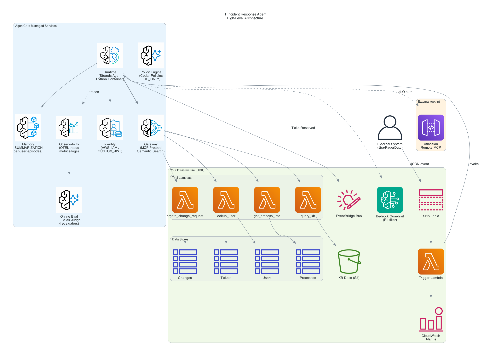

# IT incident response with Amazon Bedrock AgentCore

A synthetic incident arrives through SNS. A container-based Strands agent looks
up the requester and affected service, consults a runbook and past incidents,
records a justified change request, stores a resolution, and emits a
`TicketResolved` event. A later incident can use the earlier session's Memory
summary to recognize recurrence.



This advanced example uses **AgentCore CLI 1.2.0**, custom CDK infrastructure,
Runtime, Gateway, Memory, Identity, observability and four online evaluators.
It is a **fresh-deployment example**, not a v0 upgrade or legacy-stack adoption
workflow. Offline tests are not deployment or security acceptance.

## Before you start

- Use a disposable, explicitly authorized AWS account/region and **synthetic data
  only**. Model, Memory, Knowledge Base, logging and evaluation calls incur costs.
- Use Node.js 24 LTS, AWS CLI v2, uv 0.9.28 and CLI 1.2.0 locally; use Python 3.12 and the committed
  `uv.lock`. The Runtime image must run on **Linux ARM64**. An AMD64 build does
  not establish that gate.
- Have an authorized operator review the template, effective IAM and dependency
  findings. The CDK scaffold retains stack-level cdk-nag waivers; synthesis is
  not a clean security scan or least-privilege acceptance. Do not force-upgrade
  dependencies to make an audit green.
- Have the account owner prepare [Transaction Search](docs/online-evaluation.md).
  Deployment verifies its actual readiness without changing shared settings by
  default. The helper disables the CLI's automatic account-setting mutation.
- Choose a unique project name (at most 24 characters) in
  `agentcore/agentcore.json`. Configure optional authentication **before** deploy.
  Never rename a deployed project or discard its state to retry this example.

## Prepare locally

```bash
npm install --prefix .tools --save-exact @aws/agentcore@1.2.0
export AGENTCORE_CLI="$PWD/.tools/node_modules/.bin/agentcore"
(cd agentcore/cdk && npm ci --ignore-scripts && npm run build)
(cd app/ITIncidentAgent && uv sync --python 3.12 --frozen --no-dev)
app/ITIncidentAgent/.venv/bin/python scripts/package_sdk.py

# Set these to YOUR approved fixture. The project must match agentcore.json.
PROJECT=YourUniqueIT
TARGET=demo
ACCOUNT=111111111111
REGION=us-west-2
python scripts/configure_targets.py --target "$TARGET" --account "$ACCOUNT" --region "$REGION"
BIND=(--project "$PROJECT" --target "$TARGET" --account "$ACCOUNT" --region "$REGION")
```

The scripts require those four explicit values; ambient account/region or stack
name conflicts are rejected. They do not automatically source `.env` files.
See [configuration and commands](docs/commands-reference.md) for optional flags.

## Deploy and follow an incident

Run these commands only after the live prerequisites are approved:

```bash
# Explicitly acknowledge content capture needed by the online evaluators.
# Use only synthetic incidents, profiles, runbooks and (if enabled) Jira issues.
export IT_SAMPLE_EVALUATION_CONTENT=synthetic-only
./scripts/deploy.sh "${BIND[@]}"
./scripts/publish_ticket.sh "${BIND[@]}" --ticket seed-data/sample_ticket.json
./scripts/show_ticket.sh "${BIND[@]}" --ticket-id INC-20260604-001
```

The deploy helper first reserves a **new** CloudFormation stack with CreateStack,
records its StackId, and verifies its identity and owner tags before invoking the
native CLI. It refuses existing/unproven local or remote state. Failed deployment
leaves its reservation and ledger for cleanup; it is not a reason to reset state.

Use a new ticket ID for a new incident; republishing the same ID is a duplicate,
not the cross-session recurrence demonstration.

The agent emits genuine progress stages. `Resolved` requires nonempty output,
successful tool results, EventBridge acceptance and a persisted resolution.
Errors require operator review; a claimed/partially processed incident is not
silently re-run. [Architecture and failure behavior](docs/ARCHITECTURE.md) explains
the boundaries, including non-atomic external side effects.

## Verify the scenario

```bash
./scripts/test-e2e.sh "${BIND[@]}"
```

The full suite submits LOW/HIGH/CRITICAL synthetic incidents, waits for per-session
Memory extraction, and requires correlated tool results, cross-session recall
and all four evaluator outcomes. It retains evidence under `.e2e/` even on
failure. Missing, old, errored or incomplete results fail. `--quick` and
`--no-eval` report **full E2E NOT RUN**, not success. Scores still need review.

## Optional modes

- **Default:** Runtime and Gateway use IAM. No external IdP is needed.
- **Gateway JWT M2M:** [configure the IdP, allowed scopes and runtime token request](docs/custom-jwt-auth-upgrade.md).
  Runtime inbound authentication remains IAM.
- **Jira USER_FEDERATION:** [external secret, consent and tool approval](docs/authentication-guide.md#jira-user_federation).
  Configured Jira requires three approved synthetic issue fixtures for E2E
  (`--jira-events`); it is not silently skipped. No client secret is supplied to
  synthesis. Secret-only rotation uses the
  recorded stack's parameter, not an unrestricted redeployment.
- **Knowledge Base:** created from `kb-docs/` by default. An approved `KB_ID` or
  explicit `SKIP_KB=true` is possible; the full E2E suite still requires query-kb
  and cannot certify a skipped feature.
- **Policy:** both Cedar policies remain **LOG_ONLY**. They do not block actions;
  qualified action/context matching must be reviewed before any enforcement experiment.

## Clean up

```bash
python scripts/lifecycle.py inspect "${BIND[@]}"
./scripts/destroy.sh "${BIND[@]}" --confirm-stack-id '<full recorded StackId>'
```

Deletion verifies caller identity, stack tags and full StackId, inventories
resources, and waits for confirmed deletion. Denial, timeout or failed provider
cleanup is an error. The ledger and CLI state remain. Inspect retained data,
Jira ownership records, CLI-managed credentials, logs and images separately;
**stack deletion is not complete cleanup**. Shared Transaction Search and
bootstrap resources are retained. [Lifecycle details](docs/cli-v1-migration.md).

## Further reading

[Architecture](docs/ARCHITECTURE.md) · [Design decisions](docs/design-decisions.md) ·
[Authentication](docs/authentication-guide.md) · [Evaluation](docs/online-evaluation.md) ·
[Command reference](docs/commands-reference.md) · [CDK](agentcore/cdk/README.md)
