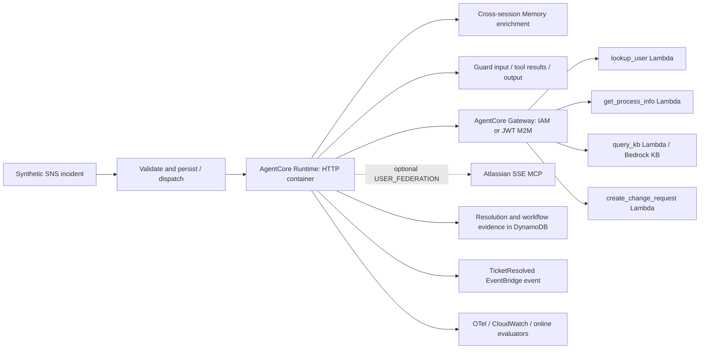

# Architecture and failure behavior

## One incident

The trigger accepts a bounded JSON object with opaque identifiers and
`synthetic: true`. A full incident contains `ticket_id`, `requester_id`, title and
description; Jira mode contains `issue_key` and the configured federation user.
The trigger controls initial status/timestamps rather than accepting those from
the event. It writes before dispatch and uses a stable Runtime session identity.

The Runtime claims an Open record using a conditional update before tool actions.
Repeated delivery cannot claim a Processing/Resolved/Failed incident and repeat
its side effects. A crash after claiming leaves a visible record for operator
review; this is not exactly-once execution or automatic recovery. Jira remains
the issue system of record, with a DynamoDB processing marker for duplicate
control and local evidence.

The agent then:

1. Applies the Guardrail to incident text (failure is closed, not original-text fallback).
2. Retrieves and guards prior incident summaries for the requester.
3. Loads Haiku for LOW priority, Sonnet for MEDIUM/HIGH/CRITICAL.
4. Connects to the internal Gateway and optionally the Jira SSE server.
5. Uses requester/service/runbook tools and records a justified corrective action.
6. Guards the final nonempty resolution, emits an event and persists the result.

There is no successful ticket-mode LLM-only fallback. Tool initialization errors,
missing results, failed tool results, blocked content, EventBridge partial
failures and failed resolution persistence fail the workflow. Raw exceptions and
consent URLs are not returned as incident details. The Runtime emits structured
SSE stage events for genuine phase boundaries; a start event is not tool success.

Tool hooks bind user lookups and change requests to this requester/incident. Jira
calls require reviewed names and explicit issue-key arguments. These application
checks are separate from Cedar: **LOG_ONLY does not enforce a deny policy**.

## Memory is hierarchical, not one shared session

Memory expires events after 30 days and retains SUMMARIZATION at
`incidents/{actorId}/{sessionId}`. Each Runtime invocation has its own session.
Enrichment requests the parent `namespacePath=incidents/<actorId>`, allowing
recall across sessions without switching to a single-session workaround.

The runtime role adds only `RetrieveMemoryRecords` on **this Memory ARN** for
that parent path; generated leaf grants remain. SDK event/record maintenance
permissions are also scoped to this Memory, but are not per-requester tenant
write isolation. Opaque requester validation
rejects namespace separators and email-like identifiers. Retrieval uses the
SDK data-plane operation rather than `retrieve_memories`, whose high-level
implementation can turn service errors into an empty list.

Summary extraction is asynchronous. The DynamoDB GSI is also eventually
consistent and is only an additional recurrence hint, never proof of Memory
recall. The full E2E suite waits for the first run's actual Memory namespace and
requires its records in subsequent workflow evidence.

## Custom infrastructure and ordering

`InfraConstruct` retains user/process/ticket/change tables, source buckets and
seeding, the S3 Vectors Knowledge Base, Guardrail, SNS/trigger/DLQ, EventBridge and
alarms. Vector-bucket and KB names are scoped to the fresh stack rather than a
shared fixed sample name. An explicitly external KB stays externally owned.

The custom stack patches Lambda ARNs in `agentcore.json` **before** constructing
v1 `AgentCoreApplication`, which owns Runtime, Memory, Gateway, policy and eval.
Gateway targets depend on the Gateway role invoke policy. Runtime ARN/invoke
permissions are wired to the trigger. Evaluators depend on bounded Transaction
Search readiness, not simply the presence of a custom resource.

Optional Jira uses an external secret reference/version, a provider lifecycle
Lambda and retained ownership table. The resource checks ARN/creation-time proof;
it does not invent tags in the Get provider response or adopt a name conflict.
Secret-only rotation updates one CloudFormation parameter on the same template.
[Authentication details](authentication-guide.md).

## State, permissions and cleanup

The [fresh lifecycle wrapper](cli-v1-migration.md) binds every mutation to project,
target, account, region and recorded StackId. It reserves only a new stack, then
uses the native CLI/CDK route against that verified reservation. Existing v0
resources and unknown state cannot be imported through this helper.

Runtime additional permissions cover this ticket table/GSI, Guardrail, event bus,
Memory and configured Identity providers/secrets. Unused L3 configuration-bundle
operations and runtime Logs Insights permissions are removed. Some AWS APIs and
the default workload identity directory still need broad resource shapes. Review
the actual synthesized role; nag suppressions are not least-privilege proof.

External actions are **not atomic** with DynamoDB, Memory or EventBridge. An
accepted change/Jira action can precede an error storing/emitting its result.
Investigate a failed incident rather than blindly retrying it. The seeder and
service provisioning can also fail partially; CloudFormation rollback is not a
promise of complete cleanup.

Delete verifies the owner and recorded StackId, preserves inventory/state and
surfaces provider/waiter errors. Retained data, logs/images, Identity credentials,
external Jira secrets and ownership evidence need separate review. Shared
Transaction Search and bootstrap remain untouched on Delete.

## Source map

| Path | Responsibility |
| --- | --- |
| `agentcore/agentcore.json` | v2 project spec, tools, Memory, policy, evaluators |
| `agentcore/cdk/bin/cdk.ts` | single-target custom native CLI/CDK entrypoint |
| `agentcore/cdk/lib/cdk-stack.ts` | AgentCore bindings and custom lifecycle resources |
| `agentcore/cdk/lib/infra-construct.ts` | scenario infrastructure and assets |
| `app/ITIncidentAgent/main.py` | guarded workflow and correlated result evidence |
| `app/ITIncidentAgent/memory/` | session persistence and parent-path enrichment |
| `lambdas/tools/` | actual Gateway tool implementations |
| `lambdas/infra/` | seeding, Jira ownership and Transaction Search readiness |
| `scripts/lifecycle.py` | target-bound operator entrypoints and retained ledger |
| `scripts/test_e2e.py`, `verify_evidence.py` | bounded live collection / pure evidence checks |

[Commands](commands-reference.md) · [Evaluation and privacy](online-evaluation.md)
