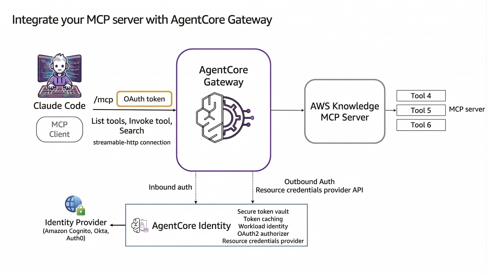

# Use the AWS Knowledge MCP server from Claude Code through AgentCore Gateway

Expose an [AWS Knowledge MCP](https://github.com/awslabs/mcp/tree/main/src/aws-knowledge-mcp-server) target through a dedicated AgentCore Gateway. Claude Code connects to **your Gateway** with a short-lived Cognito access token. The Gateway synchronizes the public server’s tools and enables semantic tool search; no downstream API key, model deployment or Starter Toolkit is needed.



The default target is AWS Knowledge. For a protected target with a separate outbound Identity provider, see [Dynatrace MCP through Gateway](../../../03-integrations/gateway/dynatrace/) before running `create`.

## Before you start

Use Python 3.12+, Bash, an approved short-lived AWS profile and a sandbox in a commercial Region supporting Gateway. The caller needs permission to create, get and delete the sample Gateway and target, list targets, and pass **one** Gateway service role. Claude Code requires its own authenticated subscription or model access; do not use its credentials to provision AWS resources. Gateway usage, Cognito machine-to-machine authentication and Claude Code can incur charges.

Bring these **owner-approved** resources (the walkthrough does not create, update or delete them):

- A Gateway service role in your account that trusts `bedrock-agentcore.amazonaws.com` with account/Region/source constraints for the intended gateway. Use [Gateway service role permissions](https://docs.aws.amazon.com/bedrock-agentcore/latest/devguide/gateway-prerequisites-permissions.html) appropriate to a **public, no-auth MCP target**. It does not need wildcard Bedrock, Lambda, Secrets Manager or `iam:PassRole` permissions to vend your developer credentials.
- A Cognito user pool with a domain prefix, resource-server scope and confidential app client enabled for OAuth **client credentials** and that scope. See [Cognito machine-to-machine access](https://docs.aws.amazon.com/cognito/latest/developerguide/cognito-user-pools-define-resource-servers.html). This authenticates the app client, not an individual user. The Gateway checks both client ID and scope. Ask the owner for the non-secret IDs; enter the app client secret only at the private terminal prompt during invocation.

## Create a dedicated project

From this sample directory, in a private terminal, set `AWS_PROFILE`, `AWS_REGION`, `GATEWAY_ROLE_ARN`, `COGNITO_POOL_ID`, `COGNITO_DOMAIN` (prefix, not URL), `COGNITO_CLIENT_ID` and `COGNITO_SCOPE` (e.g. `my-resource/invoke`). Verify the intended account with `aws sts get-caller-identity`. Never put keys or tokens in a notebook cell, shell argument, `.env` file or source control.

```bash
set -euo pipefail
sample=$PWD
project=$(mktemp -d)
cd "$project"; pwd  # keep this path and the receipt until cleanup has succeeded
python3 -m venv .venv
.venv/bin/python -m pip install -r "$sample/requirements.txt"
.venv/bin/python "$sample/gateway.py" create
```

This creates a uniquely named JWT-authorized Gateway, waits for readiness, adds `https://knowledge-mcp.global.api.aws` as the target, and waits again. It writes `claude-gateway-receipt.json` and a **project-local** `.mcp.json`. Both should stay in this directory. If a receipt or config exists, start from a different fresh directory or reconcile the old deployment; do not overwrite it. The AWS Knowledge service is public and rate-limited. Do not send sensitive queries to it.

## Connect and search

Use a Claude Code release supporting [environment variable expansion in project MCP headers](https://code.claude.com/docs/en/mcp#environment-variable-expansion-in-mcpjson). Inspect `.mcp.json` before trusting the project: it must name the Gateway you just created, and its Authorization header must contain the literal `${CLAUDE_GATEWAY_ACCESS_TOKEN}` reference, **not a token**. Disable shell tracing/debug logging. Start Claude Code **from this same project directory**:

```bash
(
  set +x
  CLAUDE_GATEWAY_ACCESS_TOKEN=$( .venv/bin/python "$sample/gateway.py" token ) || exit 1
  export CLAUDE_GATEWAY_ACCESS_TOKEN
  claude
)
```

The helper prompts for the Cognito client secret without echoing it and returns the short-lived token to the subshell. Neither appears in the registration command or config file. Do not run the token helper as a notebook cell or redirect it to a file. In Claude Code, approve this project’s MCP entry and open `/mcp`. Try: **“Use the Gateway search tool to find AWS documentation tools, then look up Amazon S3 Versioning.”** Inspect the selected tools and sources. When the token expires, exit Claude Code and repeat this step. The subshell keeps the token out of the parent shell; treat the local Claude process and this project as trusted for its lifetime.

## Cleanup

Stop Claude Code. From the original project directory with the original account:

```bash
.venv/bin/python "$sample/gateway.py" cleanup
```

The helper checks the saved account and Gateway ARN, deletes only the recorded target, then its Gateway, and waits for absence. Extra targets or an ambiguous create stop cleanup for manual reconciliation. Don't concurrently modify these resources. If a process was killed, verify no operation is running before removing `claude-gateway-receipt.lock`. On failure, preserve the receipt, check Gateway status in the saved account/Region, and retry or reconcile with the resource owner. Once deletion is confirmed, remove the sample’s local `.mcp.json` and virtual environment. Shared IAM and Cognito resources remain with their owners.
