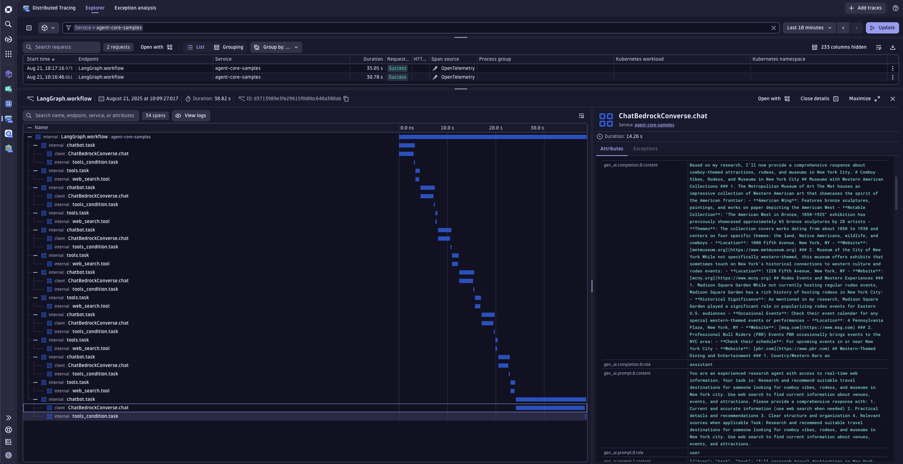

# Send AgentCore traces and metrics to Dynatrace

Run a local Strands travel agent and see its activity in your Dynatrace tenant. The agent uses the AgentCore Runtime SDK and calls Amazon Bedrock. [dynatrace.py](./dynatrace.py) registers OpenTelemetry providers **before** the agent starts, so Strands can emit spans and metrics to the same service, `agent-core-samples`.

## Before you start

- Install Python 3.11+ and [uv](https://docs.astral.sh/uv/getting-started/installation/).
- Use a short-lived AWS session for a role permitted to invoke your selected [Bedrock model](https://docs.aws.amazon.com/bedrock/latest/userguide/model-access-permissions.html). Use the normal AWS credential chain; you do not need permissions to deploy an AgentCore runtime.
- In **your** Dynatrace tenant, create an [OTLP ingest token](https://docs.dynatrace.com/docs/shortlink/otel-getstarted-otlpexport) with **Ingest OpenTelemetry traces** (`openTelemetryTrace.ingest`) and **Ingest metrics** (`metrics.ingest`). This sample does not export logs or read tenant data.

## Run locally

From this directory, in Bash, replace the region, model and OTLP URL with your own values. Use the base ingest URL, not the `/v1/traces` or `/v1/metrics` URL. Both exporters send the token to that destination; only use a trusted endpoint. Use non-sensitive prompts and tool inputs: telemetry can contain conversation content.

```bash
export AWS_DEFAULT_REGION='<your-bedrock-region>'
export BEDROCK_MODEL_ID='<model-or-inference-profile-id-enabled-in-that-region>'
export OTEL_ENDPOINT='https://<your-environment-id>.live.dynatrace.com/api/v2/otlp'
read -rs -p 'Dynatrace ingest token: ' DT_TOKEN; printf '\n'
export DT_TOKEN
uv run --locked main.py
```

If your environment mounts the token at `/etc/secrets/dynatrace_otel`, omit the token prompt and export. The file takes precedence. No AgentCore CLI or Starter Toolkit is needed.

In a second terminal, send a request (this invokes Bedrock and can incur charges):

```bash
curl --fail-with-body http://127.0.0.1:8080/invocations \
  -H 'Content-Type: application/json' \
  -d '{"prompt":"What is the weather now?"}'
```

Look for `agent-core-samples` in Dynatrace. Spans export after completion; metrics export periodically. If nothing appears, check the endpoint and token scopes without printing the token.



Press **Ctrl-C** to stop the local server, then `unset DT_TOKEN` in that shell. Revoke any token created solely for the tutorial. This walkthrough does not create or delete AWS infrastructure.
