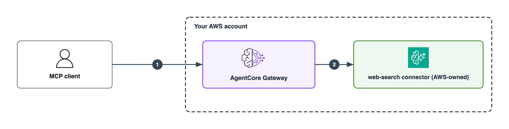

# Web Search Gateway (Terraform)

Provision an Amazon Bedrock AgentCore Gateway with the AWS-managed **Web Search**
connector, using Terraform.

## Introduction

Web Search Tool on AgentCore is a fully managed, MCP-compatible web search capability.
Queries are served entirely inside AWS — there is no third-party search API to procure,
no API keys to store, and no result-parsing glue to maintain. The Gateway authenticates
to the connector with its own IAM role, and agents discover the tool with a standard
`tools/list` call.

This sample provisions that Gateway and connector target, plus the IAM on both sides of
it, in **one `terraform apply`**. It then proves the tool works with a small MCP client
that SigV4-signs a request to the Gateway.

**There is no agent runtime in this sample, by design.** Unlike the other Terraform
patterns here, the test client speaks MCP to the Gateway directly. That means you can
verify the connector with no model entitlement, no container build, and no agent
framework version to pin — and when it returns live, dated, sourced results, nothing in
the path could have memorized them. Any MCP-compatible client (Strands, LangChain,
LangGraph, CrewAI) consumes the same Gateway unchanged.

What this sample demonstrates:

- The exact IAM the connector needs — two actions, one on an **AWS-owned** ARN.
- Inbound auth with `AWS_IAM` (SigV4), so access control is an IAM policy on the caller.
- **Domain governance** that the calling agent cannot see or widen — the content
  compliance lever for regulated workloads.

## Architecture Diagram



**1. Inbound — who may call the Gateway.** The client signs its request with SigV4.
`authorizer_type = AWS_IAM` means the Gateway evaluates the caller's IAM permissions,
so access control is an ordinary IAM policy on the calling identity. This sample creates
`aws_iam_role.demo_caller`, which holds `bedrock-agentcore:InvokeGateway` on this
Gateway's ARN and nothing else.

**2. Outbound — what the Gateway may reach.** The Gateway assumes
`aws_iam_role.gateway_service` to call the connector. That role holds
`bedrock-agentcore:InvokeWebSearch` on the AWS-owned ARN
`arn:aws:bedrock-agentcore:<region>:aws:tool/web-search.v1`. Because the Gateway
authenticates with its own role, there are no search API keys or secrets to store. The
connector is operated by AWS and queries are served inside AWS — they are not sent to a
third-party search engine.

The two roles are the whole security story, and they are deliberately separate: one
governs inbound, the other outbound. Neither carries `bedrock:InvokeModel` — model
access belongs to whatever identity runs your agent, not to this Gateway.

### What it deploys

| # | Resource | Purpose |
| --- | --- | --- |
| 1 | `aws_iam_role.gateway_service` | **Outbound auth.** The role the Gateway assumes to reach the Web Search backend. This is why there are no search credentials to manage. |
| 2 | `aws_iam_role_policy.gateway_service` | Exactly two actions: `InvokeGateway` on the Gateway ARN, and `InvokeWebSearch` on the AWS-owned `…:aws:tool/web-search.v1`. |
| 3 | `aws_bedrockagentcore_gateway.web_search` | The MCP endpoint. `protocol_type = MCP`, `authorizer_type = AWS_IAM`. |
| 4 | `aws_bedrockagentcore_gateway_target.web_search` | Attaches the managed `web-search` connector, pinned to version 1.2.0, with `GATEWAY_IAM_ROLE` outbound auth. |
| 5 | `aws_iam_role.demo_caller` | **Inbound auth.** A least-privilege caller that may invoke this Gateway and nothing else. |
| 6 | `aws_iam_role_policy.demo_caller_invoke` | `InvokeGateway` on the Gateway ARN. |

Optionally a seventh: set `existing_caller_principal_arn` to also grant `InvokeGateway`
to an IAM user or role you already hold.

## Prerequisites

- **Terraform >= 1.6** — see the [Terraform samples README](../README.md) for install guidance.
- **AWS provider >= 6.63.0** (pinned here to `~> 6.69`). The
  `target_configuration.mcp.connector` block does not exist in earlier versions.
- **AWS CLI** configured with credentials.
- **Python 3.11+** with `boto3`/`botocore` importable — used for SigV4 signing in the
  test client. No other Python dependencies.
- A Region where the Web Search connector is available: `us-east-1`, `us-east-2`,
  `us-west-2`, `eu-west-1`, `ap-southeast-2`, `ap-northeast-1`, `us-gov-west-1`.
  The `region` variable validates against this list, so an unsupported Region fails at
  plan time rather than at apply. Defaults to `eu-west-1`.
- IAM permissions to create IAM roles and AgentCore gateways, and `iam:PassRole` on the
  Gateway service role (CreateGateway passes it as `roleArn`).

## Usage

### Option 1: Automation script (recommended)

```bash
chmod +x deploy.sh
./deploy.sh
```

Validates your environment, initializes, plans, applies after you confirm, then prints
the outputs and the command that proves Web Search works.

### Option 2: Manual Terraform commands

```bash
# 1. Optional: configure variables
cp terraform.tfvars.example terraform.tfvars

# 2. Choose state management (see ../README.md)
terraform init

# 3. Review and deploy
terraform plan
terraform apply

# 4. View outputs
terraform output
```

### Verify the deployment

```bash
python3 scripts/confirm-web-search.py
```

The script reads the Gateway endpoint from `terraform output`, assumes the
least-privilege caller role, calls `tools/list`, then `tools/call`, and prints a verdict:

```text
==> 1/3  Listing tools on the Gateway (tools/list)
    1 tool(s) discovered
      - web-search___WebSearch <--
    input schema: maxResults, query, filters
    'filters' present -> connector 1.2.0 pinning is in effect

==> 3/3  Verdict
---------------------------------------------------------------
PASS  The Gateway invoked the AWS-managed Web Search connector.
      tool: web-search___WebSearch
---------------------------------------------------------------

Live results:
  1. AI News Today, October 20: Top Stories
     https://aiweekly.co/ai-news-today
     published: 07:00AM, Tuesday, October 20 2026, PDT
```

The tool is exposed as `<target_name>___WebSearch`, because the Gateway prefixes a
target's tools with the target name.

Run the offline self-test any time — no AWS calls, no cost:

```bash
python3 scripts/selftest.py
```

Exit codes, so the script works as a check and not just a demo:

| Code | Meaning |
| --- | --- |
| `0` | PASS — the tool returned results |
| `1` | FAIL — denied, unreachable, or the tool errored |
| `2` | Bad usage — query over 200 chars, or `maxResults` outside 1–25 |
| `3` | BLOCKED — a request-level filter was refused by the target-level policy |

## Sample Prompts

The tool accepts a natural-language query of **up to 200 characters** and returns up to
25 results. Pass a query with `-q`:

```bash
python3 scripts/confirm-web-search.py -q "What are the top AI news headlines today?"
python3 scripts/confirm-web-search.py -q "Who won the Formula 1 race this weekend?"
python3 scripts/confirm-web-search.py -q "What did AWS announce this week?"
python3 scripts/confirm-web-search.py -q "Latest SEC guidance for investment advisers"
python3 scripts/confirm-web-search.py -q "Current price of copper per tonne"
```

Prompts that are time-sensitive make the best demonstration: the results carry
publication dates from today, which no model could have memorized.

Add request-level filters (connector 1.2.0 and later):

```bash
# restrict this call to specific domains
python3 scripts/confirm-web-search.py -q "investment adviser compliance" --include sec.gov

# drop results from specific domains
python3 scripts/confirm-web-search.py -q "cloud computing trends" --exclude example-blocked.com

# only results published in a date window
python3 scripts/confirm-web-search.py -q "AI regulation" --from 2026-10-01 --to 2026-10-20

# use your own credentials rather than the demo caller role
python3 scripts/confirm-web-search.py --no-assume

# dump the raw MCP wire traffic
python3 scripts/confirm-web-search.py --raw
```

### Three behaviors worth demonstrating

**1. It is live data, not training knowledge.** Ask about something from today. Results
carry today's `publishedDate` and real source URLs, and there is no model in the path.

**2. Inbound auth is a real gate.** Point the script at a role without the policy:

```bash
python3 scripts/confirm-web-search.py --assume-role-arn arn:aws:iam::<acct>:role/some-other-role
```

```text
HTTP 403 Forbidden
{"jsonrpc":"2.0","id":1,"error":{"code":-32002,
 "message":"Authorization error - Insufficient permissions"}}
```

With `AWS_IAM` inbound auth, authorization is an IAM policy on the *calling* identity —
the same mechanism as any other AWS API, with CloudTrail to match.

**3. Domain governance cannot be prompt-injected.** Set an admin allowlist:

```bash
echo 'domain_include = ["sec.gov"]' >> terraform.tfvars
terraform apply
python3 scripts/confirm-web-search.py -q "top technology news headlines today"
```

Although the query says nothing about the SEC, **every** result now comes from
`sec.gov`. The list lives on the target, is hidden from the calling agent, and is
applied to every request — the agent cannot see it, so it cannot talk its way around it.

Per-request filters compose on top and can only *narrow*. Ask for a domain that is not
on the admin allowlist and the service refuses outright:

```bash
python3 scripts/confirm-web-search.py -q "top technology news" --include reuters.com
```

```text
BLOCKED  The request-level filter was refused by the target-level policy.
         DependencyFailedException - The web search tool received an invalid request:
         Runtime domainFilter.include has no overlap with admin domainFilter.include;
         request cannot be satisfied.
```

> Note the shape difference, which is easy to get wrong: at **target** level the filter
> object is `domainFilter` at the top of `parameterValues`. At **request** level the same
> object nests under `filters`.

## Configuration

| Variable | Default | Purpose |
| --- | --- | --- |
| `region` | `eu-west-1` | Validated against the supported-Region list. |
| `name_prefix` | `websearch-poc` | Prefix for created resource names. |
| `target_name` | `web-search` | Determines the tool name: `<target_name>___WebSearch`. |
| `connector_version` | `1.2.0` | `1.2.0` adds the include list and request-level filters. |
| `domain_include` | `[]` | Target-level allowlist. Requires `1.2.0`. |
| `domain_exclude` | `[]` | Target-level denylist. Works on `1.1.0` too. |
| `mcp_supported_versions` | `["2025-11-25"]` | MCP versions the Gateway accepts. |
| `existing_caller_principal_arn` | `""` | Optionally grant `InvokeGateway` to an existing identity. |

Both domain lists are empty by default, so the first run is unfiltered.

## Cost

| Item | Rate |
| --- | --- |
| Web Search queries | **$7.00 per 1,000 queries** — the dominant line item |
| Gateway API invocations (`tools/list`, `tools/call`, `ping`) | $0.005 per 1,000 |
| Semantic search (not enabled here) | $0.025 per 1,000 search calls + $0.02 per 100 tools indexed/month |

A run through this sample costs cents. The IAM roles and the Gateway itself carry no
standing charge. Confirm current rates on the
[AgentCore pricing page](https://aws.amazon.com/bedrock/agentcore/pricing) before sizing.

## Deliberate simplifications

This sample is scoped to the Web Search connector. Each omission below is an additive
next step, not an oversight.

| Omitted | Why, and what adding it costs |
| --- | --- |
| **Customer-managed KMS key** | The Gateway uses an AWS-owned key. A CMK needs a key policy granting the service role `kms:Decrypt`/`GenerateDataKey`/`CreateGrant` conditioned on `kms:ViaService` and the Gateway ARN in the encryption context — and because the Gateway depends on the role via `role_arn`, that reference cannot be expressed in one apply. Adding a CMK means **two sequential applies**. Omitting it is what keeps this sample a single clean apply with no dependency cycle. |
| **OAuth / JWT inbound auth** | `AWS_IAM` (SigV4) is used instead. Switch `authorizer_type` to `CUSTOM_JWT` and add an `authorizer_configuration` block for end users authenticating through an external IdP. IAM inbound is also the stronger posture for private ingress — see below. |
| **VPC / PrivateLink private ingress** | For private-only traffic, add an interface endpoint for `com.amazonaws.<region>.bedrock-agentcore.gateway` plus a security group and endpoint policy. Because this sample uses IAM inbound, such an endpoint policy can scope **both** `Principal` and `Resource`; with JWT inbound the `Principal` must be `"*"`. Endpoint policy changes take ~15 minutes to propagate. |
| **An agent / AgentCore Runtime** | See the Introduction — this is the point of the sample, not a gap. |
| **Memory and observability wiring** | No AgentCore Memory, CloudWatch Logs/X-Ray delivery, or CloudTrail data-event trail. For production, enable CloudTrail data events for `bedrock-agentcore.amazonaws.com`: a denied call is not guaranteed to appear in a model's response, so CloudTrail is the reliable record of attempted and denied calls. |

## Troubleshooting

**`Blocks of type "connector" are not expected here`** — your AWS provider predates
6.63.0, which introduced `target_configuration.mcp.connector`. Run
`terraform init -upgrade`. To confirm the pinned provider has it:

```bash
terraform providers schema -json | python3 -c "
import json,sys
rs=json.load(sys.stdin)['provider_schemas']['registry.terraform.io/hashicorp/aws']['resource_schemas']
print(rs['aws_bedrockagentcore_gateway_target']['block']['block_types']['target_configuration']['block']['block_types']['mcp']['block']['block_types'].get('connector') is not None)"
```

**`CERTIFICATE_VERIFY_FAILED`** — a local TLS trust-store problem, not an AWS one. Some
Python builds (notably the python.org macOS installers) ship with no system CA file, so
`urllib` fails even though boto3 works, because boto3 uses botocore's bundled
`cacert.pem`. The script falls back to `certifi` and then botocore's bundle; if your
environment needs a corporate root, pass `--ca-bundle /path/to/bundle.pem` or set
`AWS_CA_BUNDLE`.

**`HTTP 403` / `Authorization error - Insufficient permissions`** — the calling identity
lacks `bedrock-agentcore:InvokeGateway` on the Gateway ARN. Either assume the demo caller
role (the script's default) or set `existing_caller_principal_arn` and re-apply.

**Expected tool not found in `tools/list`** — the target did not provision:

```bash
aws bedrock-agentcore-control list-gateway-targets \
  --gateway-identifier "$(terraform output -raw gateway_id)" \
  --region "$(terraform output -raw region 2>/dev/null || echo eu-west-1)"
```

If the target reports a permissions failure, some setups additionally require
`bedrock-agentcore:GetGateway` and `bedrock-agentcore:GetConfigurationBundleVersion` on
`configuration-bundle/*` in the Gateway service role. The official Web Search
documentation does not list these, so they are not included here.

**`'filters' absent` warning from the script** — the connector resolved below 1.2.0.
Confirm `connector_version = "1.2.0"` and re-apply.

**Query rejected** — the tool accepts at most 200 characters and `maxResults` between 1
and 25. The script validates both before signing.

## Clean Up

```bash
./destroy.sh
```

Or directly:

```bash
terraform destroy
```

This deletes the Gateway, its Web Search target, and both IAM roles. Web Search is
billed per query, so there are no further charges once the Gateway is gone.

## References

- [Web Search Tool](https://docs.aws.amazon.com/bedrock-agentcore/latest/devguide/gateway-target-connector-web-search-tool.html)
- [Define the gateway target configuration](https://docs.aws.amazon.com/bedrock-agentcore/latest/devguide/gateway-add-target-api-target-config.html)
- [List tools in a gateway](https://docs.aws.amazon.com/bedrock-agentcore/latest/devguide/gateway-using-mcp-list.html)
- [Call a tool in a gateway](https://docs.aws.amazon.com/bedrock-agentcore/latest/devguide/gateway-using-mcp-call.html)
- [Introducing Web Search on Amazon Bedrock AgentCore](https://aws.amazon.com/blogs/machine-learning/introducing-web-search-on-amazon-bedrock-agentcore/)
- [Domain and publish date filters for Web Search](https://aws.amazon.com/blogs/machine-learning/domain-and-publish-date-filters-for-web-search-on-agentcore/)
